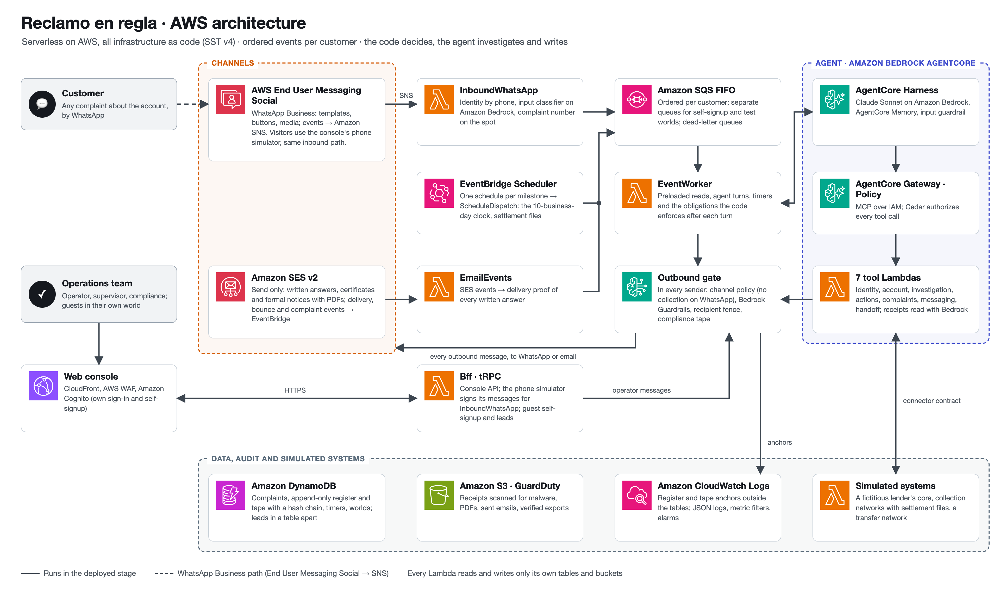
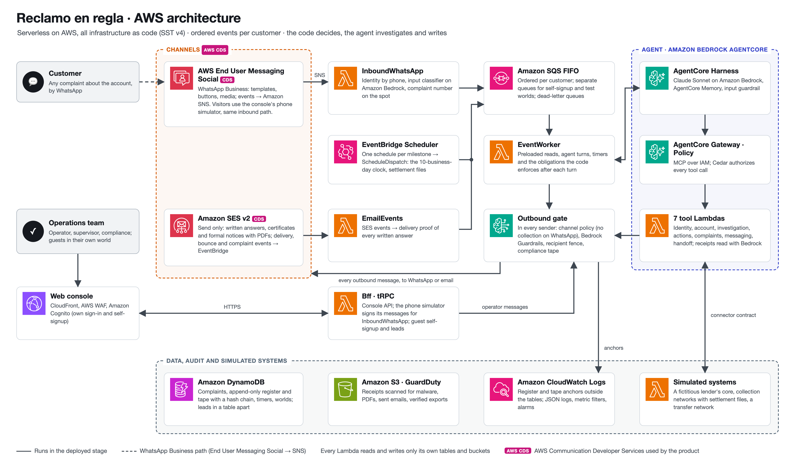

# Reclamo en regla · Powered by Craftech

**B2C regulated financial complaints: an AI agent that files, investigates and answers every account
complaint of a consumer lender or wallet in Latin America, inside the rules.**

**Live product:** https://reclamo.demo.craftech.io

**Demo video (2:31):** https://youtu.be/p3Wf2DsWoeg

Three things set it apart:

1. **A complaints register with an anchored hash chain.** Every complaint gets its number
   (`R-2026-000123`) in the same transaction that writes its first register entry. The register and
   the compliance tape are append-only, chained by hash and anchored outside the tables, so an
   overwrite is detected, not just forbidden.
2. **Reconciliation against settlement files.** "I paid and it does not show" is solved by matching
   the customer's receipt with the line of the collection network's settlement file. A receipt that
   does not appear in a published file is never "found": the complaint goes to a person.
3. **A channel-policy gate that also stops people.** Every outbound message, from the agent, from a
   human operator or from the system, goes through one gate. Debt collection on WhatsApp is blocked
   for every sender and rerouted to an allowed path (a formal notice by email or the human queue).

## Who it is for

- **Consumer lenders and regulated wallets in Latin America** that must answer every complaint in
  writing within a regulatory deadline (10 business days in our reading of the Argentine rules,
  labelled as our reading, not legal advice) and keep an auditable register.
- **Operations and compliance teams**, who keep control: the agent investigates and drafts, the code
  decides amounts, caps and deadlines, and a person approves whatever goes beyond the agent's cap.
- **Customers**, who write on WhatsApp in their own words, get a complaint number on the spot, and
  receive the formal written answer and certificates by email.

## How it works

1. **The customer writes on WhatsApp** about anything on the account: a payment that does not show, a
   charge they do not recognise, a duplicate debit, a transfer that did not arrive, a payoff
   certificate, closing the account or changing their data.
2. **A complaint number on the spot.** Identity comes from the linked phone (hashed); an input
   classifier decides whether the message is a complaint, and the code files it with its number and
   its deadline before the agent's turn even starts.
3. **Identity check before any data.** A challenge verified by code (never documents, passwords, PINs,
   cards or bank details by chat) unlocks the account.
4. **The agent investigates** against the lender's core, the collection networks and the transfer
   network: reads the receipt image, reconciles it with the settlement file, checks the charge
   against the fee schedule, looks for the duplicate debit or asks the network for the transfer
   status.
5. **The code resolves what the policy allows**: apply the payment, reverse a charge with a credit
   note, refund a duplicate debit, request a transfer reversal, issue a payoff certificate. Each
   money movement runs exactly once, by its natural key. Above the agent's cap, the agent asks for an
   approval that only a person can give in the console, after a recent sign-in.
6. **The written answer goes by email** (Amazon SES) with its PDF, and SES delivery events become the
   delivery proof recorded in the register.
7. **Everything else goes to a person with the regulatory clock running**: reminders and escalations
   are timers that fire on their own, and answering in writing cancels the remaining milestones.

Guarantees enforced in code, not in the prompt: the agent never fixes an amount, a deadline or a cap;
no tool approves; no tool accepts an id the model writes (every id comes from a signed session
token); every incoming text, image and file name is treated as hostile (masked, delimited, filtered by
guardrails); every outbound text is checked by a grounding guardrail and deterministic checks; every
decision lands on the compliance tape or the audit log.

## Try it

Open **https://reclamo.demo.craftech.io**, choose **Probar Reclamo en regla** (Try Reclamo en
regla), and create an account with your email: you get a verification code, and about a minute later
your own world is ready. A world is an isolated copy of the fictitious lender Jarilla, with its
customers, loans, collection networks and register, and a simulated clock paused at Wed Oct 7 10:10
that only moves with the console's controls. The customer's side of WhatsApp is played by the
console's **phone simulator**: choose a persona and send their script message, or write your own.
Emails are real, through SES to simulated mailboxes you can read in the console's **Emails** view.

The console's **Guided tour** panel walks you through the main story (Valeria's payment that does not
show) one button at a time: the 5-minute tour first, then the deep one. The tables below are
generated from the same source (`packages/web/src/views/tour/steps.ts`), and `npm run tour:check`
fails if they differ.

<!-- TOUR:START -->
**5-minute tour**

| # | Step | Button / action | What to look at | Budget |
|---|---|---|---|---|
| 1 | Sign in | See my world's clock | Your own world, with the clock paused on Wed Oct 7 10:10. | ~10 s |
| 2 | File a complaint | Send the script message and receipt (Valeria) · Open the simulator | Number R-2026-000123 and deadline Thu Oct 22 in under 5 s, with the automated-assistant line and the buttons “Sí, a ese email” · “Hablar con alguien”. The agent's turn goes on by itself. | ~10 s |
| 2b | Collection blocked | Open Martín's file (C09) | In the composer, “Recordatorio de mora” by WhatsApp → Enviar: the tape marks it in red BLOQUEADO · BLOCKED. Then “Enviar aviso formal por email”: REROUTED → ALLOWED, with the clock at Wed Oct 7 10:10, inside the formal-notice hours. | ~30 s |
| 3 | Verify identity | Tap “Sí, a ese email” (Valeria) · Answer “5/10” to the challenge · Open Emails | In Emails, Martín's formal notice and Valeria's acknowledgement, real, with PDF, SES events and DELIVERED proof. In Valeria's complaint, the receipt reading and the pending batch: the network settles on Thu Oct 8 08:30. | ~1.5 min |
| 4 | Settlement | Advance to the next event (once) | The clock reaches Thu Oct 8 08:30: settlement published, match with the line of Valeria's loan, payment applied, a WhatsApp update and the written answer with DELIVERED proof. | ~1.5 min |
| 5 | Metrics | Open Metrics | “This world” with your complaints (measured) and the real batch (N = 30). | ~20 s |

**Deep tour (15 minutes)**

| # | Step | Button / action | What to look at | Budget |
|---|---|---|---|---|
| 6 | Wrong charge | Send the script message (Diego) · Tap “Sí, a ese email” (Diego) · Answer “10/9” to the challenge | Charge reversed with a credit note, and the written answer by email. | ~1.5 min |
| 7 | Approval | Send the script message (Rocío) · Tap “Sí, a ese email” (Rocío) · Answer “2/10” to the challenge · Open Approvals | The agent asked for approval: the refund is above its cap. On approval, the code executes the refund exactly once. If more than 15 minutes passed since you signed in, the password prompt opens: approving money requires a recent sign-in; it is a feature, not an error. | ~2 min |
| 8 | The operator too | Open Martín's file (C09) | “Tomar conversación”, write “pagala hoy para evitar recargos” and Enviar: it is blocked by the collection lexicon, with its categories on the tape. | ~20 s |
| 9 | Deadline | Send the script message and receipt (Florencia) · Tap “Sí, a ese email” (Florencia) · Answer “3/10” to the challenge · Advance to this complaint's next milestone (reminder) · Advance to this complaint's next milestone (escalation) · Open the complaint and “Responder por escrito” | Human case filed on Thu Oct 8, due on Fri Oct 23; reminder on Fri Oct 16 10:00 and escalation to the supervisor on Wed Oct 21 10:00 (at risk). Once answered in writing, the remaining milestones are cancelled. | ~3 min |
| 10 | Register | Export the register · Open the Register | Hash chain and anchors verified. | ~10 s |
| 11 | Live clock (optional) | Live clock · Open the Clock | Real Scheduler schedules firing the milestones; the clock pauses by itself after 30 minutes. | ~2 min |
| 12 | Metrics | Open Metrics | Every KPI with its N, its source and its label. | — |
<!-- TOUR:END -->

A self-signup world is for trying the product, not for real work: it has daily usage limits (agent
turns, image reads, emails, resets), it expires 6 hours after it is ready if you never sign in, after
72 hours without activity or after 7 days, and the next sign-in prepares a fresh one (your account
stays). If every world is taken, your account is kept and the console shows that your world is
queued. Terms and privacy policy: `https://reclamo.demo.craftech.io/legal/terms.html` and
`/legal/privacy.html`.

## What is real and what is simulated

| Piece | In this proof of concept |
|---|---|
| Lender, customers, loans, payments, networks | **Synthetic.** "Jarilla — préstamos y billetera" is a fictitious lender; every person, network, receipt and settlement file is generated by the seed. No real lender, wallet, bank or network appears anywhere. |
| AI agent | **Real.** Amazon Bedrock AgentCore (Harness, Gateway with 7 targets, Policy, Memory) with Bedrock Guardrails on input and output. |
| Email | **Real end to end.** Amazon SES sends every email; recipients are the SES mailbox simulator, and delivery events come back through EventBridge. |
| WhatsApp | **Implemented on AWS End User Messaging Social.** Adapter (`SendWhatsAppMessage`, approved-template flow, media through `GetWhatsAppMessageMedia`, SNS events with signature check), templates as code and setup scripts; visitors use it through the console's phone simulator, which feeds the same inbound pipeline. Guest and test worlds are always simulated. |
| Lender's core and networks | **Mocks behind real contracts.** `CoreMock` and `NetworkMock` are Lambdas with IAM-authenticated Function URLs and OpenAPI 3.1 contracts (`packages/core-contract`); a real core plugs in behind the same contract. |
| Clock | **Simulated per world**, paused by default; every milestone is an EventBridge Scheduler schedule that the clock knows how to advance. Abuse limits always use the real clock. |
| Register and tape anchors | **Real**: CloudWatch Logs, written only by the `AnchorWriter` Lambda. |
| Account emails (sign-up code, password recovery) | **Real**, sent by Amazon Cognito through Amazon SES. |
| Impact figures and ticket volumes on the landing page | **Goals and assumptions**, labelled as such; never production results. |

## Architecture



The diagram is generated from `docs/assets/architecture/architecture.html` by
`npm run diagram:render` (`scripts/diagram/render-architecture.ts`, Playwright): boxes on a grid,
orthogonal connectors that never cross a box (checked before rendering) and the official AWS
Architecture Icons (`docs/assets/architecture/icons/LICENSE-aws-icons`).

- **Serverless only**, infrastructure as code with SST v4 on AWS (`us-east-1`), one stage (`poc`)
  deployed only by CI. Raw `aws.*` resources only where SST has no component (AgentCore, Guardrails,
  the SES configuration set).
- **Ordered events per customer**: three SQS FIFO queues (public worlds, self-signup worlds, test
  worlds), each with its own worker and reserved concurrency, so a burst of new accounts never takes
  capacity from the demo.
- **Data**: DynamoDB, one table per aggregate (complaints, register, compliance tape, audit log,
  conversations, timers, worlds, runtime counters), plus a `Leads` table kept apart from the demo
  data; S3 for receipts (GuardDuty Malware Protection), PDFs, sent emails and exports.
- **Least privilege**: every Lambda reads and writes only its own tables, and every role fenced to a
  world can only touch keys that start with that world's prefix (`dynamodb:LeadingKeys`). IAM blocks
  updates, deletes and batch writes on the append-only tables for every role of the app.
- **Each account's world is isolated**: its own synthetic lender data, clock and register, with caps
  per world and per pool and an expiry for self-signup worlds.
- **Observability**: JSON logs with a correlation id and no personal data, kept 30 days (anchors 180);
  metrics through metric filters and alarms; a monthly budget by the project's cost tag.

Design documents (in Spanish): `docs/design-brief.md`, `docs/architecture.md`,
`docs/architecture-integrations.md`, `docs/architecture-guests.md`, `docs/adr/`,
`docs/flows-catalog.md`, `docs/tool-catalog.md`, `docs/test-plan.md`; glossary in `CONTEXT.md`.
Serve them with `python3 -m http.server 8099 --bind 127.0.0.1` and open
`http://localhost:8099/docs/viewer.html`.

## How it is built

### How it uses AWS Communication Developer Services

| Service | What Reclamo en regla does with it | Where in the code |
|---|---|---|
| **Amazon SES v2** (sending only) | Sends the formal written answer, the acknowledgement, payoff certificates, credit notes and formal debt notices as MIME emails with PDF attachments: `SendEmail` with `Content.Raw`, one fenced recipient, the configuration set and `EmailTags`. The configuration set (TLS required, no open or click tracking) publishes delivery, bounce, complaint and reject events to Amazon EventBridge; the `EmailEvents` Lambda turns them into message statuses and into the delivery proof of each written answer in the register. The domain identity `reclamo.demo.craftech.io` signs with Easy DKIM and publishes DMARC `p=reject`. Cognito's sign-up and recovery emails and the lead notice to Craftech also go through SES. In the demo every customer mailbox is the SES mailbox simulator, so every email is real end to end and readable in the console's email viewer | `packages/bff/src/outbound/transports/ses.ts` (`SendEmailCommand`), `packages/bff/src/channels/email/outbound.ts`, `packages/bff/src/email-events/`, `packages/bff/src/handlers/email-events.ts`, `packages/bff/src/outbound/transports/lead-notice.ts`, `infra/messaging-email.ts`, `infra/auth-email.ts` |
| **AWS End User Messaging Social** (WhatsApp) | The lender's WhatsApp Business channel. `SendWhatsAppMessage` sends free text inside the 24-hour window, interactive messages (reply buttons and lists) and four `UTILITY` templates kept as code; inbound messages, media and delivery statuses arrive through an Amazon SNS topic (signature verified) to the `InboundWhatsApp` Lambda; `GetWhatsAppMessageMedia` copies a receipt image to S3, where GuardDuty scans it before it is read. Templates are created with `CreateWhatsAppMessageTemplate` / `ListWhatsAppMessageTemplates` and the event destination with `PutWhatsAppBusinessAccountEventDestinations`. The console's phone simulator signs an envelope with the same shape the service publishes to SNS, so a visitor's message enters through the same `InboundWhatsApp` Lambda, identity check, limits, classifier and gate; guest and test worlds always use the simulator | `packages/bff/src/outbound/transports/eum.ts` (`SendWhatsAppMessageCommand`), `packages/bff/src/channels/whatsapp/` (`live-transport.ts`, `media.ts`, `inbound.ts`, `sns-signature.ts`, `simulated-transport.ts`), `packages/bff/src/handlers/inbound-whatsapp.ts`, `scripts/channels/whatsapp-templates.ts`, `scripts/channels/waba-event-destination.ts`, `infra/messaging-whatsapp.ts`, `infra/channel-modes.ts` |

Only `packages/bff/src/outbound/transports/` may call a send command, and `npm run lint:chokepoint`
fails the build otherwise: every message reaches a channel through the outbound gate.

### The agent

- **Amazon Bedrock AgentCore Harness** with **Claude Sonnet 5.5** (`global.anthropic.claude-sonnet-5-5`
  through a tagged application inference profile), one turn per customer event, invoked by the
  `EventWorker` from an Amazon SQS FIFO queue ordered per customer.
- **AgentCore Gateway** (MCP, IAM auth) with **7 AWS Lambda targets and 28 tools**: identity (2),
  account (7), investigation (6), actions (7), complaints (3), messaging (1) and handoff (2). Every
  tool validates its input with a strict zod schema and takes its ids from a signed, short-lived
  session token, never from the model.
- **AgentCore Policy** (Cedar, `ENFORCE`) authorizes every tool call; **AgentCore Memory** keeps the
  customer's preferences, facts and conversation summaries, with an exclusion instruction for
  sensitive data, and is purged when a demo world is reset.
- **Amazon Bedrock Guardrails**: G1 on input (prompt attacks, denied topics, masking) before the
  model and inside the Harness; G2 on every outbound text (contextual grounding on the turn's tool
  results and relevance to the customer's question).
- **Two smaller models outside the loop**: an input classifier on Claude Haiku with forced tool
  output, so the complaint number does not wait for the agent, and a multimodal receipt reader on
  Bedrock `Converse` with schema-forced output and a deterministic fallback parser. A reading alone
  never applies a payment: the settlement line does.
- **Fast turns**: before invoking the Harness, the worker runs in code the reads every turn needs
  (customer, account summary, last operations, open complaints) and passes them as escaped tool
  results; every inbound message gets an answer.
- **Obligations after each turn**: the code checks what the turn had to do (acknowledge, answer in
  writing, reconcile when the file is published) and queues a follow-up turn if it was not done.
- **Kill switch at runtime**: one item stops the agent without a deploy; a monthly budget alarm at
  100 % flips it automatically.

### Glossary

| Term | Meaning |
|---|---|
| Complaint (*reclamo*) | A customer's claim about the account, numbered `R-YYYY-NNNNNN` and due in 10 business days; a *consulta* is a question that needs no regulatory answer |
| Register (*registro*) | The append-only, hash-chained list of complaint events (filed, status, answers, delivery proof), anchored outside the tables; exportable with its verification (`ok`, `partial`, `broken`) |
| Tape (*cinta de cumplimiento*) | The append-only, hash-chained record of every outbound decision: `ALLOWED`, `BLOCKED`, `REROUTED`, `DEFERRED`, `DISPATCH` |
| `CH-*` rules | The channel policy, e.g. `CH-WA-NO-COLLECTION` (no collection on WhatsApp, for any sender) |
| Settlement file (*rendición*) | The collection network's file of payments received, published on a business-day schedule; the only evidence that applies a payment |
| World (*mundo*) | An isolated copy of the synthetic lender with its own clock; every account works in its own |
| Guest | Whoever tries the product: a self-signup account or a pre-provisioned `guest-NN` account |

### Repository layout

| Path | What |
|---|---|
| `infra/` | SST v4 infrastructure (one module per capability) and the one-time CI bootstrap (`infra/bootstrap/`) |
| `packages/shared` | Enums, ids, errors and zod schemas shared by every package |
| `packages/bff` | Lambda code: tRPC BFF, auth and Cognito triggers, self-signup (`guests/`) and leads (`leads/`), event worker and turns, agent tools, complaints and register, channel policy and outbound gate, channels, world factory |
| `packages/web` | Landing page, sign-up and sign-in, operations console with the phone simulator and the guided tour (React 19, Vite, Tailwind v4) |
| `packages/core-contract`, `packages/core-mock`, `packages/network-mock` | Contracts and mocks of the lender's core, the collection networks and the transfer network |
| `scripts/` | Seed generator, scenario runner, tour check, diagram and landing captures, lint guards, operator scripts |
| `tests/` | Local flow tests, agent tests on a local model (`tests/agent`), the local UI server for Playwright, test cases |
| `docs/` | Design documents (Spanish) and the architecture diagram |

## Run the tests locally

Requirements: Node 22.14.0 (`.nvmrc`) and npm; Google Chrome for the Playwright tests; `avifenc`
(libavif) to render the diagram and the landing captures.

```bash
npm ci
npm run typecheck
npm run lint && npm run lint:duplicates && npm run lint:wp-ownership
npm test                                    # unit and local flow tests (vitest)
npm run flows:check && npm run tour:check   # every flow covered; the README tour matches the console
npm run lint:chokepoint && npm run lint:no-ses-receiving && npm run channels:check-modes
npm run build -w packages/web
npm run test:ui                             # Playwright against the local UI server
npm run lint:neutral-surfaces               # visible texts stay neutral (also with -- --dist)
FORBIDDEN_TERMS="…" npm run lint:forbidden  # the brand list lives outside the repository
npm run diagram:render                      # re-render the architecture diagram
```

There is no local stage: everything is tested locally with unit, local-flow and UI tests, and in
`poc` by CI. Never `sst dev` and never a local `sst deploy`.

**Agent tests on a local model.** The agent's behaviour is tested before it reaches Bedrock:
`tests/agent` runs the model-dependent steps of the scenarios and the grounding evaluation against a
local model (Qwen on Ollama, no token cost) with Craftech's internal `agent-test` CLI. The local world
is the one of the flow tests, with the same system prompt, envelope, preloaded reads, tool schemas,
Cedar statements, Lambda fences and outbound gate as the deployed stage; only the model differs.
Oracles check what the agent did (tools, complaint states, register, tape, outbound messages), never
its wording. No AWS credentials or secrets are needed, and the folder is outside `npm test` and CI.

```bash
agent-test doctor          # the local model is installed and answers
agent-test run smoke       # 3 short conversations
agent-test run scenarios   # the model-dependent scenario steps (map in tests/agent/support/scenario-map.ts)
agent-test run evals       # the grounding evaluation, one conversation per question
agent-test run all         # everything in tests/agent; reports land in test-results/agent-test/
```

A local model checks decisions, not the quality of the wording; a capped run on the production model
in `poc` is optional.

## Deploy from scratch

The full runbook, with every verification command, is `docs/architecture.md` §15 and §17.

1. **Pre-checks (reads only)** in the target account: SES out of the sandbox, the GitHub OIDC provider
   and the SST bootstrap exist, the three Bedrock models are `ACTIVE` with quota, the `Project` cost
   tag is active, enough unreserved Lambda concurrency.
2. **CI bootstrap, once** (and again before any push that changes the template):
   `aws cloudformation deploy --stack-name <app>-ci-bootstrap --template-file infra/bootstrap/ci-role.yaml --capabilities CAPABILITY_NAMED_IAM --parameter-overrides …`
   (`<app>` is the SST app name in `sst.config.ts`) creates the OIDC deploy role, the scenario-runner
   role, their permissions boundary and the edge resources (`infra/bootstrap/README.md`).
3. **Secrets of `poc`** with `npx sst secret set <Name> <value> --stage poc`: six random keys
   (`SessionKey`, `SimEnvelopeKey`, `QaSimEnvelopeKey`, `PhoneHashKey`, `RegisterChainKey`,
   `EdgeOriginKey`), `LeadNotifyEmail`, `WabaId` and `WhatsAppPhoneNumberId` (`not-connected` for a
   deployment that uses only the phone simulator) and `SeedOverrides`.
4. **Push to `main`.** `.github/workflows/deploy.yml` runs every check above, assumes the deploy role,
   pushes the Gateway tool schemas, runs `npx sst deploy --stage poc`, loads the seed
   (`npm run seed:load`, idempotent; it also opens the public sign-up), and runs the smoke check.
5. **Post-deploy**: DKIM `SUCCESS`, DMARC `p=reject`, no MX record, Harness and Gateway targets
   `READY`, both web ACLs attached, `npm run console:unverify-staff -- --check`, the malware
   protection plan `ACTIVE`, and the console accounts (`npm run console:invite`).
6. **WhatsApp live** (optional): link a WhatsApp Business Account and number in AWS End User
   Messaging Social, set `WabaId` and `WhatsAppPhoneNumberId`, run
   `npm run channels:waba-event-destination -- --apply` and
   `npm run channels:whatsapp-templates -- --apply`, and, in a reviewed PR, add the `demo` world to
   `liveWorlds` in `infra/channel-modes.ts` together with `whatsappLiveApproval` (date and approver);
   `npm run channels:check-modes` fails the build otherwise.

The scenario suite against `poc` runs only from `.github/workflows/scenarios.yml` (it calls Bedrock and
has a cost cap per run).

## Privacy

Sign-up asks for an email and a password. Two separate, unchecked consents are recorded with their
date and text version: the terms and privacy policy (required) and being contacted by Craftech about
this solution (optional); they are kept only once the email is verified with the code. Every
confirmed sign-up is a lead in the `Leads` table, apart from the demo data: an email never reaches
logs, the compliance tape, audit trails, metrics or demo exports, and the guest's email only receives
Cognito's messages. The data controller is Craftech (Ciudad Autónoma de Buenos Aires, Argentina);
privacy requests go to `sales@craftech.io` or https://craftech.io/contact/. Operators export and
delete leads with `npm run leads:export` and `npm run leads:delete`.

## Submission notes

This repository is Craftech's entry to the AWS CDS Agentic AI Partner Hackathon. Nothing in the
published product mentions the contest: it is presented as a product for a regulated consumer lender
or wallet, with a fictitious lender and synthetic data.



- **AWS Communication Developer Services used at runtime**: **Amazon SES** (sending, with
  configuration-set events through EventBridge as the delivery proof of every written answer).
  **AWS End User Messaging Social** (WhatsApp) is implemented end to end (`SendWhatsAppMessage`,
  `UTILITY` templates as code, media, SNS events); in the published demo visitors drive it through
  the console's phone simulator, which feeds the same inbound pipeline. See
  [How it uses AWS Communication Developer Services](#how-it-uses-aws-communication-developer-services).
- **Demo video (2:31)**: https://youtu.be/p3Wf2DsWoeg (also on the landing, `#video`).
- **AWS Partner Central**: ACE opportunity `O28893816`.
- **Access for testing**: anyone can create an account at `https://reclamo.demo.craftech.io/signup`
  and start with the 5-minute guided tour. Judges use the private testing instructions of the
  submission, which list reserved guest accounts (`guest-NN`), each with its own world and without
  the public capacity limits.
- **Pre-existing work disclosure.** The repository skeleton (SST and CI setup, CI bootstrap template,
  lint scripts, console shell and shared components, our own Cognito sign-in, tRPC base, logging,
  retry and crypto helpers, the PDF generator, the landing gallery, AgentCore setup patterns, agent
  definitions in `.claude/`) was adapted from internal Craftech scaffolding built before the contest
  period. Process skills in `.claude/skills/` come from
  [mattpocock/skills](https://github.com/mattpocock/skills) (development tooling, not product code);
  the diagram's AWS Architecture Icons come from the MIT-licensed `aws-icons` package. The product,
  its domain, its channel policy, its register, its tools and its data were built during the
  Submission Period.
- **Repository and license**: the repository is public and licensed under the Apache License 2.0
  ([LICENSE](LICENSE)), copyright Craftech. Submission materials are in English.

## License

Licensed under the [Apache License 2.0](LICENSE). © 2026 Craftech.
