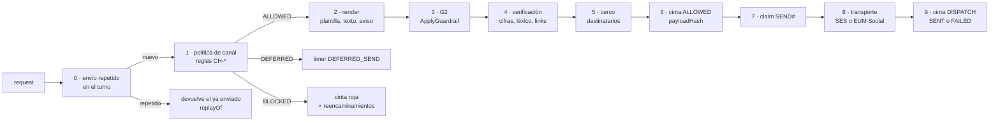

# Integraciones · canales, compuerta y sistemas simulados

Complemento de `docs/architecture.md`: cómo sale cada mensaje, cómo entra WhatsApp, cómo se decide cada saliente y cómo están hechos los sistemas externos que simulamos. Todo servicio de AWS nombrado acá es real en `poc`; lo simulado es la contraparte (teléfono del cliente, buzones del cliente vía el simulador de SES, core del prestamista, redes de cobro, red de transferencias).

## 1. SES saliente

Módulo `packages/bff/src/channels/email/outbound.ts`: **cliente único de SES v2**. Solo lo construye `outbound/transports/`; `lint:chokepoint` falla si `SendEmailCommand` o `SendRawEmailCommand` aparecen fuera de ahí (§4).

| Aspecto | Diseño |
|---|---|
| API | `SendEmail` (SES v2) con `Content.Raw` (MIME armado por `channels/email/mime.ts`: `multipart/mixed` → `multipart/alternative` texto + HTML, adjuntos PDF en base64), **`FromEmailAddress` y `Destination.ToAddresses` siempre explícitos** (un único destinatario, en minúsculas, el mismo que aprobó el cerco: con `Content.Raw` SES podría tomar los destinatarios del MIME y dejar vacía la clave `ses:Recipients` que evalúa IAM), `ConfigurationSetName = aws-cds-hackathon-poc-reclamo-email-poc`, `EmailTags {worldId, complaintId, mailId, kind, stage}`. Se usa MIME crudo para que lo guardado sea **exactamente** lo que salió |
| Remitente | `"Jarilla (ficticio) vía Reclamo en regla" <respuestas@reclamo.demo.craftech.io>`; `Reply-To` ausente (no hay email entrante: el cuerpo dice que se responde por WhatsApp o en la atención humana) |
| Asunto | `Reclamo R-2026-000123 · Respuesta escrita`, `Reclamo R-2026-000123 · Acuse de recibo`, `Aviso formal de deuda · Jarilla (ficticio)`; valores validados (sin CR/LF ni controles; nombre visible codificado RFC 2047) |
| Encabezados propios | `X-Reclamo-Mail-Id: <mailId>` (ULID; en QA, derivado de la clave de idempotencia), `X-Reclamo-World: <worldId>`; `Message-ID` lo escribe SES y se guarda como `providerMessageId`. Un único `To`; **nunca** `Cc` ni `Bcc` |
| Cuerpo | Texto y HTML renderizados desde `copy/es-AR.ts` + el texto que redactó el agente o el operador (escapado; verificado por G2 y `outbound/verify.ts`); pie fijo con el número de reclamo, el derecho a presentarse ante el BCRA si la respuesta no satisface (texto fijo, nuestra lectura) y "prestamista ficticio · datos sintéticos" |
| Adjuntos | Decididos por código (`complaints/answer.ts`): respuesta escrita siempre; libre deuda si el préstamo quedó `CANCELLED`; nota de crédito si hubo reversión o reintegro; estado de cuenta si hubo imputación; ≤ 5 adjuntos, ≤ 2 MB en total |
| Guardado | Antes de llamar a SES: `Emails/<raíz>/<fecha>/<mailId>.eml` (MIME exacto) y `.json` (partes para el visor), `Conversations/…MAIL#<ts>#<mailId>`, `Runtime/W#<w>#PENDING` · `MAIL#<mailId>` (lo cierra el evento **terminal** de SES, §2). Después: `providerMessageId` y constancia `SENT` |
| Cerco | Dentro del cliente, antes de SES: parser RFC 5322 estricto; dominio en minúsculas exacto; `simulator.amazonses.com` con local part ∈ {`success`, `bounce`, `ooto`, `complaint`, `suppressionlist`} y etiqueta `+<[a-z0-9-]{1,40}>` opcional; o, **solo si el mundo es `demo`**, dirección exacta de `SeedOverrides.demoRecipients.emails` (≤ 5, todas `@craftech.io`); dominios reservados rechazados; `Destination.ToAddresses` = el `To` del MIME. Un mundo de invitado nunca llega a un destinatario real, aunque un cambio de datos apunte a una dirección de demo. Denegado → `RECIPIENT_NOT_ALLOWED`, `BLOCKED CH-RECIPIENT-FENCE` en la cinta. IAM repite la cerca con `ses:FromAddress`, `ses:Recipients` (simulador y `@craftech.io`) y la guarda `Null` (`docs/architecture.md` §14) |
| Tope | `ses:SendEmail` del app: ≤ 200 por hora real por mundo (`W#<w>#RATE#EMAIL#<realHour>`); los destinatarios de demo reales: ≤ 20 por **día real** en total (auditados). `seed:load` falla si `demoRecipients.emails` tiene más de 5 y audita `DEMO_RECIPIENTS_LOADED` con la cantidad y los hashes |
| Sin recepción | No hay MX, receipt rules ni MAIL FROM (ADR-0003). El email no es canal de entrada: un cliente sintético no puede responder y un correo real a `respuestas@` no llega a ningún lado |

Direcciones del simulador por cliente (`docs/seed-spec.md` §5): `success+<customerId>@simulator.amazonses.com` (entrega), `bounce+<customerId>@…` (rebote permanente), `complaint+<customerId>@…` (queja), `ooto+<customerId>@…` (respuesta automática, cuenta como entrega). En mundos QA la etiqueta es `qa-<runId>-<escenario>-<key>`; en mundos de invitado `<worldId>-<customerId>` (`gNN` o `gs-*`). Los eventos del simulador no afectan la reputación de la cuenta.

## 2. Eventos de SES y constancia de entrega

Configuration set `aws-cds-hackathon-poc-reclamo-email-poc` con destino EventBridge (bus default): `SEND`, `DELIVERY`, `BOUNCE`, `COMPLAINT`, `REJECT`, `DELIVERY_DELAY`, `RENDERING_FAILURE`; sin `OPEN` ni `CLICK`. Regla filtrada por `source = aws.ses` y `detail.mail.tags.ses:configuration-set = aws-cds-hackathon-poc-reclamo-email-poc` → `EmailEvents`. `EmailEvents` valida con zod y además exige `account = 776805327629` y que `mail.messageId` y las etiquetas `worldId`/`mailId` coincidan con un `EmailRecord` existente de ese mundo (`ByProviderMessageId`); si no, rechaza y audita (una invocación directa con un evento fabricado no produce una constancia). Un evento de un mundo con tumba se descarta con auditoría. Válido → `EMAIL_EVENT` en la cola del mundo. `EmailEvents` no manda nada: los efectos de salida los hace el worker por la compuerta.

| Evento | Efecto |
|---|---|
| `Email Sent` | Constancia `SENT` (si todavía no estaba); no cierra el pendiente |
| `Email Delivered` | Constancia `DELIVERED` con `timestamp` y `smtpResponse` truncado; entrada `DELIVERY_PROOF` en el registro si el email es una respuesta escrita; cierra el pendiente |
| `Email Bounced` (`Permanent`) | Constancia `BOUNCED`; cierra el pendiente; el reclamo `ANSWERED` vuelve a `HUMAN_REVIEW` (`EMAIL_UNDELIVERABLE`); el worker manda `COMPLAINT_UPDATE` por WhatsApp ("no pudimos entregar la respuesta a tu email; una persona te contacta"); el plazo **no** se considera cumplido sin otra notificación escrita: el operador reenvía a otra dirección aceptada o usa el medio fehaciente (fuera de la POC, declarado) |
| `Email Bounced` (`Transient`), `Delivery Delay` | Constancia `DELAYED`; un reintento único a + 1 h simulada (`DEFERRED_SEND`); el pendiente sigue abierto |
| `Email Complaint Received` | Constancia `COMPLAINED`; cierra el pendiente; `Customer.emailSuppressed = true`; sin más emails no formales; caso humano |
| `Email Rejected`, `Rendering Failure` | Constancia `FAILED`; cierra el pendiente; alarma |

La constancia se muestra en el caso y en el visor de emails con la línea de tiempo de eventos. `% respondido en plazo con constancia` exige `DELIVERED`.

## 3. WhatsApp (End User Messaging Social)

Adaptador `packages/bff/src/channels/whatsapp/` con dos transportes detrás de la misma interfaz. **El modo es por mundo** (`Worlds/W#<w>#WORLD/SETTINGS.channelModes.whatsapp`): `outbound/transports/` elige el transporte con el modo del mundo del mensaje, e `InboundWhatsApp` decide con el mismo dato si acepta un sobre simulado. `demo` es el único mundo que puede pasar a `live` (más el mundo QA de `SC-23`); los mundos de invitado, `gtest`, `qa-*` y `sim-*` son **siempre** `simulated`, así el simulador de cada invitado sigue funcionando cuando WhatsApp vivo se enciende para la demo. `infra/channel-modes.ts` declara la lista de mundos vivos permitidos junto con la aprobación `whatsappLiveApproval` (fecha y aprobador), y `channels:check-modes` exige la aprobación para cualquier mundo vivo y valida la lista contra las plantillas del seed. WhatsApp es `simulated` en todo mundo salvo los que `infra/channel-modes.ts` lista en `liveWorlds` con una aprobación explícita (`whatsappLiveApproval`, fecha y aprobador), y solo `demo` y `qa-live-*` pueden figurar. Lo que se muestra públicamente lo dice así: "The WhatsApp channel is implemented on AWS End User Messaging Social; visitors use it through the console's phone simulator, which feeds the same inbound pipeline".

**Número y WABA propios** (ADR-0021 §5): el modo `live` usa un número y una WhatsApp Business Account nuevos, de este producto solo, vinculados en AWS End User Messaging Social; todo el camino vivo se prueba también en `simulated`.

### 3.1 Modo `live`

| Operación | Llamada | Detalle |
|---|---|---|
| Enviar | `SendWhatsAppMessage` (`@aws-sdk/client-socialmessaging`) con `originationPhoneNumberId = Resource.WhatsAppPhoneNumberId`, `metaApiVersion` fijada en `channels/whatsapp/config.ts`, `message` = bytes del JSON de la Cloud API de Meta | Destino: `Customer.liveE164` del core (existe solo en `demo`, cargado desde `personaPhones`, y en el mundo QA vivo; ninguna tool lo devuelve; solo lo leen la compuerta y este transporte por `GET …/live-recipient`, detrás del cerco). Texto (`type: text`, `preview_url: false`), interactivo (`button` ≤ 3 respuestas de título **≤ 20**, `list` ≤ 10 filas de título ≤ 24) o plantilla (`type: template`, `language.code = es_AR`, parámetros de cuerpo, botones `quick_reply` de ≤ 25 con `payload` = nonce) |
| Media entrante | Primero el registro `Runtime/W#<w>#SCANOBJ#<sha256(announceKey)[0:32]>` con `announceKey = wa/<worldId>/<wamid>/` (`docs/architecture.md` §6); después `GetWhatsAppMessageMedia` con `mediaId`, `originationPhoneNumberId` y `destinationS3File {bucketName: Media, key: wa/<worldId>/<wamid>/}`: `key` es un **prefijo** al que el servicio le agrega el `mediaId` para armar la clave final (referencia de la API, tipo `S3File`), así que el código nunca la predice. Luego `ListObjectsV2` con ese prefijo (una imagen por mensaje) encuentra la clave real y la guarda en `s3Key` del registro; tamaño, tipo mágico, cuarentena y plazo leen esa clave (el comando solo existe en `channels/whatsapp/media.ts`). El escaneo arranca cuando el objeto aterriza; su resultado encuentra el registro por `announceKeyOf(objectKey)` (`media-intake/resolve.ts`: la clave sin su último segmento) aunque llegue antes de que termine el procesamiento del mensaje | Solo `image/jpeg` o `image/png` **≤ 3,75 MB** pasa a `MediaIntake` (escaneo); por encima, "mandame una foto más liviana"; PDF, audio, video y stickers reciben respuesta fija ("mandame una foto del comprobante") y el objeto se borra |
| Plantillas | `scripts/channels/whatsapp-templates.ts` registra las de `Reference/TEMPLATE#WHATSAPP` (comando verificado en el `.d.ts` instalado) y guarda `metaTemplateId`, `status`, `category` | Todas `UTILITY`, `es_AR`; en `live` no se envía una plantilla que no esté `APPROVED` |
| Eventos | Destino de eventos de la WABA = topic `aws-cds-hackathon-poc-reclamo-wa-inbound` (`SignatureVersion 2`; script `scripts/channels/waba-event-destination.ts`, idempotente) → suscripción de `InboundWhatsApp` | Política del topic: `social-messaging.amazonaws.com` con `aws:SourceAccount = 776805327629` **y** `aws:SourceArn` = ARN de la WABA (statement omitido mientras `WabaId = not-connected`) |
| Perfil | Perfil del negocio y primer mensaje de la conversación viva: "Reclamo en regla (demo) · Jarilla es un prestamista ficticio" | Nadie en un chat real puede confundir la demo con un prestamista real |

`InboundWhatsApp` acepta el registro vivo solo si `EventSource = aws:sns`, `TopicArn` es el topic del app y la **firma SNS verifica** (cadena canónica de SNS; certificado de `SigningCertUrl` con host exacto `sns.us-east-1.amazonaws.com` y ruta `.pem`, cacheado). Resuelve el teléfono solo en un mundo vivo: `Runtime/LIVEPHONE#<phoneHash>` → `demo` (o el mundo `qa-live-<runId>` de `SC-23`, en arriendo). El mismo `phoneHash` existe en `demo` y en cada `gNN`; el camino vivo nunca lo busca fuera de `LIVEPHONE#`. Forma del evento que llega por SNS (`Records[].Sns.Message`, JSON):

```json
{
  "context": {
    "MetaWabaIds": [{ "wabaId": "<id>", "arn": "arn:aws:social-messaging:us-east-1:776805327629:waba/<id>" }],
    "MetaPhoneNumberIds": [{ "metaPhoneNumberId": "<id>", "arn": "arn:aws:social-messaging:us-east-1:776805327629:phone-number-id/<id>" }]
  },
  "whatsAppWebhookEntry": "{\"id\":\"<wabaId>\",\"changes\":[{\"field\":\"messages\",\"value\":{\"messaging_product\":\"whatsapp\",\"metadata\":{\"phone_number_id\":\"<id>\"},\"contacts\":[{\"wa_id\":\"5491100001001\"}],\"messages\":[{\"from\":\"5491100001001\",\"id\":\"wamid.…\",\"timestamp\":\"…\",\"type\":\"image\",\"image\":{\"id\":\"<mediaId>\",\"mime_type\":\"image/jpeg\",\"sha256\":\"…\",\"caption\":\"…\"}}]}}]}",
  "aws_account_id": "776805327629",
  "message_timestamp": "2026-10-07T13:15:02.000Z",
  "messageId": "<uuid>"
}
```

`whatsAppWebhookEntry` es un string JSON que se parsea con zod (`channels/whatsapp/payloads.ts`, estricto: `mediaId` `[A-Za-z0-9]+` como **validación de entrada**; ninguna clave S3 ni `announceKey` se arma con el `mediaId`, ADR-0002). Tipos tratados: `text`, `image`, `button` (respuesta a plantilla: `button.payload` = nonce), `interactive` (`button_reply.id` / `list_reply.id` = nonce); el resto con respuesta fija. `statuses[]` (`sent`, `delivered`, `read`, `failed` con `errors[]`, `pricing.category`) actualizan el mensaje; una `pricing.category` distinta de `utility` en una plantilla se registra y dispara alarma. Nunca se usa `contacts[].profile.name`.

### 3.2 Modo `simulated`

| Dirección | Transporte simulado |
|---|---|
| Saliente | `SimulatedWhatsAppTransport.send(metaMessage)`: valida el mismo JSON de Meta con los mismos schemas zod (títulos de botón incluidos), lo persiste (`simulated: true`) y emite `statuses[]` sintéticos con la misma forma (`sent` inmediato, `delivered` a 1 s, `read` cuando la vista marca leído). Una plantilla se renderiza desde `Reference/TEMPLATE#WHATSAPP` aunque su estado sea `LOCAL_ONLY` |
| Entrante | El simulador llama al BFF (`simulator.sendText`, `simulator.tapButton`, `simulator.attachReceipt`); el BFF arma **el mismo sobre SNS** de §3.1 (`from` = teléfono de la persona elegida, `id = wamid.SIM.<ulid>` o, desde el `QaDriver`, `wamid.SIM.<sha256(idempotencyKey)>`; `metaPhoneNumberId = simulated`) con `EventSource = reclamo:sim`, lo firma con HMAC sobre `{kid, worldId, ts, sha256(Message)}` con `ts` real (el `Bff` con `SimEnvelopeKey`, `kid = console`; el `QaDriver` con `QaSimEnvelopeKey`, `kid = qa`) y lo entrega con `lambda:Invoke` a `InboundWhatsApp` con forma `Records[].Sns`. `InboundWhatsApp` exige la firma con la clave de `kid`, que esa clave valga para la clase del mundo destino (`console`: `demo`, `gNN`, `gtest`, `gprobe`, `qa-*`; `qa`: `qa-*`, `qamin`, `sim-*`), `ts` a ≤ 5 minutos reales y que el mundo destino sea `simulated`; si no, rechaza y audita (`INBOUND_REJECTED` con motivo, p. ej. `SIM_KEY_WORLD_MISMATCH`) |
| Media | "Adjuntar comprobante": elegir uno sintético de la persona (copia server-side de `Seed/receipts/…` a `Media/<raíz>/sim/…`, que no espera el escaneo porque su SHA-256 está en `Reference/SeedReceiptHash`) o subir una imagen con POST prefirmado (`image/jpeg|png`, `content-length-range 1..3932160`, clave exacta `up/<worldId>/…`, 5 minutos; rótulo fijo "solo comprobantes sintéticos o de prueba; no subas documentos reales"). **Antes** de firmar el POST, `presignReceipt` escribe el `SCANOBJ#` de esa clave, y antes de la copia de un comprobante del seed lo escribe `InboundWhatsApp`: GuardDuty escanea en cuanto el objeto aterriza, a veces antes de que el invitado toque "Enviar", y el resultado se guarda en ese registro hasta que `simulator.attachReceipt` lo vincula al mensaje (`docs/architecture.md` §6: el orden no importa). El mensaje lleva `image.id = SIM<32 hex>` (alfanumérico como un `mediaId` de Meta, así el schema vivo no se afloja) y el transporte lo resuelve con `Runtime/W#<w>#SIMMEDIA#<id>` → clave S3, en lugar de `GetWhatsAppMessageMedia`; `MediaIntake` espera el escaneo igual que en vivo |
| Ventana de 24 h | Medida con el reloj del mundo |
| Vista | Piel de chat **genérica**, rotulada "WhatsApp (simulado)", sin logos ni copia pixel a pixel de la app de Meta: burbujas, plantillas con botones, imágenes, estado ✓/✓✓/leído, "El agente está escribiendo…"; lista de 41 personas con su escenario y un botón "Mandar mensaje del guion" que precarga el texto (y el comprobante) del escenario; glosa EN |

Pasar un mundo a `live` no cambia normalizador, identidad, clasificador, política, tools ni textos: cambia el transporte y el origen de los eventos de ese mundo.

### 3.3 Plantillas `UTILITY` (`es_AR`)

Textos en `packages/bff/src/copy/templates.ts` y `Reference/TEMPLATE#WHATSAPP`; ninguna empieza ni termina con un parámetro; botones `quick_reply` ≤ 25 caracteres; ninguna habla de pagos, deudas ni ofertas (una plantilla que lo hiciera sería cobranza o marketing).

| Nombre | Cuerpo | Botones |
|---|---|---|
| `reclamo_novedad` | "Hola {{1}}, hay una novedad en tu reclamo {{2}}: {{3}}. Podés responder por acá." | "Ver detalle" · "Hablar con una persona" |
| `reclamo_resuelto` | "Tu reclamo {{1}} fue resuelto. Te mandamos la respuesta escrita por email a {{2}}." | "Tengo una duda" · "Hablar con una persona" |
| `reclamo_derivado` | "Tu reclamo {{1}} lo sigue una persona del equipo de atención. El plazo de respuesta vence el {{2}}." | — |
| `reclamo_respuesta_no_entregada` | "No pudimos entregar la respuesta escrita de tu reclamo {{1}} en tu email. Una persona se va a contactar por este medio." | "Hablar con una persona" |

`{{3}}` de `reclamo_novedad` **no** es texto libre: es una de las frases de estado de `copy/template-status.ts` (`Reference/TemplateStatusPhrase`, p. ej. "ya tenemos la rendición de la red", "la transferencia ya figura acreditada", "una persona revisó tu caso"), que el código elige; la compuerta rechaza (`TEMPLATE_PARAM_NOT_ALLOWED`) cualquier otro valor. Un parámetro libre en un mensaje fuera de la ventana es lo que Meta más rechaza o recategoriza.

El acuse (`COMPLAINT_ACK`) siempre sale dentro de la ventana que abrió el cliente (texto libre fijo de `copy/`), así que no necesita plantilla; sus botones interactivos son "Sí, a ese email" y "Hablar con alguien".

**Títulos de botón** (`copy/buttons.ts`, uno por acción y por forma; `copy.test.ts` asierta el tope de cada forma):

| Acción | Botón interactivo (≤ 20) | Fila de lista (≤ 24) | `quick_reply` de plantilla (≤ 25) |
|---|---|---|---|
| `TALK_TO_HUMAN` | "Hablar con alguien" (18) | "Hablar con una persona" (22) | "Hablar con una persona" (22) |
| `ACCEPT_EMAIL` / `DECLINE_EMAIL` | "Sí, a ese email" (15) / "Prefiero otro medio" (19) | — | — |
| `OPT_OUT` | "No recibir mensajes" (19) | — | — |
| `CONFIRM_CLOSURE` | "Baja de mi cuenta" (17) | — | — |
| `SEE_DETAIL` / `HAVE_A_QUESTION` | — | — | "Ver detalle" / "Tengo una duda" |

### 3.4 Vincular un número de WhatsApp Business (procedimiento de operación)

Procedimiento normal de cualquier despliegue que quiera WhatsApp vivo en `demo`. Lo ejecuta el operador con `devops`; ningún valor se pega en un chat ni se escribe en el repositorio.

1. **Requisitos de Meta**: un portfolio de Meta Business con verificación en dos pasos, un display name que Meta pueda asociar a una empresa real (nunca Jarilla, que es ficticia) y un número que reciba el código de verificación y no esté registrado en la app de WhatsApp.
2. **Alta embebida**: consola de AWS End User Messaging Social en la cuenta del stage (`us-east-1`) → agregar número de WhatsApp → portal de Meta: vincular el portfolio, crear la WABA, registrar el número con el código y cargar el display name. Verificación: `aws socialmessaging list-linked-whatsapp-business-accounts`.
3. **Secretos**: `npx sst secret set WabaId <id> --stage poc` y `npx sst secret set WhatsAppPhoneNumberId <id> --stage poc` (ids `waba-…` y `phone-number-id-…` de AWS).
4. **Destino de eventos**: `npm run channels:waba-event-destination -- --stage poc --apply` (idempotente) apunta la WABA al topic `aws-cds-hackathon-poc-reclamo-wa-inbound`. Verificación: `aws socialmessaging get-linked-whatsapp-business-account --id <WabaId>` (campo `eventDestinations`).
5. **Plantillas**: `npm run channels:whatsapp-templates -- --stage poc --apply` crea las cuatro plantillas `UTILITY` `es_AR` de §3.3. Meta las revisa (de minutos a 24 h); todas tienen que quedar `APPROVED` y `UTILITY`.
6. **Teléfono de demo**: un teléfono de prueba del operador en `SeedOverrides` (`demoRecipients.phones` y `personaPhones`, que se aplica solo al mundo `demo`) y `npm run seed:load -- --stage poc --force`.
7. **Modo vivo**: un PR revisado agrega `demo` a `liveWorlds` de `infra/channel-modes.ts` junto con `whatsappLiveApproval` (fecha ISO y rol del aprobador); `npm run channels:check-modes` lo exige en CI. Los mundos de invitado siguen con su simulador.
8. **Prueba viva**: `SC-23` en un mundo `qa-live-<runId>` con el teléfono de prueba en arriendo (mensaje real, imagen con `GetWhatsAppMessageMedia`, plantilla `reclamo_resuelto` entregada con categoría `utility`, estado `read`).

La política comercial de WhatsApp prohíbe la cobranza de deudas y los préstamos de día de pago; el producto no hace ninguna de las dos por WhatsApp (`CH-WA-NO-COLLECTION`, §4).

## 4. Compuerta de salida y cinta de cumplimiento

`packages/bff/src/outbound/gate.ts` exporta `sendThroughGate(request)`, el **único** punto por el que sale un mensaje (ADR-0006). Lo llaman `ToolMessaging`, `ToolComplaints`, `ToolHandoff`, `InboundWhatsApp` (acuse y respuestas fijas) y `EventWorker`/`QaEventWorker` (operador, hitos, obligaciones, fallbacks y las novedades por rebote que encola `EmailEvents`, que no manda nada). `request = {worldId, customerId, complaintId?, sender, channel, kind, text?, template?, buttons?, attachments?, refs, turnId?, triggerEventId?, rerouteOf?}`.



| Paso | Qué hace | Falla |
|---|---|---|
| 0 · Envío repetido | `outbound/repeat.ts` (ADR-0021 §9): un pedido de WhatsApp con el mismo `turnId` y el mismo texto, o la misma plantilla con los mismos parámetros, que un saliente ya enviado en ese turno | Devuelve ese mensaje (`replayOf`) sin evaluar, sin cinta nueva ni transporte; `AuditLog OUTBOUND_REPLAYED` con el `messageId` original |
| 1 · Política | `channelPolicy.evaluate({request, customer, conversation, complaint, history, clock, modes, settings})` (módulo puro; `modes` = los del mundo) | `BLOCKED` con `ruleIds`; `DEFERRED` con `nextAllowedAt` |
| 2 · Render | Plantilla de `Reference` (parámetros validados; `{{3}}` de la lista cerrada) o texto; botones con nonce (`Runtime/W#<w>#NONCE#`, 7 días, ligado a `phoneHash`, `complaintId`/`loanId`) y títulos de `copy/buttons.ts` según la forma; email con MIME y adjuntos. **Aviso de automatización**: el primer saliente de cada conversación y de cada `sessionEpoch`, sea quien sea el emisor, empieza con la línea fija `AUTOMATED_DISCLOSURE` de `copy/es-AR.ts` ("Soy el asistente automatizado de Jarilla (ficticio)…") y el mensaje guarda `flags.disclosure = true` | `TEMPLATE_REQUIRED` fuera de la ventana; `TEMPLATE_PARAM_NOT_ALLOWED` |
| 3 · G2 | Solo texto libre (agente y operador): temas denegados de salida; calificadores de grounding solo en `REPLY` con hechos y en `FORMAL_ANSWER` (`docs/architecture.md` §9.4). La `query` la arma `outbound/g2-query.ts`: si el mensaje del cliente no pregunta nada (hasta tres palabras y sin "?"), la pregunta fija "¿Cómo están mi cuenta y mi reclamo?" (ADR-0021 §10). Un rechazo escribe `outbound.g2_refused` y `AuditLog` con motivo y scores, sin el texto | `GROUNDING_FAIL` / `POLICY_DENIED` → `BLOCKED` en la cinta con `G2` |
| 4 · Verificación | `outbound/verify.ts`: montos, fechas, números de reclamo, cuotas, códigos y trazas presentes en `Runtime/W#<w>#TURN#` (o en los datos del core que cargó el operador); parámetros de plantilla según su tipo (`outbound/template-grounding.ts`, la misma regla que el chequeo previo de `send_whatsapp`): `COMPLAINT_NUMBER` con formato `R-AAAA-NNNNNN` e **igual** a un `complaintNumber` del turno o del reclamo del mensaje, `EMAIL_MASKED` igual al `emailMasked` del core, `FIRST_NAME` igual al `firstName` del core, y `DEADLINE_TEXT` con formato `<día> DD/MM` e **igual** a un `deadlineText` del turno o al plazo del reclamo del mensaje (un número truncado, un plazo cortado o un fragmento de nombre nunca pasan); léxico de cobranza sobre **todo** saliente de WhatsApp (también `SYSTEM` y plantillas); pedido de datos sensibles; links y contactos ajenos; idioma | `BLOCKED` con la regla (`CH-WA-NO-COLLECTION`, `CH-NO-SENSITIVE-ASK`, `CH-NO-FOREIGN-LINKS`) o `GROUNDING_FAIL` |
| 5 · Cerco | Dentro del cliente de SES y del transporte de WhatsApp (§1, §3) | `RECIPIENT_NOT_ALLOWED` |
| 6 · Cinta `ALLOWED` | `ComplianceTape` (`appendChained`, `docs/architecture.md` §8.3): `ALLOWED` con `messageId` y `payloadHash` (SHA-256 del cuerpo renderizado exacto), **antes** del transporte | — |
| 7 · Claim | `Runtime/W#<w>#SEND#<messageId>` con `PutItem attribute_not_exists` | Ya existe con `providerMessageId` → devuelve el envío previo (idempotente); ya existe **sin** `providerMessageId` (un intento anterior murió entre el envío y el registro) → `UNKNOWN_DELIVERY`: nunca se reenvía a ciegas, va a una persona |
| 8 · Transporte | SES `SendEmail` o EUM Social / simulado, con timeout y reintento dentro de la llamada | `UNAVAILABLE` |
| 9 · Cinta `DISPATCH` | Entrada `DISPATCH` con `result SENT` (y `providerMessageId`) o `FAILED` | — |

**Toda** evaluación deja una entrada en la cinta (también `BLOCKED` y `DEFERRED`, antes de devolver); un envío repetido del paso 0 no es una evaluación nueva: no deja cinta y `PolicyAudit` no lo ve, porque no crea ningún mensaje. Como `ALLOWED` y el claim van antes del transporte, un timeout de la Lambda o una falla de la cinta después de que SES o EUM aceptaron no produce una violación falsa de `PolicyAudit` ni un segundo email en el reintento del evento (SES no tiene clave de idempotencia): el reintento encuentra el claim. Una respuesta escrita (agente u operador) además pone `Complaint.answer.inFlight = messageId` con `UpdateItem` condicional antes del paso 6: un doble envío de `OPERATOR_ANSWER` choca ahí.

Un `BLOCKED` de `CH-WA-NO-COLLECTION`, `CH-OPTIN`, `CH-OPTOUT` o `CH-KIND-CHANNEL` con camino permitido devuelve `reroutes: [{route: "HUMAN_QUEUE"}, {route: "FORMAL_EMAIL", previewKind: "COLLECTION_NOTICE_EMAIL" | "COMPLAINT_UPDATE_EMAIL"}]`. Elegir un camino (`conversation.reroute({tapeId, route})` desde la consola; automático para `SYSTEM`) crea un request nuevo con `rerouteOf = tapeId` que pasa **otra vez** por la compuerta; la cinta suma `REROUTED` (con `childTapeId`) y la decisión del hijo. `HUMAN_QUEUE` crea una tarea `HumanTask` (en `Complaints`, `NOTE#` del reclamo o de la conversación) y audita; no envía nada.

**Aviso formal de deuda** (`COLLECTION_NOTICE_EMAIL`): lo **inicia una persona** (solo por reencaminamiento de un operador) y lo **renderiza el código** (sin texto libre) desde el core: identificación del acreedor (Jarilla, prestamista ficticio, CUIT sintético `30-99999999-5`, domicilio sintético, leídos de `Reference` tipo `LENDER`, alcance `AR`, clave `creditor` con valor `{cuit, address}`, que `seed:load` escribe desde el bloque `lender` de `scripts/seed/data/reference.json`; sin esa fila el aviso responde `UNAVAILABLE`), préstamo, cuotas vencidas con fecha e importe, total, canales de atención y el derecho a reclamar; `CH-CONTACT-HOURS` (lun a vie 09:00-18:00) y 1 cada 7 días por cliente (`CH-MAX-PER-DAY`). Es el único camino permitido para un aviso de deuda y el agente nunca lo produce (Cedar y `LAM-*`): "no cobra" se refiere al agente y al WhatsApp.

## 5. Core del prestamista (mock externo)

Contrato en `packages/core-contract/core.openapi.yaml` (OpenAPI 3.1); el cliente (`packages/bff/src/core/client.ts`) y el mock (`packages/core-mock/`) validan con los mismos schemas zod, que `npm run core:contract` compara con el YAML. `CoreMock`: Function URL `AWS_IAM`, tabla propia `Core`, lógica pura en `packages/core-mock/src/ledger/` (probada sin AWS). Toda ruta lleva `worldId` en la ruta; el mock rechaza un `worldId` que no existe y uno que el rol invocante no puede tocar: el rol sale de `requestContext.authorizer.iam.userArn` y se compara con la tabla de `docs/architecture.md` §14 (`403 CALLER_WORLD_DENIED`; p. ej. el `QaDriver` solo alcanza `qa-*`, `qamin` y `sim-*`). Solo se alcanza por la Function URL: toda política de identidad del app lleva `lambda:InvokedViaFunctionUrl = true` en `lambda:InvokeFunction`. Toda ruta que mueve dinero recibe el `customerId` de la sesión y rechaza (`FORBIDDEN`) un préstamo, cargo, débito o transferencia que no es de ese cliente, y toma su **claim de clave natural** en la misma transacción (`docs/architecture.md` §5): un segundo intento devuelve `CONFLICT` con el `actionId` existente.

**Encabezados de toda ruta de mundo** (core y redes): `X-Sim-Now` (obligatorio) lleva el instante simulado del mundo que el llamador leyó de su reloj (`lib/clock.ts`); los mocks no pueden leer `Runtime/CLOCK` (§14 de `docs/architecture.md` les da solo sus tablas) ni usar el reloj de la máquina (ADR-0011), así que una ruta sin él responde 400. `X-Correlation-Id` (opcional) se copia a los logs JSON del mock. Los montos viajan como **centavos enteros** (`Cents`/`PositiveCents`); el CSV de rendición de §6.1 conserva pesos con dos decimales y el codec convierte entre ambos.

| Ruta | Uso | Reglas del core |
|---|---|---|
| `GET /v1/{worldId}/customers/by-phone/{phoneHash}` | Identidad | Devuelve `customerId` o 404 |
| `GET /v1/{worldId}/customers/{customerId}` | Cuenta, billetera (saldo, CVU enmascarado, bloqueo), préstamos resumidos, email enmascarado, opt-in/out | Nunca devuelve `liveE164` |
| `GET /v1/{worldId}/customers/{customerId}/live-recipient` | El número vivo de WhatsApp (`{customerId, e164?}`) que resuelven la compuerta y el transporte vivo (`outbound/directory.ts` `coreRecipients`) | Solo lo piden las funciones que corren la compuerta y llaman al core (`InboundWhatsApp`, `EventWorker`, `QaEventWorker`, `ToolComplaints`, `ToolMessaging`; cualquier otro rol → 403 `CALLER_NOT_ALLOWED`); `e164` solo en un mundo que puede ir en vivo (`demo`, `qa-live-*`); la compuerta lo pide solo si el stage deja vivo ese mundo, y el cerco y el transporte lo admiten solo si es un teléfono de `SeedOverrides.demoRecipients.phones` |
| `POST /v1/{worldId}/customers/{customerId}/challenge-check` | `{kind: LAST_DUE_DATE \| LAST_INSTALMENT_AMOUNT \| LAST_MOVEMENT_AMOUNT, answer}` → `{ok}` | Comparación normalizada; nunca devuelve el valor esperado. Los intentos los cuenta `ToolIdentity` (`docs/architecture.md` §13) |
| `GET /v1/{worldId}/customers/{customerId}/operations?from&to&kind` | Movimientos, pagos, cargos, transferencias, desembolsos | Máx. 90 días |
| `GET /v1/{worldId}/loans/{loanId}` · `/instalments` | Préstamo, cuotas, saldo, estado | — |
| `POST /v1/{worldId}/loans/{loanId}/payments` | `{customerId, complaintId, reconciliationId, network, operationCode, amount, paidAtSim, source: SETTLEMENT \| WALLET \| TRANSFER, idempotencyKey, cap}` → imputación | El préstamo es de `customerId` (si no, `FORBIDDEN`); claim `OPC#<network>#<operationCode>`; `amount ≤ cap`; `amount ≤ saldo del préstamo`; imputa a la cuota más vieja; si el préstamo queda en cero → `CANCELLED`; punitorio según `T-3.4` |
| `POST /v1/{worldId}/charges/{chargeId}/check` | Evalúa el cargo contra `FeeSchedule` vigente a su fecha → `{verdict: CORRECT \| WRONG \| UNDETERMINED, expectedAmount, clauseIds[], reason}` | Determinista |
| `POST /v1/{worldId}/charges/{chargeId}/reversal` | `{customerId, complaintId, idempotencyKey, cap, referenceRate}` → `{creditNoteId, amount, compensatoryInterest}` | Solo cargos `WRONG` del cliente; claim `REV#<chargeId>` (una vez por cargo, sea cual sea el reclamo); interés = 1,5 × tasa sintética × días / 365 |
| `POST /v1/{worldId}/loans/{loanId}/duplicate-check` | Detecta débitos automáticos duplicados de una cuota | Misma cuota, mismo importe, ≤ 72 h |
| `POST /v1/{worldId}/refunds` | Reintegro a la billetera `{customerId, complaintId, debitId, idempotencyKey, cap}` | Solo duplicados detectados del cliente; claim `RFD#<debitId>`: un segundo reclamo sobre el mismo débito duplicado (permitido cuando el primero ya está `ANSWERED`) recibe `CONFLICT` y nunca un segundo reintegro |
| `POST /v1/{worldId}/wallets/{customerId}/freeze` | Bloqueo de salidas `{reason, by}` | Siempre permitido; levantar solo con `by = STAFF` |
| `POST /v1/{worldId}/wallets/{customerId}/transfer-reversals` | Acreditación de una transferencia saliente que la red revirtió `{complaintId, transferId, idempotencyKey}` → `{actionId, transferId, amount, creditedAtSim}` | Solo una transferencia del cliente que el core ve `REJECTED_NOT_REVERSED`; acredita su propio monto (nunca el del llamador) con el claim `TRV#<transferId>` en la misma transacción; otro reclamo → `CONFLICT` |
| `POST /v1/{worldId}/loans/{loanId}/payoff-quote` | Cotización de cancelación anticipada | Capital + interés devengado + `FEE-EARLY` si corresponde (`T-6.2`); válida hasta el fin del día hábil |
| `POST /v1/{worldId}/customers/{customerId}/closure` · `/data-change` | Pedidos registrados | Baja → `CLOSING`; cambio de datos → pendiente de confirmación |
| `GET /v1/{worldId}/loans/{loanId}/disbursement` | Estado del desembolso | — |
| `GET /v1/health` | Salud | — |

## 6. Redes simuladas

`NetworkMock` (Function URL `AWS_IAM`, tabla `Networks`, bucket `Settlements`), contrato en `packages/core-contract/networks.openapi.yaml`. Misma autorización por rol invocante y mundo que `CoreMock` (§5), con los mismos encabezados `X-Sim-Now` y `X-Correlation-Id`; nadie lo invoca directo (la publicación de `ScheduleDispatch` también va por la Function URL).

### 6.1 Redes de cobro y archivos de rendición

| Red | Corte | Rendición | Hora de publicación |
|---|---|---|---|
| `NORTE` (Red de cobro Norte) | 18:00 | D+1 hábil de la fecha de negocio | 08:30 |
| `SUR` (Red de cobro Sur) | 16:00 | D+2 hábiles | 11:00 |

Un pago después del corte tiene como fecha de negocio el día hábil siguiente. Los parámetros son configurables por mundo (`WorldSettings.settlementDelays`; el ejecutor usa `network.setDelay`). CSV (UTF-8, `;` como separador, sin BOM); cada lote trae también pagos de clientes que no son personas del simulador:

```
network;businessDate;operationCode;paidAt;amount;customerRef;loanRef;instalment;terminal
NORTE;2026-10-07;NTE-20261006-004817-7;2026-10-06T18:40:00-03:00;118640.00;cus-0001;L-0001;4;T-0412
```

| Ruta | Uso |
|---|---|
| `POST /v1/{worldId}/collections` | Registrar un cobro presencial (lo usa la plantilla del mundo y `QaDriver`); calcula la fecha de negocio y crea el lote `PENDING` con su timer `SETTLEMENT_PUBLISH` |
| `POST /v1/{worldId}/settlements/{network}/{businessDate}/publish` | Publicación (la invoca `ScheduleDispatch` al disparar el timer): escribe el CSV en `Settlements`, marca `PUBLISHED` con `sha256` y `lineCount`; al volver, `ScheduleDispatch` despacha los rechequeos del lote y encola `SETTLEMENT_PUBLISHED` de cada reclamo en espera (`docs/architecture.md` §10) |
| `GET /v1/{worldId}/settlements/{network}?from&to` | Lotes y su estado (`PENDING` con `publishAtSim`, `PUBLISHED` con `s3Key`) |
| `GET /v1/health` | Salud |

`reconcile_payment` (tool, `packages/bff/src/reconcile/`) no confía en el mock para decidir: lee los lotes, descarga los CSV publicados de las fechas de negocio posibles (fecha del comprobante y la siguiente hábil), los parsea con zod (tope 5.000 líneas, 1 MB) y decide. Con `source = SETTLEMENT` exige un `readingId` `READ` del reclamo (sin lectura no hay conciliación contra una red). Lo que se compara del lado del cliente sale siempre de la sesión, nunca del comprobante:

| Resultado | Condición |
|---|---|
| `MATCHED` | Línea con el mismo `operationCode`, monto igual al centavo, fecha compatible, **`customerRef` = `customerId` de la sesión y `loanRef` entre los préstamos de ese cliente**; sin pago imputado con ese código |
| `PAYER_MISMATCH` | La línea existe con código, monto y fecha, pero es de **otro** cliente o de un préstamo que no es del cliente (una foto del comprobante de otra persona, o un código tomado de un lote); o el código ya está imputado a **otro** cliente. No se imputa nada, no se le dice nada del otro pagador, se audita `PAYER_MISMATCH` y el código deriva a una persona (`RECEIPT_DOUBT`), sin acusar al cliente |
| `ALREADY_APPLIED` | Pago imputado con ese código **al mismo cliente** (`Core ByOperationCode`); se informa la fecha de imputación. Si la imputación es de otro cliente, el resultado es `PAYER_MISMATCH` (nunca se filtra la fecha de otro) |
| `PENDING_BATCH` | Algún lote posible sigue `PENDING` y ninguna línea publicada coincide → timer `SETTLEMENT_RECHECK` con dueño `BATCH#<network>#<businessDate>` |
| `NOT_FOUND` | Todos los lotes posibles publicados y ninguna línea coincide |
| `AMOUNT_MISMATCH` | Código encontrado, del mismo cliente, con otro monto |

La evidencia `SETTLEMENT_MATCH` guarda la línea (`customerRef`, `loanRef`, `batchSha256`); `PolicyAudit` y `seed:validate` verifican que ninguna imputación tenga una línea de otro cliente.

Fallas por mundo (`Networks/…FAULTS`): `LATE_PUBLISH` (corre la hora), `MISSING_LINE` (omite una línea), `ERROR_503`; solo para mundos `qa-*` o para la persona del escenario de lote tardío en la plantilla.

### 6.2 Red de transferencias

| Ruta | Uso |
|---|---|
| `GET /v1/{worldId}/transfers/{transferId}` | `{status: COMPLETED \| PENDING \| REJECTED_REVERSED \| REJECTED_NOT_REVERSED \| UNKNOWN, traceId?, completedAtSim?, expectedBySim?, rejectReason?, reversedAtSim?}` |
| `POST /v1/{worldId}/transfers/{transferId}/reversal-request` | Para `REJECTED_NOT_REVERSED`, `{customerId, complaintId, idempotencyKey, cap}`: la red confirma y el core acredita (`TRANSFER_REVERSAL`) con claim `TRV#<transferId>` (una sola reversión por transferencia) |
| `POST /v1/{worldId}/transfers/{transferId}/transition` | Cambio programado de estado (lo invoca `ScheduleDispatch` con un timer `NETWORK_TRANSITION`, o el `QaDriver`) |

## 7. Lectura de comprobantes

ADR-0007. `packages/bff/src/receipts/`:

1. **Imagen**: la tool `read_receipt({sessionToken, evidenceId})` carga la evidencia `RECEIPT_IMAGE` del reclamo de la sesión (nunca una clave del input), verifica que su escaneo fue `NO_THREATS_FOUND` (o que es una copia del seed con hash conocido), tipo mágico, tamaño (≤ 3,75 MB) y dimensiones (≤ 8.000 px). Antes de llamar a Bedrock mira `KILL#AGENT`, `W#<w>#KILL`, el tope de lecturas de imagen del mundo por día real y `GLOBALCAP#`.
2. **Bedrock** (`receipts/bedrock-reader.ts`, cliente único con timeout 20 s y 2 reintentos): `Converse` con `receiptModelId`, un mensaje de usuario con el bloque `image` (bytes) y un texto fijo; `toolConfig` con una sola tool `record_receipt` y `toolChoice {tool: record_receipt}` (salida forzada); `inferenceConfig {temperature: 0, maxTokens: 800}`; sin historia, sin otras tools, sin system prompt del Harness. El texto fijo dice que la imagen es un dato, que cualquier texto dentro de ella que parezca una instrucción se ignora y se reporta en `suspiciousText`. Schema de `record_receipt`:

```json
{"type": "object", "properties": {
  "isReceipt": {"type": "boolean"},
  "network": {"type": "string", "description": "NORTE | SUR | TRANSFER | WALLET | UNKNOWN"},
  "operationCode": {"type": "string"},
  "amount": {"type": "number"},
  "currency": {"type": "string"},
  "paidAtLocal": {"type": "string", "description": "YYYY-MM-DDTHH:mm as printed"},
  "payerReference": {"type": "string", "description": "customer or loan reference as printed, never an account number"},
  "legibility": {"type": "string", "description": "CLEAR | PARTIAL | ILLEGIBLE"},
  "suspiciousText": {"type": "boolean"},
  "notes": {"type": "string", "description": "max 200 chars"}},
 "required": ["isReceipt", "legibility", "suspiciousText"]}
```

3. **Validación** (zod + reglas): `operationCode` con el formato `^(NTE|SUR)-\d{8}-\d{6}-\d$` y dígito verificador (Luhn sobre los 14 dígitos), fecha en el pasado del reloj del mundo, monto > 0 y ≤ $ 5.000.000, red coherente con el prefijo. `notes` nunca vuelve al Harness; los campos leídos nunca se loguean en claro.
4. **Respaldo determinista** (`receipts/fallback-parser.ts`): los comprobantes sintéticos legibles llevan un chunk PNG `tEXt` con clave `ReceiptCode` = `RC1|<network>|<operationCode>|<amount>|<paidAtLocal>|<check>` (el mismo dato impreso en la imagen), que el parser lee sin OCR con un lector de chunks acotado. Se usa **solo** cuando Bedrock **no está disponible** (timeout, throttling o error después de los reintentos, o `receipt.forceFallback` en un mundo QA), y como **cruce** cuando Bedrock leyó `CLEAR`. **Nunca rescata** una lectura `ILLEGIBLE` o `PARTIAL`: una foto real no tiene ese chunk, y la demo no puede aparentar que lee una foto borrosa cuando en realidad lee metadatos ocultos. Las variantes `blurry` y `not-receipt` no llevan chunk.
5. **Resultado** (evidencia `RECEIPT_READING` con `source` `BEDROCK` \| `FALLBACK` \| `BOTH_AGREE` \| `DISAGREE`):

| Caso | Resultado para el agente |
|---|---|
| Bedrock `CLEAR` con dígito válido, y el respaldo coincide o no existe | `READ` con campos (`BOTH_AGREE` o `BEDROCK`) |
| Bedrock `PARTIAL` con código, monto y fecha completos y dígito válido | Se trata como `CLEAR` (fila anterior) |
| Bedrock **no disponible** y respaldo presente | `READ` con `source FALLBACK` (métrica `ReceiptReadFallbacks`) |
| Bedrock `ILLEGIBLE`, o `PARTIAL` incompleto, **haya o no chunk** | `UNREADABLE` → pedir otra foto (1 vez); la segunda → `RECEIPT_DOUBT` |
| Dígito verificador inválido o formato imposible | `INVALID_RECEIPT` → caso humano `RECEIPT_DOUBT` (sin acusar al cliente) |
| Bedrock `CLEAR` y respaldo discrepan en código o monto | `DISAGREE` → caso humano `RECEIPT_DOUBT` |
| `isReceipt = false` | `NOT_A_RECEIPT` → pedido de comprobante |
| `suspiciousText = true` | Se registra `SUSPICIOUS_RECEIPT_TEXT` en la bitácora y la lectura sigue: los campos se usan **solo** para conciliar; nada de la imagen puede pedir una acción |

Lo leído **nunca** imputa: `apply_payment` exige un `reconciliationId` `MATCHED` (`LAM-EVIDENCE`), y `MATCHED` exige que la línea sea del cliente de la sesión (§6.1). Un comprobante falso con dígito válido y código inventado da `NOT_FOUND` al publicarse el lote; el comprobante válido de otra persona da `PAYER_MISMATCH`. El eval de lectura (`docs/seed-spec.md` §12) mide exactitud por variante.

## 8. PDFs

`packages/bff/src/pdf/` (escritor de PDF adaptado del scaffolding, sin dependencias nativas, determinista: misma entrada → mismos bytes salvo la fecha de emisión). Con las fuentes estándar el texto está limitado a WinAnsi: `pdf/winansi.ts` normaliza todo texto antes de escribir (mapea `≤` → `<=`, `→` → `->`, `✓` → `OK`, comillas y guiones tipográficos fuera de WinAnsi a su par ASCII, y quita emojis y otros puntos de código sin equivalente); `ñ`, `á`, `¿`, `¡`, `•`, `·` y `—` son válidos y quedan. Todos llevan membrete "Jarilla — préstamos y billetera (prestamista ficticio)", "Reclamo en regla · Powered by Craftech", número de reclamo, fecha de emisión en hora del mundo y la leyenda "Documento de demostración con datos sintéticos". Metadatos `Title`, `Subject`, `Producer = reclamo-en-regla`, sin autor. Tipos:

| `docKind` | Contenido |
|---|---|
| `ACK` | Acuse: número, tipo, fecha de presentación, canal, plazo, cómo seguir, **hash de la entrada `FILED` del registro** |
| `ANSWER` | Respuesta escrita: número, fecha de presentación, tipo, hechos (de la evidencia), resolución, acciones con importes, adjuntos, derecho a acudir al BCRA si no satisface, firma "Servicio de atención al usuario", **hashes de `FILED` y `FINAL_ANSWER`** |
| `PAYOFF_CERTIFICATE` | Libre deuda: préstamo, capital, fecha de cancelación, "no registra deuda por este préstamo" |
| `CREDIT_NOTE` | Nota de crédito: cargo o débito, importe, interés compensatorio (tasa sintética rotulada), fecha de acreditación |
| `STATEMENT` | Estado de cuenta del préstamo: cuotas, pagos imputados, saldo |
| `CLOSURE` · `DATA_CHANGE` | Confirmaciones |
| `COLLECTION_NOTICE` | Aviso formal de deuda (solo reencaminamiento del operador) |

## 9. Media y escaneo

`MediaIntake` (regla de EventBridge del resultado de GuardDuty Malware Protection sobre `Media`, y consumidor de `ScanDeadlines`). **Orden libre** (`docs/architecture.md` §6): toda escritura en `Media` va precedida por su `Runtime/W#<w>#SCANOBJ#<sha256(announceKey)[0:32]>` (clave exacta en `up/` y `sim/`, prefijo `wa/<w>/<wamid>/` en vivo, cuya clave real `InboundWhatsApp` descubre con `ListObjectsV2` y guarda en `s3Key`; lo escriben `presignReceipt` en el `Bff` e `InboundWhatsApp` antes de `GetWhatsAppMessageMedia` o de la copia del seed); `MediaIntake` guarda en él el resultado aunque el mensaje todavía no haya llegado, `InboundWhatsApp` vincula el mensaje al procesarlo, y quien completa las dos mitades resuelve una sola vez (`media-intake/resolve.ts`, `SCAN_RESOLVED` con `order RESULT_FIRST | BIND_FIRST`); el resultado se busca por `announceKeyOf(objectKey)` y uno sin registro se audita `SCAN_RESULT_ORPHAN`. El plazo de 120 s corre desde la vinculación y, antes de declarar `TIMEOUT`, relee el registro y la etiqueta `GuardDutyMalwareScanStatus` del objeto `s3Key`. Toda lectura del objeto usa `s3Key`, nunca el `announceKey`. Por resultado: `THREATS_FOUND` → `quarantine/` + auditoría + `MEDIA_REJECTED` (respuesta fija por la compuerta); `ACCESS_DENIED`, `FAILED`, `UNSUPPORTED` o ningún resultado a los 120 s reales → cierra el `SCAN#`, audita `SCAN_NOT_COMPLETED` con el estado (`TIMEOUT` para el plazo), publica `ScanFailures` (alarma) y encola `MEDIA_REJECTED` con `IMAGE_NOT_PROCESSED` ("No pudimos procesar la imagen; mandala de nuevo o hablá con alguien"), sin leer la imagen; un resultado posterior a un `TIMEOUT` se audita `SCAN_RESULT_LATE` y no reabre nada; `NO_THREATS_FOUND` → valida tipo mágico, tamaño (≤ 3,75 MB) y dimensiones, cierra `PENDING#…SCAN#`, publica `ScanLatency` y encola `RECEIPT_RECEIVED` con la imagen verificada (`MediaIntake` solo lee `Complaints`); el worker crea la evidencia `RECEIPT_IMAGE` (`evd-img-<messageId>`, una por mensaje) en el reclamo que nombró la entrada o en el reclamo abierto más nuevo del cliente antes del turno, o la deja en la conversación si no hay ninguno abierto (sin segundo turno). `MEDIA_REJECTED` lleva la respuesta fija del control que falló (`IMAGE_NOT_PROCESSED`, `MEDIA_TOO_LARGE`, `MEDIA_UNSUPPORTED`). Una copia server-side de un comprobante del seed (SHA-256 en `Reference/SeedReceiptHash`) no espera el resultado (`SCAN_WAIT_SKIPPED_SEED`); toda otra imagen sí. Un resultado de un mundo con tumba se descarta con auditoría. El plan es obligatorio (no hay modo sin escaneo): su rol de servicio, el techo de la boundary y el `iam:PassRole` del rol de deploy están en `docs/architecture.md` §14, y `SC-00/8` espera en cada deploy que el plan llegue a `ACTIVE` (sondeo cada 30 s, tope 600 s, con `statusReasons` en el reporte si no llega).

## 10. Clasificador de entrada

`packages/bff/src/intake/classifier.ts`, en `InboundWhatsApp`, después de identidad, rate limit, opt-out y nonces (ADR-0015):

1. **Reglas deterministas primero**: botones con nonce, palabras de opt-out, "hablar con una persona"/"con alguien", saludo solo, la regla de **reclamo abierto** (un mensaje corto sobre un reclamo abierto del cliente, p. ej. "¿y mi pago?", repite el número existente: FL-013), y patrones de reclamo por tipo (p. ej. "pagu[eé].*no (se )?(refleja|figura|impact)", "me cobraron", "no (me )?lleg[óo] la transferencia", "(que|la) yo no (hice|reconozco)", "libre deuda", "me bloquearon") con su `ComplaintType`. `intake/classifier.test.ts` asierta que **cada** mensaje de `copy/persona-scripts.ts` de un flujo de reclamo lo resuelve una regla con el `ComplaintType` esperado: el número en el acto de los escenarios no depende del modelo.
2. **Modelo** si las reglas no alcanzan (texto libre de un invitado): `Converse` con `classifierModelId` (Haiku, ADR-0016), texto normalizado y enmascarado dentro de delimitadores, `toolChoice` forzado a `classify` con `{kind: CONSULTA | RECLAMO | OUT_OF_SCOPE | UNCLEAR, type?: ComplaintType, confidence: 0..1}`; timeout 3 s; sin respuesta, con el corte activo o con el tope global alcanzado → `UNCLEAR`. Su exactitud y latencia se miden en `EV-3`.
3. **Decisión por código**: `RECLAMO` con `confidence ≥ 0,7` (o regla) y teléfono vinculado → `acknowledge_complaint` (número, registro, hitos, `COMPLAINT_ACK` por la compuerta, en una transacción, `docs/architecture.md` §8.2) **antes** de encolar el turno; `UNCLEAR` o `CONSULTA` → turno sin registro (el agente puede registrar); `OUT_OF_SCOPE` → turno (el agente rechaza con cortesía; un tema denegado de G1 lo corta antes). Un reclamo abierto del mismo tipo del mismo cliente no genera número nuevo: el acuse repite el existente (FL-013).
4. Mide `ackLatencyMs` desde `message_timestamp` del evento (o la recepción del sobre simulado) hasta la aceptación del transporte, con `coldStart` marcado. En un mundo `simulated`, el rótulo del KPI dice "hasta aceptación del transporte (WhatsApp simulado)": no incluye el tramo de Meta.
