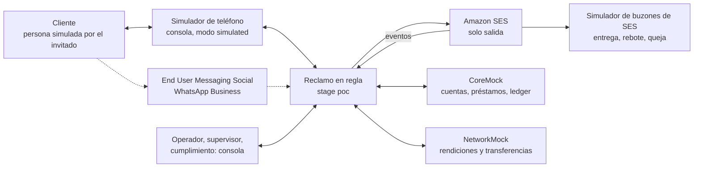
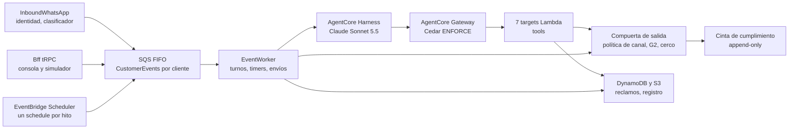
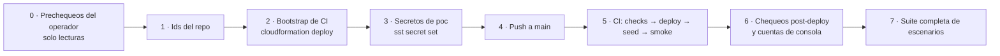

# Arquitectura · aws-cds-hackathon-poc-reclamo

Topología, datos, agente, seguridad, IAM, orden de deploy y lecciones heredadas. Lo que lee `devops` para levantar el stack y quien evalúe la POC (un prospecto o un evaluador) para reproducirlo. Los canales, la compuerta de salida y los sistemas simulados (SES saliente y sus eventos, WhatsApp vivo y simulado, core del prestamista, redes de cobro, red de transferencias, lectura de comprobantes, PDFs) están en `docs/architecture-integrations.md`. El alta propia de invitados, los leads y sus controles contra abuso (Cognito, WAF, `Leads`, contrato con la fábrica de mundos) están en `docs/architecture-guests.md`. El diseño funcional está en `docs/design-brief.md`; la experiencia de la landing, en `docs/landing-spec.md`.

## 1. Cuenta, región, dominios y nombres fijos

| Ítem | Valor |
|---|---|
| Cuenta | `craftech-demos` `776805327629` (**compartida** con otras apps; nunca `craftech-sandbox`, que se destruye a diario) |
| Región | `us-east-1` (Bedrock, AgentCore, End User Messaging Social, SES) |
| App SST | `aws-cds-hackathon-poc-reclamo` (29 caracteres) · forma con guiones bajos `aws_cds_hackathon_poc_reclamo` |
| Repo | `craftech-io/aws-cds-hackathon-poc-reclamo` (público, licencia Apache-2.0, propiedad intelectual de Craftech); org id `60447213`; repo id `gh api repos/craftech-io/aws-cds-hackathon-poc-reclamo --jq .id` (lo carga el operador en el bootstrap) |
| Zona DNS | `demo.craftech.io` (`Z043097217S4W7QWXU5O0`), delegada en la cuenta Demos, compartida con otras demos; se referencia por id, no se gestiona |
| Dominios | Consola y landing `reclamo.demo.craftech.io`; remitente de respuestas `respuestas@reclamo.demo.craftech.io`; invitaciones del personal y códigos de alta y recuperación de invitados de Cognito `no-reply@reclamo.demo.craftech.io` (`docs/architecture-guests.md` §9) |
| Identidad SES | Dominio `reclamo.demo.craftech.io` con Easy DKIM (firma `d=reclamo.demo.craftech.io`, alineada en modo relajado con el `From`). **Sin MAIL FROM propio**: un MAIL FROM exige un registro MX y este app no declara MX (ADR-0003); DMARC pasa por DKIM alineado |
| DMARC | `_dmarc.reclamo.demo.craftech.io` TXT `v=DMARC1; p=reject; adkim=r; aspf=r` (nadie puede mandar como nosotros) |
| Modelos | Agente y Memory: `global.anthropic.claude-sonnet-5-5` por el perfil de inferencia de aplicación con tags `aws-cds-hackathon-poc-reclamo-poc-sonnet-5-5` (ADR-0021 §6; el nombre lleva el modelo). Clasificador de entrada: un perfil de inferencia global de la familia Claude Haiku (`classifierModelId`, ADR-0016; el id exacto se confirma `ACTIVE` en el paso 0). Lectura de comprobantes: `receiptModelId`, Opus por defecto; bajarlo a un modelo más chico exige que `EV-2` siga en umbral. Los dos parametrizados en `infra/agentcore-spec.ts`. Verificar `ACTIVE` y cuota (§17 ítems 5-6) |
| Providers | `aws` 7.32.0, `aws-native` 1.74.1 (pinneados; cambio solo con ADR); SST `4.17.1`; Node 22 arm64 con versión **exacta** `22.x.y` en `.nvmrc`, `engines` y `setup-node` de CI (misma en laptop y CI: el seed es determinista por bytes) |

Nombres fijos (sin prefijo de stage, únicos por cuenta, dentro de la cerca del rol de CI):

| Recurso | Nombre | Por qué fijo |
|---|---|---|
| Topic SNS de WhatsApp | `aws-cds-hackathon-poc-reclamo-wa-inbound` | Una WABA tiene un solo destino de eventos |
| Configuration set SES | `aws-cds-hackathon-poc-reclamo-email-poc` | Cercado por nombre en el rol de CI y en `ses:SendEmail` |
| Rol de deploy de CI | `aws-cds-hackathon-poc-reclamo-github-deploy` | Lo crea el bootstrap (ADR-0013) |
| Rol del ejecutor de escenarios | `aws-cds-hackathon-poc-reclamo-qa-runner` | Lo crea el bootstrap (ADR-0009) |
| Boundary | `aws-cds-hackathon-poc-reclamo-ci-boundary` | Estampada en todo rol del app por `infra/ci.ts` |
| Path IAM | `/aws-cds-hackathon-poc-reclamo/` | Cerca IAM del rol de deploy |
| Función QA | `aws-cds-hackathon-poc-reclamo-poc-qa-driver` | Para que `qa-runner` la cerque por ARN |
| Grupo del Scheduler | `aws-cds-hackathon-poc-reclamo-poc-schedules` | Cercado por nombre (se leen tags justo después de crear) |
| Response headers policy | `aws-cds-hackathon-poc-reclamo-poc-console` | Creada por el bootstrap |
| KVS del Router | `aws-cds-hackathon-poc-reclamo-poc-router` | Creado por el bootstrap |
| Stack del bootstrap | `aws-cds-hackathon-poc-reclamo-ci-bootstrap` | Operador, una vez |
| Bucket `Media` | `aws-cds-hackathon-poc-reclamo-poc-media-776805327629` | La CSP del bootstrap nombra su host exacto (§11) |
| Bucket `Documents` | `aws-cds-hackathon-poc-reclamo-poc-documents-776805327629` | Ídem (la consola descarga PDFs por `fetch()`) |
| Bucket `Emails` | `aws-cds-hackathon-poc-reclamo-poc-emails-776805327629` | Ídem (visor de emails) |
| Log group de anclas | `/aws-cds-hackathon-poc-reclamo/poc/register-anchors` | Ancla de la cadena del registro y la cinta fuera de las tablas (§8.3); la boundary niega borrarlo o cambiar su retención |
| Rol de `AnchorWriter` | `aws-cds-hackathon-poc-reclamo-poc-anchor-writer` (nombre fijado por `transform`) | La boundary lo nombra como único escritor de anclas (§8.3, §14) |
| Rol del `QaDriver` | `aws-cds-hackathon-poc-reclamo-poc-qa-driver` (nombre fijado por `transform`) | La boundary le permite anclas solo en streams `qa-*` (`register.tamperProbe`) y los mocks lo reconocen por ARN (§14) |
| Rol del plan de malware | `aws-cds-hackathon-poc-reclamo-poc-malware-plan` | `iam:PassRole` del rol de deploy a GuardDuty, cercado por ARN (§6, §14) |
| Topic de presupuesto | `aws-cds-hackathon-poc-reclamo-budget-alerts` | AWS Budgets publica el 100 % → `BudgetBreaker` (§12) |
| Web ACL de borde | `aws-cds-hackathon-poc-reclamo-poc-edge` (`CLOUDFRONT`) | El bootstrap cerca `wafv2:*WebACL` por nombre (`docs/architecture-guests.md` §8, §12) |
| Web ACL de Cognito | `aws-cds-hackathon-poc-reclamo-poc-auth` (`REGIONAL`) | Ídem; asociada al user pool |

`ci-role.test.ts` verifica que cada nombre fijo está cubierto por un statement con su ARN exacto.

## 2. Stage y cuenta compartida

Un solo stage: **`poc`**, desplegado con `sst deploy --stage poc` solo desde CI en push a `main`. No hay stage `local` ni `sst dev`: el desarrollo se prueba con `U`, `LF` y `UI` locales (`docs/test-plan.md` §2). `sst.config.ts` rechaza cualquier stage distinto de `poc`.

Cercas de la cuenta compartida (heredadas y ampliadas):

| Cerca | Cómo |
|---|---|
| Tag | `sst:app = aws-cds-hackathon-poc-reclamo` en todo recurso (default tags del provider y `infra/tags.ts` en `awsnative.*`); el rol de deploy solo muta recursos con ese tag, y un deny impide re-etiquetar recursos de otra app |
| Nombre | Prefijo del app en tablas, colas, topics, grupos del Scheduler, funciones de CloudFront y buckets (nombres lógicos ≤ 16 caracteres porque SST recorta nombres largos; los tres buckets que lee el navegador tienen nombre físico fijo, §1) |
| Path IAM | Todo rol y política del app bajo `/aws-cds-hackathon-poc-reclamo/` con la boundary |
| DNS | El rol de deploy solo cambia registros con `ForAllValues:StringLike route53:ChangeResourceRecordSetsNormalizedRecordNames` ∈ {`reclamo.demo.craftech.io`, `*.reclamo.demo.craftech.io`} más `Null` = `false` sobre esa clave (un sufijo suelto también aceptaría `xreclamo.demo.craftech.io`, de otra demo de la zona compartida) y de tipo `A`, `AAAA`, `CNAME` o `TXT` (`route53:ChangeResourceRecordSetsRecordTypes`); **deny explícito de `MX`**. Cubre el apex (A/AAAA), `_dmarc` (TXT), los CNAME de DKIM (`*._domainkey`) y los de validación de ACM; `ci-role.test.ts` prueba un nombre parecido de otra demo (debe denegar) |
| SES | El rol de deploy tiene **deny explícito** de `ses:*ReceiptRule*`, `ses:*ReceiptFilter*` (los filtros IP son de toda la cuenta y afectarían el correo entrante de la otra app), `ses:SetActiveReceiptRuleSet`, `ses:SetReceiptRulePosition`, `ses:CloneReceiptRuleSet`, `ses:ReorderReceiptRuleSet`, `ses:SetIdentityMailFromDomain`, `ses:PutEmailIdentityMailFromAttributes` y las de ingreso de Mail Manager (`ses:CreateIngressPoint`, `ses:CreateRuleSet`, `ses:CreateTrafficPolicy`). El prefijo IAM de SES v2 es `ses:`: `ci-role.test.ts` rechaza cualquier acción `sesv2:` y `security` verifica los deny con `simulate-principal-policy`; `lint:no-ses-receiving` falla antes del deploy (§18) |
| Lecturas | Ningún script ni prechequeo lista o describe recursos de otra app salvo los de cuenta (`sesv2 get-account`) |

## 3. Secretos (`sst.Secret`)

Declarados una sola vez en `infra/secrets.ts`; leídos con `secretValue(nombre)` (`packages/bff/src/lib/secrets.ts`, zod). Un secreto sin valor aborta el deploy: todos se cargan antes del primer deploy (§15 paso 3).

| Secreto | Uso | Valor inicial |
|---|---|---|
| `SessionKey` | `sessionToken` y `runtimeSessionId` (subclaves HKDF `session`, `runtime-session`). Linkeado solo a `EventWorker`, `SignupEventWorker`, `QaEventWorker` y las 7 Lambdas target | 32 bytes aleatorios en base64 |
| `SimEnvelopeKey` | Firma HMAC (`kid = console`) del sobre simulado que arma el simulador de la consola (§13). Solo `Bff` e `InboundWhatsApp`, que la acepta solo para mundos `demo`, `gNN`, `gtest`, `gprobe`, `gs-*` y `qa-*` (los escenarios de navegador `SC-21` y `SC-22` usan el `Bff` real) | 32 bytes aleatorios en base64 |
| `QaSimEnvelopeKey` | Firma HMAC (`kid = qa`) del sobre simulado que arma el `QaDriver` (`wa.inbound`, el simulador por `createCaller`, `batch.run`). Solo `QaDriver` e `InboundWhatsApp`, que la acepta solo para `qa-*`, `qamin` y `sim-*`: un sobre del `QaDriver` dirigido a `demo`, `gNN`, `gtest` o `gprobe` se rechaza (`INBOUND_REJECTED SIM_KEY_WORLD_MISMATCH`), igual que uno dirigido a un `gs-*` aunque la firma sea válida | 32 bytes aleatorios en base64 |
| `PhoneHashKey` | `phoneHash` y `emailHash` (subclaves `phone-hash`, `email-hash`), y en el alta de invitados `lead-email`, `signup-ip` y `guest-world` (`docs/architecture-guests.md`). Solo `InboundWhatsApp`, `CoreMock`, la fábrica de mundos (`Bff`, `QaDriver`, `WorldJanitor`, `console:invite`) y `seed:load`. **Rotarla exige `seed:load --force`** (cambian todos los hashes de identidad) | 32 bytes aleatorios en base64 |
| `RegisterChainKey` | HMAC de la cadena del registro, del registro de reintegros y de la cinta (§8.3); se publica con cada exportación para que un tercero verifique. Solo quienes escriben esas tablas y quienes verifican | 32 bytes aleatorios en base64 |
| `WabaId` | Id de la WABA | `not-connected` mientras ningún mundo use WhatsApp en vivo |
| `WhatsAppPhoneNumberId` | `originationPhoneNumberId` | `not-connected` mientras ningún mundo use WhatsApp en vivo |
| `LeadNotifyEmail` | Casilla `@craftech.io` que recibe el aviso de cada lead; solo `LeadNotifier` (`docs/architecture-guests.md` §9) | `not-configured` hasta que el operador cargue la casilla que fijó el CTO (ADR-0021 §4) |
| `EdgeOriginKey` | Cabecera de borde que agrega el Router y exige el `Bff` en los procedimientos públicos del alta (`docs/architecture-guests.md` §4) | 32 bytes aleatorios en base64 |
| `SeedOverrides` | JSON: `demoRecipients.emails` (≤ 5, solo `@craftech.io`, reciben correo real y solo desde el mundo `demo`), `demoRecipients.phones` (WhatsApp vivo), `budgetEmail` (avisos de AWS Budgets), `personaPhones` (teléfono real de demo para una persona en vivo; se aplica **solo** al mundo `demo`) | `{}` |

Un secreto por propósito, linkeado solo donde hace falta: una Lambda que necesita una clave no recibe las demás (una clave maestra con HKDF separaría propósitos pero no funciones: el `Bff` podría emitir `sessionToken` y cualquier tool firmar sobres simulados). Los nonces de botones son aleatorios y no usan clave. Verificación: `npx sst secret list --stage poc` (imprime valores: no se comparte). Riesgo residual (§13): SST cifra los secretos linkeados en el bundle y deja `SST_KEY` en una variable de entorno de la función.

## 4. Componentes

| Componente | Servicio | Por qué |
|---|---|---|
| Agente | **Bedrock AgentCore Harness** (`awsnative.bedrockagentcore.Harness`), endpoint `live`, `global.anthropic.claude-sonnet-5-5` por el perfil de aplicación con tags (ADR-0021), `converse_stream`, `maxIterations 12`, `maxTokens 4096` (tokens de salida sumados de todas las llamadas al modelo de una invocación, como en la referencia; un turno feliz con varias tools, un `send_whatsapp` de 900 caracteres y un `draftBody` de 2.500 no entra en 2048), `timeoutSeconds 120`, prompt caching del system prompt y de los schemas de tools si el `.d.ts` instalado lo expone (WP-31), `truncation sliding_window 40`; `tools` = solo el Gateway; `allowedTools: ["@reclamo-tools/*"]`; sin shell, archivos ni code interpreter; G1 | Loop gestionado probado en el scaffolding (ADR-0001) |
| Tools | **AgentCore Gateway** MCP `AWS_IAM` + 7 `GatewayTarget` Lambda (`identity`, `account`, `investigation`, `actions`, `complaints`, `messaging`, `handoff`) con `toolSchema.inlinePayload` generado desde zod | Un target por dominio, permisos mínimos por Lambda |
| Autorización de tools | **AgentCore Policy** (Cedar `ENFORCE`) + `sessionToken` HMAC + zod `.strict()` + cercas `LAM-*` | `docs/design-brief.md` §8.6 |
| Memoria | **AgentCore Memory** con tres estrategias propias con instrucción de exclusión | §9.3 |
| Seguridad de contenido | **Bedrock Guardrails** G1 (pre-filtro y Harness) y G2 (compuerta de salida) | `docs/design-brief.md` §8.5 |
| Clasificador de entrada | Reglas deterministas + Bedrock `Converse` con un modelo chico (Haiku) y `toolChoice` forzado (una sola tool de salida `classify`) | Número en el acto sin esperar el turno (ADR-0015, ADR-0016) |
| Lectura de comprobantes | Bedrock `Converse` multimodal con salida forzada por schema + parser determinista de respaldo | ADR-0007; `docs/architecture-integrations.md` §7 |
| Orquestación por cliente | **SQS FIFO** `CustomerEvents.fifo` (`MessageGroupId = <worldId>#<customerId>`) + `EventWorker` (concurrencia reservada 5) + DLQ `CustomerEventsDlq.fifo`, para `demo`, `gNN`, `gtest` y `gprobe`; **cola aparte** `SignupCustomerEvents.fifo` + `SignupEventWorker` (mismo código, concurrencia reservada 2) + `SignupCustomerEventsDlq.fifo` para los mundos de alta propia `gs-*`; **cola aparte** `QaCustomerEvents.fifo` + `QaEventWorker` (mismo código, concurrencia reservada 3) + `QaCustomerEventsDlq.fifo` para `qa-*`, `qamin` y `sim-*` | Serializa entrada, turnos, timers, envíos del operador y eventos de SES de un cliente; ni una corrida de QA ni una ráfaga de altas propias le quita capacidad de ejecución a `demo` o a un `gNN`, y el `QaDriver` solo puede escribir en la cola de QA (§14) |
| Estado del reclamo | **DynamoDB** con máquina de estados en código y escrituras condicionales por `version` | ADR-0004 (sin Step Functions) |
| Timers y SLA | Item `Timers/…` + **EventBridge Scheduler** (un schedule `at()` por timer vencible, grupo del app, `ActionAfterCompletion DELETE`, destino `ScheduleDispatch`) | Hitos, publicaciones de rendición, rechequeos, envíos diferidos y transiciones de red con un solo mecanismo que el reloj sabe avanzar (§10) |
| Reloj de demo | `Runtime/W#<worldId>#CLOCK` (`PAUSED` o `RUNNING` con `rate`) | ADR-0011 |
| Core del prestamista (mock) | Lambda `CoreMock` con Function URL `AWS_IAM` + tabla propia `Core`; contrato OpenAPI 3.1 | Se consume como un sistema externo (`docs/architecture-integrations.md` §5) |
| Redes (mock) | Lambda `NetworkMock` con Function URL `AWS_IAM` + tabla `Networks` + bucket `Settlements` | Redes de cobro con rendiciones CSV y red de transferencias con API de estado (§6 de integraciones) |
| Email | **Amazon SES v2** solo salida: identidad, DKIM, DMARC, configuration set → EventBridge → `EmailEvents` | ADR-0002, ADR-0003 |
| WhatsApp | **AWS End User Messaging Social** (`@aws-sdk/client-socialmessaging`); modo `simulated` salvo los mundos aprobados para vivo (`infra/channel-modes.ts`); topic SNS standard | `docs/architecture-integrations.md` §3 |
| PDFs | Generador propio en `packages/bff/src/pdf/` (respuesta escrita, acuse, libre deuda, nota de crédito, estado de cuenta) | Reusado del scaffolding; sin servicio externo |
| Datos | **DynamoDB** una tabla por agregado (§5), **S3** (§6); **GuardDuty Malware Protection for S3** sobre `Media` | Patrón del scaffolding |
| Consola | **CloudFront Router** + **StaticSite** (React 19 + Vite + Tailwind v4) + Function tRPC v11 `Bff` + **Cognito** (login propio SRP). `Bff`: **timeout 20 s declarado** (no el default implícito) y **1.024 MB**, por debajo del timeout de origen de 30 s de CloudFront; presupuesto por procedimiento 10 s. Ningún procedimiento hace en línea trabajo proporcional al tamaño de un mundo (crear, reiniciar, borrar, purgar Memory): lo encola o invoca en asíncrono y responde enseguida (§10) | §11 |
| Trabajo largo de mundos | Lambda `WorldJanitor` (**timeout 900 s, 1.024 MB**), invocada en asíncrono con ticket (`RESETREQ#`, `PURGEREQ#`) y por schedule horario; reanudable por cursor (§10) | Un reinicio o una creación de la plantilla `demo`/`guest` escribe miles de items y no entra en una request detrás de CloudFront |
| Observabilidad y costo | **CloudWatch** logs JSON con redacción, métricas `ReclamoAgent/*`, alarmas, Transaction Search, **AWS Budgets** por tag con acción al 100 % (SNS → `BudgetBreaker`), topes globales y corte del agente en runtime (`Runtime/KILL#AGENT`) | §12-§13 |
| Ancla del registro | Lambda `AnchorWriter` (rol de nombre fijo, invocación asíncrona): **único** escritor del log group de anclas; relee cada entrada comprometida antes de anclarla | §8.3 |
| Alta propia de invitados | `GuestSignupClient` (confidencial), triggers post-confirmation y custom message, procedimientos públicos `signup.*`/`password.*` del `Bff`, Lambda `LeadNotifier`, tabla `Leads`, dos web ACL de **AWS WAF** (borde y Cognito) | ADR-0020; `docs/architecture-guests.md` |
| QA en el stage | Lambda `QaDriver` (nombre fijo, sin URL) invocada solo por `qa-runner` | ADR-0009 |
| Infra y CI | **SST v4**, GitHub Actions + OIDC, bootstrap de CloudFormation | ADR-0013 |

Contexto: ¿quién habla con Reclamo en regla y por dónde?

Línea llena: camino que corre en `poc`. Línea punteada: camino de WhatsApp Business, activo solo en mundos aprobados para vivo.

Internos: ¿qué pasa con un mensaje del cliente?

La compuerta entrega a SES o a EUM Social (contexto de arriba). Memory, G1 y los mocks no se dibujan como cajas: cada uno sirve a un solo consumidor.

## 5. DynamoDB

Una tabla por agregado. Nombres lógicos PascalCase; atributos camelCase; ids con prefijo. Todo item lleva `entity`, `worldId`, `createdAt`, `updatedAt`, `version` (bloqueo optimista), `synthetic: true` cuando viene del seed y, en mundos `qa-*`, de invitado y `sim-*`, `expiresAt` (TTL). Fechas ISO 8601 con zona; las fechas de negocio se guardan en tiempo simulado (`…Sim`) y, donde hace falta, también real (`…Real`). SSE con claves de AWS.

**Toda clave de partición de un item de un mundo empieza con `W#<worldId>#`**, en todas las tablas (incluidas `Worlds`, `Register`, `ComplianceTape`, `AuditLog` y `Runtime`), y también la clave de partición de todo índice que consulten los roles cercados por mundo (`Bff`, `QaDriver`, `WorldJanitor`): IAM evalúa `dynamodb:LeadingKeys` sobre la clave de partición del índice. `worldId` cumple `^[a-z0-9-]{1,24}$` (entra en nombres de schedule, §10). Las únicas particiones sin mundo son `Reference` (`REF#…`), la tabla `Leads`, la auditoría del borde público en `AuditLog` (`SIGNUP#AUD#<yyyy-mm>` y `SIGNUP#AUD#QA#<yyyy-mm>`, sin email) y los items globales de `Runtime` (`GLOBALCAP#`, `KILL#AGENT`, `KILL#SIGNUP`, `SWITCH#SIGNUP`, `GUESTCAP#`, `LIVEPHONE#`, `LEASE#`, `PROBE#` y los contadores del alta de `docs/architecture-guests.md` §11), que ningún rol cercado escribe salvo los de la fila de §14. Así las cercas `ForAllValues:StringLike dynamodb:LeadingKeys` de §14 se pueden escribir tal cual y se prueban en `infra/iam-capabilities.test.ts`. La fábrica enumera un mundo con el índice `WorldIndex` (partición `worldIndexKey = W#<worldId>#`, orden `worldIndexSort = <pk>|<sk>`, solo claves, lo usa solo la fábrica): la partición lleva el prefijo del mundo como cualquier otra, así que las cercas `LeadingKeys` de §14 también lo cubren.

| Tabla | Entidades | PK | SK | GSIs | TTL |
|---|---|---|---|---|---|
| `Worlds` | World (`kind` `DEMO` \| `GUEST` \| `QA` \| `SIM`, `template`, `epoch`, `origin` `INVITED` \| `SIGNUP` (solo `GUEST`, derivado del id), `status` `REGISTERED` \| `CREATING` \| `READY` \| `RESETTING` \| `EXPIRING` \| `EXPIRED` (los dos últimos solo en `gs-*`), `lastActivityAtReal`, `readyAtReal`, `buildCursor` (fase y último bloque escrito de la fábrica, §10), `reset{requestId, fromEpoch, toEpoch, phase, requestedAtReal, heartbeatAtReal, attempts}` mientras `RESETTING`, `lastResetAtReal`), WorldSettings (`caps`, `contactHours`, `maxProactivePerDay`, `settlementDelays`, `turnCaps`, `imageReadsPerDay`, `rateLimitPerHour`, **`channelModes`** `{whatsapp: live \| simulated}`, `manualBaseline{items[{action, minutes, label: "supuesto"}]}`, `referenceRate` sintética), Staff (`staffId`, `role`, `displayName`, `cognitoSubKey`) | `W#<worldId>#WORLD` | `META` · `SETTINGS` · `STAFF#<staffId>` | `BySub` (`cognitoSubKey` = `SUB#` → staff; lo consulta solo el trigger pre-token) · `GuestIndex` (disperso, solo `gs-*`: `GUEST#<status>` + `<atReal>#<worldId>`; lo consulta solo `WorldJanitor`, `docs/architecture-guests.md` §5) | `expiresAt` en QA y en `gNN`; ninguno en `gs-*` (los vence `WorldJanitor`) |
| `Core` (del `CoreMock`) | Customer (`phoneHash`, `liveE164` **solo en `demo` y en el mundo QA vivo, solo lo lee el transporte vivo**, `emailMasked`, `emailHash`, `docType`, `docNumberMasked`, `optIn{at, medium, textVersion, history[]}`, `optOut{at, history[]}`), Account (`status`, `blockReasonCategory`, `closure`), Wallet (`balance`, `syntheticCvu`, `freeze{active, at, by, history[]}`), Loan (`principal`, `instalmentsCount` 3-18, `rate`, `status`, `disbursement`), Instalment, Payment (`network`, `operationCode`, `amount`, `paidAtSim`, `allocations[]`, `customerId`), Movement, Charge (`feeCode`, `amount`, `chargedAtSim`, `reversal`), Transfer, CreditNote, PayoffQuote, PhoneClaim, **ActionClaim** (`OPC#`, `REV#`, `RFD#`, `TRV#`: `actionId`, `customerId`, `complaintId`, `amount`) | `W#<worldId>#CUS#<customerId>` · `W#<worldId>#PHONE#<hash>` · `W#<worldId>#OPC#<network>#<operationCode>` · `W#<worldId>#REV#<chargeId>` · `W#<worldId>#RFD#<debitId>` · `W#<worldId>#TRV#<transferId>` | `META` · `ACCOUNT` · `WALLET` · `LOAN#<loanId>` · `LOAN#<loanId>#INST#<nn>` · `LOAN#<loanId>#PAY#<paymentId>` · `WALLET#MOV#<ts>#<movId>` · `CHG#<chargeId>` · `TRF#<transferId>` · `CN#<creditNoteId>` · `QUOTE#<quoteId>` · `CLAIM` | `ByPhone` (`phoneHash`) · `ByOperationCode` (`opCodeKey` = `W#<worldId>#<network>#<operationCode>` → pago) · `ByCvu` (`cvuKey`) · `WorldIndex` | `expiresAt` en QA, invitado y `sim-*` |
| `Networks` (del `NetworkMock`) | SettlementBatch (`network`, `businessDate`, `status` `PENDING` \| `PUBLISHED`, `publishAtSim`, `s3Key`, `lineCount`, `sha256`), TransferStatus (`status`, `traceId`, `expectedBySim`, `transitions[]`), NetworkFault (por mundo) | `W#<worldId>#NET#<network>` · `W#<worldId>#TRF#<transferId>` | `BATCH#<businessDate>` · `STATUS` · `FAULTS` | `WorldIndex` | Igual que `Core` |
| `Complaints` | Complaint (`complaintNumber`, `kind` `CONSULTA` \| `RECLAMO`, `type`, `status`, `outcome`, `priority`, **`origin` `SEED` \| `LIVE`** (lo sembrado por la plantilla nunca entra en un KPI medido, §12), `control` espejo, `filedAtSim`, `deadlineSim`, `slaState`, `emailAnswerConsent`, `answer{messageId, sentAtSim, deliveryProof, inFlight}`, `handoff{reason, atSim}`, `statusHistory[]`), Evidence (`kind` `RECEIPT_IMAGE` \| `RECEIPT_READING` \| `SETTLEMENT_MATCH` (con `line.customerRef` y `line.loanRef`) \| `CHARGE_CHECK` \| `DUPLICATE_CHECK` \| `TRANSFER_STATUS` \| `DISBURSEMENT` \| `TERMS_CLAUSE` \| `LOAN_STATUS` \| `PAYOFF_QUOTE`), Action (`kind`, `amount`, `coreRef`, `idempotencyKey`, `claimKey`), Approval (`action`, `amount`, `capTier`, `requestedBy AGENT`, `decision`, `decidedBy`, `decidedAtSim`, `epoch`, `expiresAtSim` = 2 días hábiles simulados, `executedAt`, `reason`), Execution (`EXEC#<approvalId>`, escrita una sola vez), Note | `W#<worldId>#CMP#<complaintId>` | `META` · `EVD#<evidenceId>` · `ACT#<actionId>` · `APR#<approvalId>` · `EXEC#<approvalId>` · `NOTE#<ts>` | `InboxIndex` (`inboxKey` = `W#<worldId>#OPEN` \| `#CLOSED`, `deadlineSort`) · `ByCustomer` (`W#<worldId>#CUS#<customerId>`, `filedAtSim`) · `ByNumber` (`W#<worldId>#<complaintNumber>`) · `ApprovalIndex` (sparse, `W#<worldId>#PENDING`, `requestedAtSim`) · `WorldIndex` | `expiresAt` en QA, invitado y `sim-*` |
| `Register` | RegisterEntry (evento inmutable: `eventType` `FILED` \| `STATUS` \| `PROVISIONAL_ANSWER` \| `FINAL_ANSWER` \| `DELIVERY_PROOF` \| `WITHDRAWN` \| `RECLASSIFIED`, `complaintNumber`, `kind`, `type`, `channel`, `reason`, `presenter{docType, docNumberMasked}`, `status`, `answerRef`, `bodySha256`, `prevHash`, `hash`, `seq`), RefundEntry (registro de reintegros: cliente, causa, producto, monto, interés, `creditNoteId`) | `W#<worldId>#REG#e<epoch>` · `W#<worldId>#RRI#e<epoch>` | `<seq 000000000>` | `ByComplaint` (`W#<worldId>#e<epoch>#<complaintNumber>`, `seq`) | `expiresAt` fijado **al escribir** según el tipo de mundo (demo 180 días, invitado 30, QA 2): la tabla nunca se actualiza |
| `Timers` | Timer (`kind`, `dueAtSim`, `seq` (desempate estable entre timers con la misma hora), `status` `SCHEDULED` \| `FIRED` \| `CANCELLED` \| `SKIPPED` \| `DISCARDED`, `firedBy` `SCHEDULER` \| `CLOCK` \| `PUBLICATION` \| `MANUAL`, `version`, `epoch`, `scheduleName`, `ownerKey`, `payload`, `reason`) | `W#<worldId>#TIMER#<kind>#<timerId>` | `META` | `ClockDue` (sparse: `W#<worldId>#CLOCKDUE` + `dueAtSim#seq`, solo `SCHEDULED`) · `ByOwner` (`W#<worldId>#<ownerKey>`, p. ej. `CMP#<id>` o `BATCH#<network>#<businessDate>`) · `WorldIndex` | `expiresAt` en QA |
| `Conversations` | Conversation META (`control` `AGENT` \| `OPERATOR` con `controlHistory[]`, `identifiedAtReal`, `identifiedUntilReal` (30 minutos **reales**: ni un mundo en pausa la extiende ni un reloj comprimido la acorta), `windowOpenUntilSim`, `sessionEpoch`, `disclosedEpochs[]`, `openComplaintIds[]`), Message (in/out, cuerpo normalizado y enmascarado, `channel`, `kind`, `sender`, `templateName`, `interactive`, `media{s3Key, scan}`, `providerMessageId`, `status`, `tapeRef`, `turnId`, `triggerEventId`, `flags{disclosure}`, `simulated`, `sentAtSim`), MessageEvent, TurnNote (`refs[]`), EmailRecord (`mailId`, `to` enmascarado, `subject`, `s3RawKey`, `attachments[]`, `events[]`, `deliveryProof`), ConversationTask (`author`, `text`, `task{status}`: la tarea humana que deja `escalate_to_human` cuando la conversación no tiene un reclamo abierto) | `W#<worldId>#CONV#<customerId>` | `META` · `MSG#<ts>#<messageId>` · `EVT#<ts>#<eventId>` · `NOTE#<ts>#<turnId>` · `MAIL#<ts>#<mailId>` · `TASK#<ts>#<taskId>` | `ByProviderMessageId` (`wamid`, SES `MessageId`) · `ByCustomerSent` (`W#<worldId>#CUS#<customerId>`, `sentAtSim`; conteo diario y ventana) · `EmailIndex` (`W#<worldId>#MAIL`, `sentAtSim`; visor) · `WorldIndex` | 90 días; `expiresAt` en QA |
| `ComplianceTape` | TapeEntry (`decision` `ALLOWED` \| `BLOCKED` \| `REROUTED` \| `DEFERRED` \| `DISPATCH` (resultado del transporte: `result` `SENT` \| `FAILED` \| `UNKNOWN_DELIVERY`), `ruleIds[]`, `evaluated[{ruleId, result}]`, `ruleSetVersion`, `sender`, `channel`, `kind`, `payloadHash` SHA-256 del cuerpo renderizado, `messageId`, `complaintId`, `customerRef` (hash), `reroute{route, childTapeId}`, `atSim`, `atReal`, `seq`, `prevHash`, `hash`) | `W#<worldId>#TAPE#<yyyy-mm-dd simulado>` | `<atSim>#<ulid>` | `ByComplaint` (`W#<worldId>#CMP#<id>`, `atSim`) · `ByDecision` (`W#<worldId>#<decision>`, `atSim`) · `ByMessage` (`messageId`) · `BySeq` (`W#<worldId>#TAPESEQ#e<epoch>`, `seq`) | Igual que `Register` (fijado al escribir; append-only) |
| `AuditLog` | Decision (`action`, `actor` `AGENT` \| `OPERATOR:<id>` \| `SYSTEM` \| `QA`, `ruleIds[]`, `refs`, `outcome`) para todo lo que no es un saliente (tools con efecto, **aprobaciones y rechazos**, tomas, logins, reloj, reinicios, disparos descartados, bloqueos de guardrail, `CROSS_WORLD`). **Append-only como `Register`**: solo `PutItem`, partición por época, un reinicio no la borra. Las acciones del alta y del borde público que no son de un mundo (`SIGNUP_REJECTED`, `SIGNUP_SWITCHED`, `LEAD_NOTICE_*`, `LEAD_DELETED`, `EDGE_REQUIRED`; `docs/architecture-guests.md` §11) van a una partición global, nunca con un email: `SIGNUP#AUD#<yyyy-mm>` y, las del ejecutor de escenarios, `SIGNUP#AUD#QA#<yyyy-mm>` (`packages/bff/src/leads/repo.ts`) | `W#<worldId>#AUD#e<epoch>#<yyyy-mm>` · `SIGNUP#AUD#<yyyy-mm>` · `SIGNUP#AUD#QA#<yyyy-mm>` | `<ts>#<ulid>` | `ByRef` (`W#<worldId>#<refKey>`, `ts`) · `ByAction` (`W#<worldId>#<action>`, `ts`) | Fijado al escribir: 12 meses en demo, 30 días en invitado, 2 en QA |
| `Reference` | Holiday (AR), ProductTerms (versionado, cláusulas), FeeSchedule (versionado), ReasonCategory (bloqueos), Template (WhatsApp), TemplateStatusPhrase (frases permitidas para `{{3}}` de `reclamo_novedad`), RateCard, ChannelRuleSet (versionado, parámetros por defecto), CollectionLexicon (versionado), NameCheck, EvalTruth (grounding y lectura de comprobantes), SeedReceiptHash (SHA-256 de los comprobantes sintéticos, §6) | `REF#<type>#<scope>` | clave del tipo | — | — |
| `Runtime` | Session, TurnResult, Nonce, Clock, Counter, Idempotency, RateCounter, TurnCap, ImageCap, ChallengeLedger, WorldState (`inFlight`), Pending (`MAIL#` hasta el evento **terminal** de SES, `SCAN#` hasta el resultado del escaneo o su plazo de 120 s), ScanObject (`SCANOBJ#`: un registro por objeto de `Media`, con clave de anuncio (`announceKey`: la clave exacta en `up/` y `sim/`, el prefijo `wa/<w>/<wamid>/` en vivo) y `s3Key` real, escrito **antes** de que el objeto pueda existir; guarda el resultado del escaneo aunque llegue antes que el mensaje, §6), SendClaim, SimMedia, LivePhone, Tombstone, Kill, PurgeRequest (ticket de purga de Memory, §9.3), ResetRequest (ticket de reinicio, §10), ProvisionRequest (ticket de creación de un `gs-*`), TurnCapEpoch, MailCap y ResetCap (topes de un mundo de alta propia), SessionSeen (`SIGNIN#`: primera llamada de una sesión de invitado a `guest.status`); globales: GlobalCap, Kill global, Lease (teléfonos QA), Probe, GuestCap (cupo de mundos de alta propia), el interruptor y el corte del alta y sus contadores (`docs/architecture-guests.md` §7) | `W#<w>#SESSION#<id>` · `W#<w>#TURN#<turnId>` · `W#<w>#NONCE#<nonce>` · `W#<w>#CLOCK` · `W#<w>#COUNTER#EPOCH` · `W#<w>#COUNTER#CMP#e<epoch>#<yyyy>` · `W#<w>#COUNTER#REGSEQ#e<epoch>` · `W#<w>#COUNTER#RRISEQ#e<epoch>` · `W#<w>#COUNTER#TAPESEQ#e<epoch>` · `W#<w>#IDEMP#<source>#<id>` · `W#<w>#RATE#<phoneHash>#<realHour>` · `W#<w>#TURNCAP#<realHour\|realDay>` · `W#<w>#IMGCAP#<customerId>#<realDay>` · `W#<w>#CHALLENGE#<customerId>` · `W#<w>#WORLDSTATE` · `W#<w>#PENDING` · `W#<w>#SEND#<messageId>` · `W#<w>#SIMMEDIA#<id>` · `W#<w>#TOMB#<epoch>` · `W#<w>#KILL` · `W#<w>#PURGEREQ#<requestId>` · `W#<w>#RESETREQ#<requestId>` · `W#<w>#SCANOBJ#<sha256(announceKey)[0:32]>` · `W#<w>#PROVISIONREQ#<requestId>` · `W#<w>#TURNCAPEPOCH#e<epoch>` · `W#<w>#MAILCAP#<realDay>` · `W#<w>#RESETCAP#<realDay>` · `W#<w>#SIGNIN#<sessionId>` · `LIVEPHONE#<phoneHash>` · `GLOBALCAP#<pool>#<realMinute\|realHour\|realDay>` (pools PUBLIC, SIGNUP y QA; el minuto solo en SIGNUP) · `GLOBALCAP#SIGNUPIMG#<realDay>` · `KILL#AGENT` · `LEASE#PHONE#<n>` · `PROBE#<id>` · `GUESTCAP#ACTIVE` · `GUESTCAP#QA` · `SWITCH#SIGNUP` · `KILL#SIGNUP` · `SIGNUPCAP#[QA#]<realHour\|realDay>` · `SIGNUPIP#<ipHash>#<realDay>` · `SIGNUPCANON#<canonHash>#<realDay>` · `AUTHMAIL#<realHour\|realDay>` · `GUESTACCT##RESEND\|RECOVERY#<realHour\|realDay>` · `GUESTACCT##WORLDREQ` · `RECOVERYIP#<ipHash>#<realHour>` · `LEADNOTICE#<realDay>` | `META` · `RESULT#<tool>#<seq>` · `MAIL#<mailId>` · `SCAN#<sha8>` | — | Sesión 1 h, turno 1 h, nonce 7 d, idempotencia 7 d, rate, topes y reclamos de envío 48 h, pendientes y sondas 48 h, tickets de purga 1 h, tickets de reinicio 7 d, `SCANOBJ#` 1 h desde el último cambio, lease 2 h, `CHALLENGE#` 24 h desde el último fallo, `SIGNIN#` 24 h, `TURNCAPEPOCH#` 8 días, contadores del alta 48 h desde su ventana, `PROVISIONREQ#` 7 d; `CLOCK`, `GUESTCAP#` y `SWITCH#SIGNUP` sin TTL (`CLOCK` sí en QA); `COUNTER#EPOCH` nunca se borra |
| `Leads` | Pedido de alta (`SIGNUP#<signupId>`), pedido vigente por email (`PENDING#<emailHash>`), contador por email canónico (`CANON#<canonHash>`), lead (`LEAD#`), constancia de borrado (`LEADDEL#<emailHash>`); sin PITR ni backups; datos de contacto y consentimientos. **Fuera de los datos de la demo**: sin `W#`, ninguna fábrica, exportación ni métrica la lee (`docs/architecture-guests.md` §10) | `SIGNUP#…` · `PENDING#…` · `CANON#…` · `LEAD#…` · `LEADDEL#…` (QA: `QASIGNUP#…`, `QAPENDING#…`, `QALEAD#…`) | `META` · `<atReal>` | `ByEmailHash` (`emailHashKey` = `EMAIL#<emailHash>`, solo claves) · `BySub` (`subKey` = `SUB#`, solo claves) | Pedido 48 h; lead 24 meses desde el último ingreso |
| `Metrics` | ComplaintKpi (`source` `WORLD` \| `BATCH` \| `SIMULATED_LOAD`, `agentMode` `REAL` \| `SCRIPTED`, `origin` `SEED` \| `LIVE`, `ackLatencyMs` (con `coldStart`), `resolvedWithoutHuman`, `answeredOnTime`, `deliveryProof`, `humanActions[]`, `tokens{in, out, cached}`, `messages{wa, email}`, `costUsd`, `rateCardVersion`) | `W#<worldId>#METRICS` | `<source>#<runId>#<complaintId>` | — | `expiresAt` en QA |

Reglas de escritura:

- Toda transición de `Complaint.status`, `Conversation.control`, `Timer.status`, `Approval.decision` y `Wallet.freeze` es un `UpdateItem` condicional sobre `version` (y sobre el estado de origen permitido por la máquina de estados, §8.1); las altas de mensajes, evidencias y acciones son `PutItem` con `attribute_not_exists`.
- `Register`, `ComplianceTape` y `AuditLog` son **append-only**: el código escribe solo `PutItem` con `attribute_not_exists(pk)`, e **IAM bloquea `UpdateItem`, `DeleteItem` y `BatchWriteItem`** para todo rol del app (lo verifica `infra/iam-capabilities.test.ts`). IAM no puede exigir una `ConditionExpression`: un rol con `PutItem` podría **sobrescribir** una entrada sin condición. Eso no se impide, **se detecta**: cada entrada lleva `seq`, `prevHash` y `hash`, y la cabeza de cada cadena se ancla fuera de las tablas (§8.3). Un reinicio de mundo no las toca: la época nueva usa otra partición y las viejas vencen por TTL.
- Unicidad del teléfono: `W#<worldId>#PHONE#<hash>` con `PutItem` condicional en toda alta; dos clientes con el mismo teléfono en un mundo es imposible.
- **Una sola ejecución por acción de dinero, por clave natural**: la imputación, la reversión, el reintegro y la reversión de transferencia escriben, en la misma `TransactWriteItems` que mueve el dinero, un `Put` condicional (`attribute_not_exists`) del claim `W#<worldId>#OPC#<network>#<operationCode>`, `W#<worldId>#REV#<chargeId>`, `W#<worldId>#RFD#<debitId>` o `W#<worldId>#TRV#<transferId>`. Un segundo intento (otro reclamo sobre el mismo débito, otra aprobación, un reintento) devuelve `CONFLICT` con el `actionId` existente y no mueve nada. La imputación suma la condición de saldo (`outstanding ≥ amount`) y la de cliente (el préstamo es del `customerId` que manda el llamador). El seed escribe los claims `OPC#` de todos los pagos históricos.

## 6. S3

Nombres lógicos de bucket de 16 caracteres o menos (cerca del rol de CI); `Media`, `Documents` y `Emails`, que el navegador lee o escribe, tienen además **nombre físico fijo** (§1) para que la CSP del bootstrap nombre su host exacto (§11). Todos privados, SSE-S3, `BlockPublicAccess` total, TLS obligatorio por política. Raíz de un mundo: `W/<worldId>/` en `demo`, `gNN`, `gtest` y `sim-*`; `qa/<runId>/<worldId>/` en `qa-*` y `qa/qamin/` en `qamin`, **la misma** en `WORLDS`, en la regla de lifecycle (`qa/` 2 días) y en los borrados del `QaDriver`.

| Bucket | Prefijos | Quién escribe | Retención |
|---|---|---|---|
| `Media` | `wa/<worldId>/<wamid>/…` (vivo; `InboundWhatsApp` ya resolvió el mundo antes de pedir la media y pasa **solo el prefijo** `wa/<worldId>/<wamid>/` como `destinationS3File.key`: el servicio le agrega el `mediaId` y arma la clave final, que el código nunca predice, ADR-0002) · `<raíz>/sim/<messageId>/<n>.<jpg\|png>` (copias server-side de comprobantes del seed) · `up/<worldId>/<messageId>/<n>.<jpg\|png>` (imagen subida desde el simulador; en QA bajo `<raíz>/up/`) · `quarantine/…` | `InboundWhatsApp`, BFF (POST prefirmado del simulador), fábrica de mundos | 90 días; `qa/` y `up/` **2 días** (una subida de invitado puede ser una foto real: se borra pronto y nunca entra en capturas, galería, landing ni métricas de lote) |
| `Documents` | `<raíz>/complaints/<complaintId>/<docKind>-<n>.pdf` (`ANSWER`, `ACK`, `PAYOFF_CERTIFICATE`, `CREDIT_NOTE`, `STATEMENT`, `CLOSURE`, `DATA_CHANGE`, `COLLECTION_NOTICE`) | `ToolComplaints`, `EventWorker`, `Bff` (respuesta del operador) | Vida del stage; `qa/` 2 días |
| `Emails` | `<raíz>/<yyyy-mm-dd>/<mailId>.eml` (MIME crudo exacto enviado) · `…/<mailId>.json` (render de la vista: encabezados, partes, adjuntos) | Cliente único de SES (`channels/email/outbound.ts`) | 90 días; `qa/` 2 días |
| `Settlements` | `<raíz>/<network>/<businessDate>/batch-<seq>.csv` | `NetworkMock` al publicar un lote | Vida del stage; `qa/` 2 días |
| `Exports` | `<raíz>/register/<ts>-<kind>.{csv,json,sha256}` | `Bff` (exportación del registro y de la cinta) | 7 días |
| `Seed` | `receipts/<variant>/<id>.png` · `worlds/<plantilla>.json` (`demo`, `guest`, `qa-min`, `models`) · `load/simulated-complaints.jsonl` · `load/batch-inputs.jsonl` · `settlements/<plantilla>/…csv` | `seed:load` | Vida del stage |

- **CORS**: `AllowedOrigins = https://reclamo.demo.craftech.io` exacto, `MaxAge 300`; `Media` con `POST` (subida de un comprobante desde el simulador) y `GET`; `Documents` y `Emails` con `GET`. La consola descarga imágenes y PDFs prefirmados con `fetch()` y los muestra como URL `blob:` (§11).
- **GuardDuty Malware Protection for S3** (`aws.guardduty.MalwareProtectionPlan` del provider pinneado, `infra/malware.ts`) sobre `Media`, con `actions.tagging` habilitado y el rol de servicio `aws-cds-hackathon-poc-reclamo-poc-malware-plan` (§14: trust, permisos, techo de la boundary y `iam:PassRole` del rol de deploy). No hay modo "sin plan": el plan es parte del stack y `SC-00/8` espera, después de cada deploy, que `GetMalwareProtectionPlan` llegue a `status = ACTIVE` (sondeo cada 30 s, tope 600 s: un plan recién creado tarda minutos, y un `WARNING` `INSUFFICIENT_TEST_OBJECT_PERMISSIONS` es un defecto del rol, §14, que el smoke imprime con sus `statusReasons`). `MediaIntake` recibe el evento `GuardDuty Malware Protection Object Scan Result` del bucket (regla de EventBridge del app) y actúa por `scanResultStatus`; nunca espera en silencio.

  **El resultado no depende del orden.** GuardDuty escanea cuando el objeto aterriza en `Media`: en una subida del simulador, en el POST prefirmado; en vivo, en `GetWhatsAppMessageMedia`; en una copia del seed, en el `CopyObject`. El mensaje que lo usa (`simulator.attachReceipt` o el evento vivo) llega a `InboundWhatsApp` **después**, tras firma, identidad, rate limit, opt-out, nonces y clasificador, y una PNG chica se escanea en segundos. Por eso **toda escritura en `Media` va precedida por su registro** `Runtime/W#<w>#SCANOBJ#<sha256(announceKey)[0:32]>` (`{announceKey, s3Key?, source, createdAtReal}`, sin mensaje): lo escribe el `Bff` en `presignReceipt` antes de firmar el POST, y `InboundWhatsApp` antes de `GetWhatsAppMessageMedia` y antes de la copia de un comprobante del seed. La **clave de anuncio** (`announceKey`) es lo que el código conoce antes de que el objeto exista:

  | Origen | `announceKey` | `s3Key` (objeto real) |
  |---|---|---|
  | `up/…` (simulador) y `<raíz>/sim/…` (copia del seed) | La clave exacta: la arma el código | Igual a `announceKey`, escrita junto con el anuncio |
  | `wa/…` (WhatsApp vivo) | El prefijo `wa/<worldId>/<wamid>/` (una imagen por mensaje) | La arma el servicio (`destinationS3File.key` es un prefijo al que End User Messaging Social le agrega el `mediaId`); `InboundWhatsApp` la descubre **después** de `GetWhatsAppMessageMedia` con `ListObjectsV2` (`Prefix` = el `announceKey`) y la guarda con `SET s3Key` (condición `attribute_not_exists(s3Key) OR s3Key = :k`). Cero objetos o más de uno bajo el prefijo → `IMAGE_NOT_PROCESSED`, auditado `MEDIA_KEY_UNRESOLVED` |

  `media-intake/resolve.ts` (`announceKeyOf(objectKey)`) lleva la `objectKey` de un resultado de GuardDuty a su anuncio: una clave `wa/…` pierde su último segmento (`wa/<w>/<wamid>/<cualquier cosa>` → `wa/<w>/<wamid>/`); `up/…` y `…/sim/…` quedan tal cual. Nada que arme una clave o un `announceKey` depende de la forma del `mediaId`. Las validaciones de tamaño, tipo mágico y dimensiones, la cuarentena y el `GetObjectTagging` del plazo leen **siempre** `s3Key` del registro, nunca el `announceKey`. Las dos mitades se encuentran en ese item, con `UpdateItem` condicionales (`packages/bff/src/media-intake/resolve.ts`, un solo camino para las dos):

  - `MediaIntake`, al llegar un resultado: `SET result, resultAtReal, s3Key = if_not_exists(s3Key, :objectKey)` sobre el `SCANOBJ#` de `announceKeyOf(objectKey)` (condición `attribute_exists(pk) AND attribute_not_exists(result)`; así un resultado que llega antes del `ListObjectsV2` ya deja la clave real). Sin `SCANOBJ#` (objeto que nadie anunció) → audita `SCAN_RESULT_ORPHAN` y no hace nada más.
  - `InboundWhatsApp`, al procesar el mensaje: en una transacción, `SET messageId, conversationId, customerId, boundAtReal` sobre el `SCANOBJ#` (condición `attribute_not_exists(messageId)`) y el `PENDING#…SCAN#` de quiescencia (§7), con `ReturnValues` del registro.
  - Quien deja el registro con **las dos** cosas (resultado y mensaje) lo resuelve: `SET resolvedAtReal` con condición `attribute_not_exists(resolvedAtReal)` (una sola resolución aunque las dos mitades coincidan) y aplica la tabla de abajo; audita `SCAN_RESOLVED` con `order: RESULT_FIRST | BIND_FIRST`. Si al vincular todavía no hay resultado, `InboundWhatsApp` encola el plazo de 120 s.
  - Un `presignReceipt` que nunca se usa deja un `SCANOBJ#` sin mensaje que no cuenta para la quiescencia y vence por TTL a la hora; su objeto (si se subió) vence con el lifecycle de `up/`.

| Resultado | Qué hace |
|---|---|
| `NO_THREATS_FOUND` | Validación, evidencia `RECEIPT_IMAGE` y `RECEIPT_RECEIVED` (`docs/architecture-integrations.md` §9) |
| `THREATS_FOUND` | Objeto a `quarantine/`, auditoría `MALWARE`, métrica `MalwareFindings`, `MEDIA_REJECTED` (respuesta fija por la compuerta) |
| `ACCESS_DENIED`, `FAILED`, `UNSUPPORTED` | La imagen no se lee: cierra el `SCAN#`, audita `SCAN_NOT_COMPLETED` con el estado, publica `ScanFailures` (alarma > 0) y encola `MEDIA_REJECTED` con la respuesta fija `IMAGE_NOT_PROCESSED` de `copy/` ("No pudimos procesar la imagen; mandala de nuevo o hablá con alguien") |
| Sin resultado a los **120 s reales** desde que el mensaje se vinculó | `InboundWhatsApp`, al vincular un `SCANOBJ#` sin resultado, encola un plazo en la cola estándar `ScanDeadlines` con `DelaySeconds 120` (por `worker/enqueue.ts`, `enqueueScanDeadline`). `MediaIntake` lo consume y, si el registro sigue sin resolver, relee el `SCANOBJ#` y la etiqueta `GuardDutyMalwareScanStatus` del objeto `s3Key` del registro (`GetObjectTagging`; un registro vivo sin `s3Key` no tiene objeto que leer y no llama): con resultado o etiqueta, resuelve por ellos (un evento de EventBridge perdido no deja la imagen sin leer); sin ninguno, igual que la fila anterior con estado `TIMEOUT`. Un resultado que llega después de un `TIMEOUT` se audita `SCAN_RESULT_LATE` y no reabre nada |

  Excepción medida: una **copia server-side de un comprobante del seed** cuyo SHA-256 está en `Reference/SeedReceiptHash` no espera el escaneo (auditado `SCAN_WAIT_SKIPPED_SEED`; el escaneo corre igual sobre su `SCANOBJ#` y un `THREATS_FOUND` posterior la pone en cuarentena); toda imagen subida o entrante espera su resultado, llegue antes o después del mensaje. La latencia subida → resultado se publica como `ScanLatency` (p95 medido en la primera corrida, `docs/test-plan.md` §7); `SC-21/12` exige que la PNG subida en el dominio real termine como evidencia `RECEIPT_IMAGE` leída por `read_receipt` dentro de `ScanLatency` + 12 s, y `SC-03/10` sube, espera más que el tope medido de `ScanLatency` (el resultado llega primero) y recién entonces envía: `RECEIPT_IMAGE`, `read_receipt` y `SCAN_RESOLVED order RESULT_FIRST`, sin `TIMEOUT`.
- Una imagen entra a un reclamo solo después de validar tipo mágico (`FFD8FF` o `89504E47`), **tamaño ≤ 3,75 MB (3.932.160 bytes, el máximo que acepta Bedrock `Converse` por imagen)** y dimensiones ≤ 8.000 px por lado (leídas del encabezado, sin decodificar la imagen). El mismo tope rige en la validación de `MediaIntake`, en el chequeo de media de WhatsApp vivo y en el `content-length-range` del POST prefirmado; por encima, respuesta fija de `copy/` ("mandame una foto más liviana") y la media se borra, sin llamar a Bedrock. La clave la arma el código, nunca un nombre de archivo externo.

## 7. Orquestación

`CustomerEvents.fifo` recibe todo lo que cambia una conversación o un reclamo de `demo`, `gNN`, `gtest` o `gprobe`; `SignupCustomerEvents.fifo`, lo de los `gs-*` (`docs/architecture-guests.md` §7); `QaCustomerEvents.fifo`, lo de `qa-*`, `qamin` y `sim-*`. `EventWorker`, `SignupEventWorker` y `QaEventWorker` corren el mismo código (timeout 360 s, batch 1, concurrencia reservada 5, 2 y 3, **visibilidad 2.160 s** = 6 × el timeout de la función, como recomienda AWS para un event source mapping de SQS; `maxReceiveCount 2` → DLQ con alarma). Cada worker descarta y audita (`WRONG_QUEUE`) un evento de un mundo que no le corresponde. El único productor es `worker/enqueue.ts` (`enqueueCustomerEvent`): elige la cola por la clase y el origen del mundo (§10; un `gs-*` nunca va a `CustomerEvents.fifo`, `worker/enqueue.test.ts`), arma `MessageGroupId = <worldId>#<customerId>` y rechaza un `worldId` que el principal del llamador no puede tocar; el mismo archivo exporta `enqueueScanDeadline` (cola estándar `ScanDeadlines`, `DelaySeconds 120`, §6), y `lint:chokepoint` falla si `SendMessageCommand` aparece fuera de él.

| Tipo | Productor | Qué hace el worker |
|---|---|---|
| `CUSTOMER_MESSAGE` | `InboundWhatsApp` (ya identificó, clasificó y, si era reclamo, registró y mandó el acuse) | Si `control = OPERATOR`: registra y termina. Corte del agente (`KILL#AGENT`, `W#<w>#KILL`), `TURN_CAP`, tope global. Pre-filtro G1. Turno del Harness con el sobre |
| `RECEIPT_RECEIVED` | `MediaIntake` | Evidencia `RECEIPT_IMAGE` en el reclamo abierto (o en uno nuevo registrado por el clasificador); turno |
| `MEDIA_REJECTED` | `MediaIntake` (amenaza, escaneo no completado o plazo de 120 s vencido, §6) | Respuesta fija de `copy/` por la compuerta, sin turno ni lectura de la imagen |
| `TIMER` | `ScheduleDispatch`, `advance_clock`, consola | `fire_timer` por `kind` (§10) con `eventAtSim = dueAtSim`; los hitos son deterministas y sin turno |
| `SETTLEMENT_PUBLISHED` | `ScheduleDispatch` al publicar un lote (§10) | Reconciliación determinista del reclamo en espera; turno para comunicar e imputar |
| `OPERATOR_SEND` | `Bff` | Compuerta con `sender = OPERATOR:<staffId>` |
| `OPERATOR_ANSWER` | `Bff` | Respuesta escrita del operador (PDF + SES) por la compuerta |
| `APPROVAL_DECIDED` | `Bff` | El evento trae **solo** `{approvalId}`: el worker nunca confía en el payload para la decisión ni el monto. `execute_approved_action` (§8.5) relee, reclama la ejecución, recalcula y ejecuta; después, turno `APPROVAL_DECIDED` para comunicar y responder por escrito |
| `OPERATOR_RELEASED` | `Bff` | Turno con refs a los mensajes del operador desde la toma |
| `ANSWER_DUE` | El propio worker (obligaciones, abajo) | Un único turno para mandar la respuesta escrita que falta |
| `EMAIL_EVENT` | `EmailEvents` (solo encola; no envía) | Constancia de entrega; rebote o queja → `HUMAN_REVIEW` (`EMAIL_UNDELIVERABLE`) y el **worker** manda el `COMPLAINT_UPDATE` por la compuerta si la política lo permite |
| `WA_STATUS` | `InboundWhatsApp` (estados vivos) o transporte simulado | Estado del mensaje; categoría distinta de `utility` en una plantilla → alarma |
| `HEALTH_PROBE` | `QaDriver` (`SMK`), cola de QA | `GET /v1/health` del core y de las redes con el rol del worker |
| `POISON` | `QaDriver`, solo mundos `qa-*` (cola de QA) | Falla a propósito con visibilidad 0 hasta la DLQ de QA (FL-108) |

**Idempotencia doble**: `MessageDeduplicationId = eventId` (5 minutos de SQS) y `Runtime/W#<w>#IDEMP#<tipo>#<eventId>` con `attribute_not_exists` (7 días). `ThrottlingException` de Bedrock: backoff exponencial con jitter (hasta 3 veces, dentro del timeout); agotado, el evento vuelve a la cola.

**Obligaciones después del turno** (`worker/obligations.ts`, deterministas; el modelo puede terminar un turno sin hacer lo que el reclamo exige, y el código no lo deja así):

| Condición al cerrar el turno | Qué hace el código |
|---|---|
| Un reclamo quedó `RESOLVED`, o hubo una acción ejecutada, y no tiene `answer.messageId` | Encola **un** `ANSWER_DUE` (turno con esa sola consigna). Si ese turno tampoco responde: `HUMAN_REVIEW` `OTHER` + `HANDOFF_NOTICE` fijo, auditado `ANSWER_OBLIGATION_FAILED` |
| Un turno `CUSTOMER_MESSAGE`, `RECEIPT_RECEIVED`, `SETTLEMENT_PUBLISHED`, `TRANSFER_STATUS_CHANGED` o `APPROVAL_DECIDED` no produjo ningún saliente ni derivación | Mensaje fijo de espera (`HOLDING_NOTICE` de `copy/`) o `HANDOFF_NOTICE` si ya hubo uno, auditado `AGENT_SILENT` |
| Reclamo `PAYMENT_NOT_REFLECTED` con una lectura `READ` y ninguna conciliación en el turno | El código corre `reconcile` (determinista): `PENDING_BATCH` → `AWAITING_SETTLEMENT` + timer; `MATCHED` → `ANSWER_DUE`-equivalente para imputar y responder (`RECONCILE_DUE`); `NOT_FOUND`, `AMOUNT_MISMATCH` o `PAYER_MISMATCH` → caso humano |
| Un turno `SETTLEMENT_PUBLISHED` con `MATCHED` terminó sin `apply_payment` | `RECONCILE_DUE` una vez; después, caso humano `OTHER` |

"Segundo turno" significa solo estos turnos encolados por el código (`ANSWER_DUE`, `RECONCILE_DUE`), nunca un mensaje de cliente extra. Cada obligación se dispara a lo sumo una vez por reclamo y evento de origen.

**Quiescencia.** `Runtime/W#<worldId>#WORLDSTATE.inFlight` (string set `<customerId>#<eventId>~<addedAtMs>`, con el instante real del `ADD`): cada productor hace `ADD` antes de `SendMessage` y el worker `DELETE` de todas las fichas del evento al terminar (un turno en curso cuenta). Un productor no vuelve a encolar un evento que el worker ya procesó (`IDEMP#<type>#<eventId>`): SQS descartaría la copia dentro de su ventana de 5 minutos y nadie sacaría su ficha. Si la fila ya tiene una ficha del mismo `<customerId>#<eventId>`, el productor no agrega otra y vuelve a mandar el mensaje (el primer envío pudo fallar después del `ADD`; si no, SQS descarta la copia o `IDEMP#` la reconoce). Una ficha se espera mientras su mensaje pueda seguir vivo en la cola: `maxReceiveCount × visibilityTimeout + timeout del worker` (2 × 36 + 6 = 78 minutos reales, `worker/queue-limits.ts`, que también lee `infra/workers-spec.ts`), porque un turno `THROTTLED` espera 36 minutos su reentrega y los eventos siguientes de su grupo FIFO esperan detrás. Solo una ficha más vieja que eso se informa `STALE` y deja de esperarse, como red de último recurso. `Runtime/W#<worldId>#PENDING` guarda cada email hasta su evento **terminal** de SES (`Delivery`, `Bounce`, `Complaint`, `Reject` o `RenderingFailure`; `Send` y `DeliveryDelay` no lo cierran) y cada imagen desde que se vincula a su mensaje hasta que se resuelve (`SCAN#`, lo cierra `media-intake/resolve.ts`; un `SCANOBJ#` sin mensaje no cuenta, §6). Un mundo está **quieto** cuando `inFlight` está vacío, ningún timer está vencido (`dueAtSim ≤ simNow` y `SCHEDULED`) y no hay pendientes vigentes (vencen a los 10 minutos reales y se informan `STALE`). `QaDriver conv.settleProbe` y la compuerta `WORLD_BUSY` de la consola lo exigen antes de mover el reloj.

**Mundos destruidos.** `EmailEvents`, `MediaIntake`, `ScheduleDispatch` y los workers leen `W#<w>#TOMB#<epoch>`: un evento tardío de un mundo destruido o de una época vieja se descarta con auditoría (`TOMBSTONED_EVENT`), sin error ni reintento, así no cae a la DLQ ni dispara alarmas. Un reinicio escribe la tumba de la época vieja **al pedirse** (§10), así que mientras el mundo está `RESETTING` todo evento de esa época ya se descarta; `InboundWhatsApp` además descarta y audita `WORLD_RESETTING` un mensaje (simulado o vivo) dirigido a un mundo `RESETTING`, y el `Bff` ni siquiera lo arma (`worldProcedure`, §11).

**Evento perdido (último intento).** Si el intento que falla es el último (`ApproximateReceiveCount ≥ 2`), el worker, antes de relanzar: saca el `eventId` de `inFlight`, escribe `Conversations/META.processError = {eventId, type, atReal}` y audita `EVENT_DEAD_LETTERED`. Así un evento en la DLQ no deja un mundo ocupado para siempre.

## 8. Reclamos, registro y plazo

### 8.1 Máquina de estados

`packages/bff/src/complaints/state-machine.ts` declara las transiciones permitidas (`docs/design-brief.md` §4) como datos (`from → to → requires`), y `transition(complaint, to, cause)` es la **única** función que cambia `status`: arma el `Update` del reclamo con `ConditionExpression version = :v AND #status IN (:allowedFrom)`, incrementa `version`, agrega a `statusHistory[]` y lo manda **en la misma `TransactWriteItems`** que la entrada `STATUS` del registro con el esquema de §8.3. Una transacción cancelada (conflicto de versión, `TransactionConflict` o cabeza movida) no consume nada: se relee reclamo y cabeza y se reintenta, hasta 5 veces con jitter; una transición no permitida es un error de programación (`INVALID_TRANSITION`, alarma). `requires` expresa precondiciones de código: `RESOLVED` exige un `Action` o una `Evidence` que la funda; `ANSWERED` exige `answer.messageId` con constancia `SENT`; `CLOSED` exige `ANSWERED` + 5 días hábiles.

### 8.2 Numeración

`register_complaint` (tool) y `acknowledge_complaint` (handler del clasificador) usan `complaints/numbering.ts` con el mismo esquema optimista que el registro: leen el contador `Runtime/W#<worldId>#COUNTER#CMP#e<epoch>#<yyyy>` con lectura fuertemente consistente y mandan **una sola** `TransactWriteItems` con: `Update` del contador `SET value = :n` con condición `value = :n − 1` (o `attribute_not_exists` para el primero), el `Put` del reclamo, la entrada `FILED` (§8.3, que suma su propio `Update` de cabeza y `Put` de entrada), los tres timers del plazo y `IDEMP#REGISTER#<eventId>`. El año es el del reloj del mundo. Número, entrada y reclamo existen juntos o no existe ninguno: una cancelación se reintenta releyendo (hasta 5 veces) y un reintento del mismo evento encuentra el `IDEMP#` y devuelve el mismo número. No hay huecos.

### 8.3 Registro append-only con cadena de hash anclada

`complaints/register.ts` exporta `appendChained(chain, entry, extraItems[])`, que usan el registro (`REG#`), el registro de reintegros (`RRI#`) y la cinta (`TAPE#`):

1. Lee la **cabeza** de la cadena, `Runtime/W#<w>#COUNTER#{REGSEQ|RRISEQ|TAPESEQ}#e<epoch>` = `{value: seq, hash}`, con `GetItem` fuertemente consistente.
2. Calcula `seq = head.value + 1`, `prevHash = head.hash` y `hash = HMAC-SHA256(RegisterChainKey, prevHash ‖ canonicalJson(entrada sin hash))`.
3. Manda **una** `TransactWriteItems` con: (a) `Update` de la cabeza `SET value = :n, hash = :h` con condición `value = :n − 1` (o `attribute_not_exists` para `seq = 1`); (b) `Put` de la entrada con `attribute_not_exists(pk)`; (c) los items extra del llamador (p. ej. el `Update` condicional del reclamo de §8.1).
4. `TransactionCanceledException` → relee la cabeza y reintenta desde 1, hasta 5 veces. Una transacción fallida **no consume** un `seq`: nunca queda un hueco, dos escritores concurrentes del mismo mundo (`EventWorker`, `InboundWhatsApp`, `EmailEvents`, `ToolActions`, `ToolComplaints`) se serializan por la condición de la cabeza, y `Register` sigue recibiendo solo `PutItem`.
5. **Ancla**: después del commit, el escritor invoca en asíncrono (`InvocationType Event`, capacidad `ANCHOR`) la Lambda **`AnchorWriter`** con `{worldId, epoch, chain, entries: [{seq, pk, sk}]}` (hasta 100 por llamada). `AnchorWriter` es el **único** rol con `logs:{CreateLogStream,PutLogEvents}` sobre el log group de anclas (§1): relee cada entrada comprometida con `GetItem` fuertemente consistente, exige que su `worldId`, `epoch` y `seq` coincidan con el pedido, arma el stream `<worldId>-e<epoch>-<chain>` desde la entrada releída y escribe `{worldId, epoch, chain, seq, hash, atReal}` con el `hash` **guardado**: un pedido fabricado solo puede repetir lo que ya está en la tabla. Ningún rol que escribe `Register` o `ComplianceTape` tiene `PutLogEvents`: la boundary lo niega sobre ese grupo a todo rol salvo `AnchorWriter` y, solo en streams `qa-*`, el `QaDriver` (`register.tamperProbe`, §14); y niega a todos `logs:DeleteLogStream`, `logs:DeleteLogGroup`, `logs:PutRetentionPolicy` y `logs:DeleteRetentionPolicy` (retención 180 días fijada por la IaC). La invocación asíncrona reintenta 2 veces y su destino de falla alimenta la alarma `AnchorWriteFailed`; una entrada que igual queda sin ancla se informa `UNANCHORED` y deja la verificación en `partial` (abajo), nunca en `ok`.

`verify_register_chain` (`complaints/register-verify.ts`, el mismo código que `scripts/register/verify.ts`) recorre la partición, recalcula cada `hash` y lee las anclas con `FilterLogEvents` (prefijo de stream `<worldId>-e<epoch>-`). Las ordena por **`ingestionTime`**, la hora que asigna CloudWatch Logs, y **nunca** por el `timestamp` del evento, que elige el cliente y puede atrasar hasta 14 días:

| Caso | Resultado |
|---|---|
| El ancla de un `seq` es la **primera ingerida** para ese `seq` en su stream exacto | Se compara con el `hash` de la entrada; si difiere, `brokenAt` |
| Dos o más anclas del mismo `seq` que no coinciden entre sí | `ANCHOR_CONFLICT`: cuenta como `brokenAt` aunque la primera coincida con la tabla, y dispara `ChainBroken` |
| Un ancla en un stream cuyo nombre no es exactamente `<worldId>-e<epoch>-<chain>` | Se ignora y se informa en `foreignAnchors[]` |
| Un `seq` sin ancla | Va a `unanchored[]` y el resultado es **`partial`**, no `ok` |
| Toda entrada con su ancla, sin roturas ni conflictos | `ok` |

Devuelve `{result: ok | partial | broken, entries, brokenAt?, anchorConflicts[], unanchored[], foreignAnchors[]}`. El encabezado de la exportación y la consola muestran ese resultado tal cual ("Verificada" · "Parcial: N entradas sin ancla" · "Rota en seq N"); `broken` dispara `ChainBroken`. Así una **sobrescritura** con `PutItem` sin condición (que IAM no puede impedir, §5) se detecta en toda entrada anclada aunque quien sobrescribe recalcule los hashes con la clave publicada y agregue un ancla con fecha atrasada: vale la primera ancla ingerida, y una segunda que no coincide es por sí misma una rotura. Lo prueban `complaints/register-verify.test.ts` (anclas con `timestamp` atrasado e `ingestionTime` posterior, streams ajenos, `seq` sin ancla) y `register.tamperProbe` en `poc`. Además, el PDF del acuse (`ACK`) lleva el hash de la entrada `FILED` y el de la respuesta escrita (`ANSWER`) los de `FILED` y `FINAL_ANSWER` (que se asienta con `bodySha256` antes de renderizar el PDF): esos documentos salen por SES y quedan en manos del cliente, fuera de nuestro control. La exportación incluye el resultado de la verificación, el hash de cabeza, la clave publicada y las anclas de la época con su `ingestionTime` y su stream, así un tercero verifica el archivo sin acceso al stage con las mismas reglas. Los datos mínimos de 3.1.3 del BCRA están en cada `FILED`; los estados en `STATUS`, la respuesta en `FINAL_ANSWER` y la constancia en `DELIVERY_PROOF`.

Qué garantiza y qué no (dicho así en la consola, la landing y el README): IAM **bloquea** actualizar, borrar y escribir en lote; una sobrescritura **no se impide, se detecta** en toda entrada anclada (cadena + primera ancla ingerida + PDFs entregados); una entrada sin ancla se informa **sin verificar** (`partial`), nunca como verificada. Un administrador de la cuenta compartida, al que la boundary no alcanza, puede borrar un stream de anclas: la verificación de esas entradas pasa a `partial` y lo dice. Una sobrescritura hecha antes de la primera ancla (segundos después del commit) solo la delatan los PDFs entregados (§13).

### 8.4 Plazo e hitos

`complaints/sla.ts` + `services/business-days.ts`: `deadline(filedAtSim)` = 23:59:59 del décimo día hábil posterior; `milestones(filedAtSim)` = `OPERATOR_REMINDER` (hábil 5, 10:00), `SUPERVISOR_ESCALATION` (hábil 8, 10:00), `DEADLINE` (hábil 10, 23:59:59). Los tres timers (`Timers/W#<w>#TIMER#SLA#<complaintId>-<milestone>`) se crean en la misma transacción que registra (§8.2); si el mundo está `RUNNING`, `schedule_sla_milestones` crea sus schedules después del commit (§10). `cancel_milestones` (al pasar a `ANSWERED` o `WITHDRAWN`) marca los tres `CANCELLED` con `version + 1` y borra los schedules (un `ResourceNotFoundException` se ignora).

### 8.5 Ejecución de una acción aprobada

`execute_approved_action({approvalId})` (worker) es la única forma de mover dinero después de una aprobación:

1. `GetItem` **fuertemente consistente** del `Approval`; exige `decision = APPROVED`, `decidedBy` presente, `epoch` igual a la del mundo, `expiresAtSim > simNow` y `executedAt` ausente. Si no, no hace nada y audita `APPROVAL_NOT_EXECUTABLE` (un `APPROVAL_DECIDED` falso o repetido termina acá).
2. `Put` condicional de `EXEC#<approvalId>` (`attribute_not_exists`) junto con `SET executedAt` en el `Approval`: una sola ejecución aunque el evento llegue dos veces.
3. Recalcula el monto con el core (misma evidencia) y el tier con los topes vigentes del mundo; si el monto supera el aprobado o el tier cambió → `HUMAN_REVIEW` (`ABOVE_CAP`) sin ejecutar.
4. Llama al core con `{customerId, complaintId, approvalId, idempotencyKey}`; el core toma el claim de clave natural (§5): un segundo reclamo sobre el mismo débito, cargo o transferencia recibe `CONFLICT` con el `actionId` existente.

`EXEC#` guarda el `eventId` que reclamó la ejecución. La reentrega de **ese mismo** evento retoma: si el core no pudo actuar, repite el paso 4 con la misma clave; si el dinero ya se movió y el reclamo ya salió de `AWAITING_APPROVAL` pero el turno falló (Harness `THROTTLED`, una falla transitoria), encuentra el `ACT#` de la aprobación, devuelve su resultado (`EXECUTED` o `CONFLICT`) y el turno y las obligaciones (`ANSWER_DUE`) corren de nuevo. Cualquier otro evento sobre la misma aprobación termina en `APPROVAL_NOT_EXECUTABLE ALREADY_EXECUTED`. Lo mismo vale para `SETTLEMENT_PUBLISHED`: la reentrega que encuentra su propia transición `AWAITING_SETTLEMENT → INVESTIGATING` (causa `SETTLEMENT_PUBLISHED`, al instante del evento) no reconcilia de nuevo y va directo al turno, así `RECONCILE_DUE` no se pierde.

Una aprobación vence a los 2 días hábiles simulados sin ejecutar y ante cualquier cambio de época; vencida, el pedido vuelve a `HUMAN_REVIEW`.

## 9. AgentCore

### 9.1 Invocación del Harness

`InvokeHarness` (cliente único `packages/bff/src/agent/harness-client.ts`) sobre el endpoint `live`, con:

- `runtimeSessionId = sha256hex(K_runtime-session ‖ "conv" ‖ worldId ‖ customerId ‖ worldEpoch ‖ sessionEpoch)[0:48]`.
- `actorId = w-<worldId>-<customerId>-e<worldEpoch>` (patrón de AgentCore `[A-Za-z0-9-_/]`, máximo 255; el más largo, de un mundo QA, ronda los 60 caracteres). Los `customerId` (`cus-0001`…) y las épocas iniciales se repiten en `demo` y en cada `gNN`: sin el `worldId`, la memoria de largo plazo de un cliente de un invitado aparecería en el mundo de otro.
- Mensaje = sobre de `docs/design-brief.md` §8.2 con `sessionToken = <worldId>.<sessionId>.<turnId>.<exp>.<HMAC>` (≤ 15 min, HMAC con `SessionKey` sobre todo lo anterior) y `Runtime/W#<worldId>#SESSION#<sessionId>` = `{customerId, conversationId, complaintIds, identified, trigger, triggerEventId, eventAtSim}`. Una tool rechaza un token de un turno cerrado.
- Nunca `systemPrompt`, `model` ni `tools` desde el borde.
- **Antes** de invocar, el worker lee `KILL#AGENT` y `W#<w>#KILL` (corte en runtime, §13) y cuenta el turno en `W#<w>#TURNCAP#…` y en `GLOBALCAP#<pool>#…` con `UpdateItem ADD` condicional al tope; cualquiera en el tope → `TURN_CAP` o `AGENT_KILLED` sin llamar al Harness (el acuse y el número ya salieron) y `HANDOFF_NOTICE` fijo.
- **Lecturas precargadas** (ADR-0021 §7): después de los cortes, los topes y el pre-filtro G1, y antes de invocar, el worker corre en paralelo (`turns/preload.ts`), con el `sessionToken` del turno y la firma en proceso de `createToolHandler` (las mismas cercas `LAM-*`), `identify_customer` en todo turno y, con la sesión identificada, `get_account` y `list_operations` de los últimos 30 días del reloj del mundo. Cada una deja su `RESULT#` del turno (fuente de G2 y de la verificación) y va al sobre como `<tool-result tool="…">` con `<`, `>` y `&` escapados; una lectura que falla queda afuera y el modelo la pide. El Harness ejecuta en serie las tools que pide una misma respuesta: precargar ahorra una vuelta al modelo y la espera de cada lectura. Los reclamos abiertos ya van en `<facts>`.
- La memoria de largo plazo la recupera el **worker** (`RetrieveMemoryRecords`), la valida con zod (preferencias solo con los campos enumerados de `docs/design-brief.md` §8.4; lo que no cumple se descarta y se audita) y la pone en el sobre **dentro** del delimitador aleatorio del turno, como dato. El Harness no recupera memoria de largo plazo por su cuenta.

**Pre-filtro G1** sobre el texto no confiable ya normalizado (`ApplyGuardrail`, `INPUT`): bloquea solo `BLOCKED` en temas denegados, `PROMPT_ATTACK` o tarjeta; solo `ANONYMIZED` sigue con el texto de G1 y audita `GUARDRAIL_MASK`. Un bloqueo (pre-filtro o `stopReason` `guardrail_intervened`/`content_filtered` del Harness) sigue un camino determinista: nunca se reenvía el texto del Harness; respuesta fija por la compuerta (`OUT_OF_SCOPE_REFUSAL` para temas, `SAFETY_GUIDANCE` para tarjeta, "no puedo seguir con ese mensaje, te paso con una persona" para ataque); `escalate_to_human` directo con `GUARDRAIL_BLOCK`; auditoría con política, origen (`PREFILTER`/`HARNESS`) y fuente; `sessionEpoch + 1` si vino del Harness. Las regex de PII de G1, del normalizador y de `log.ts` salen de `packages/bff/src/lib/mask.ts`.

El worker lee el stream hasta `end_turn`, guarda `metadata.usage` en `Metrics` y el texto final como `TurnNote` (nunca se envía); un `stopReason = max_tokens` se publica como dimensión de `TurnErrors` y `SC-01` asierta que no aparece. Después corre las obligaciones de §7.

### 9.2 Gateway, targets y Cedar

| Target | Lambda | Tools | Tablas / recursos |
|---|---|---|---|
| `identity` | `ToolIdentity` | `identify_customer`, `verify_challenge` | `Conversations`, `Runtime`, `AuditLog`; `MOCK_CORE` |
| `account` | `ToolAccount` | `get_account`, `list_operations`, `get_loan`, `get_instalments`, `get_fee_rules`, `get_terms`, `quote_early_payoff` | `Complaints` (solo la `Evidence` `LOAN_STATUS`, `PAYOFF_QUOTE` o `TERMS_CLAUSE` en el reclamo del turno), `Runtime`, `Reference`, `AuditLog`; `MOCK_CORE` |
| `investigation` | `ToolInvestigation` | `read_receipt`, `reconcile_payment`, `check_charge`, `check_duplicate_debit`, `get_transfer_status`, `get_disbursement` | `Complaints`, `Runtime` (incluidos `GLOBALCAP#` y `KILL#AGENT`), `Reference`, `AuditLog`; S3 `Media` (lectura), `Settlements` (lectura); `bedrock:InvokeModel` (lectura de comprobantes); `MOCK_CORE`, `MOCK_NETWORK` |
| `actions` | `ToolActions` | `apply_payment`, `reverse_charge`, `refund_duplicate_debit`, `request_transfer_reversal`, `freeze_outgoing`, `request_account_closure`, `request_data_change` | `Complaints`, `Register` (solo `PutItem`), `Worlds` (lectura de topes), `Runtime`, `AuditLog`; anclas; `MOCK_CORE`, `MOCK_NETWORK` |
| `complaints` | `ToolComplaints` | `register_complaint`, `update_complaint`, `answer_complaint_in_writing` | `Complaints`, `Register`, `Timers`, `Runtime`, `AuditLog`; anclas; S3 `Documents`; `PIPELINE`; `TIMERS`; `MOCK_CORE` |
| `messaging` | `ToolMessaging` | `send_whatsapp` | `Conversations`, `Complaints` (lectura), `Runtime`, `AuditLog`; `PIPELINE`; `MOCK_CORE` (el préstamo de un botón `CHOOSE_LOAN` se confirma con el core) |
| `handoff` | `ToolHandoff` | `escalate_to_human`, `request_operator_approval` | `Complaints`, `Conversations`, `Runtime`, `AuditLog`; `PIPELINE` (`HANDOFF_NOTICE`, `SAFETY_GUIDANCE`); `MOCK_CORE` (solo la compuerta de salida lee al cliente) |

La entrada Lambda de cada target (`packages/bff/src/agent-tools/<target>/handler.ts`) acepta **solo** `{sessionToken, …}` con zod `.strict()`: un input con `caller` (o sin `sessionToken`) → `INVALID` + `AuditLog DENY DIRECT_INVOKE`, antes de cualquier lectura (`agent-tools/common/handler.test.ts` lo asierta sobre cada entrada). La variante con `caller` existe solo como **firma en proceso** que importan el worker, el `Bff` y el `QaDriver`; ninguna Lambda desplegada la expone.

Gateway `aws-cds-hackathon-poc-reclamo-poc`, herramienta del Harness `reclamo-tools`, acciones Cedar `<target>___<tool>`. Schemas restringidos a `type`, `properties`, `required`, `items`, `description`; los `enum` bajan a `description` y zod valida con `.strict()`. Cedar (`infra/policy.ts`, texto en `infra/policy-rules.ts`): una política por statement, calificada con el ARN del Gateway; cada statement < 10.000 caracteres; todo `context.input.<campo>` citado existe en el schema generado y todo forbid que lo lee lo protege con `has` (`infra/policy-rules.test.ts`).

**Orden de creación** (lección del scaffolding: Cedar valida contra el schema de tools del Gateway, y ningún turno debe correr sin cerca), como cadena explícita de `dependsOn` que `infra/agentcore-spec.test.ts` asierta: `GatewayTarget` en serie (con `ignoreChanges` en `metadataConfiguration`, `targetConfiguration` y `description`; el digest del schema va en la descripción y un schema cambiado lo empuja `scripts/agent/push-gateway-schemas.ts` antes del deploy, §16) → permits por target (después del último target) → forbids (cada uno con `dependsOn` de todos los permits) → Harness (después del último forbid) → endpoint `live` (después del Harness y de su log group).

### 9.3 Memory

`awsnative.bedrockagentcore.Memory` `aws_cds_hackathon_poc_reclamo_poc`, `eventExpiryDuration 30`. Tres `customMemoryStrategy` con la misma instrucción de exclusión (`docs/design-brief.md` §8.4):

| Estrategia | Nombre | Namespace |
|---|---|---|
| Preferencias (override de `userPreference`; salida JSON con campos enumerados) | `customerPreferences` | `/customers/{actorId}/preferences/` |
| Semántica | `customerFacts` | `/customers/{actorId}/facts/` |
| Resumen (override de `summary`) | `conversationSummary` | `/customers/{actorId}/{sessionId}/summary/` |

Recuperación (worker, §9.1): preferencias y hechos `topK 5`; resumen `topK 3`. Borrado en reinicio y destrucción de mundo: `ListActors` filtrado por el prefijo exacto `w-<worldId>-` (con el guion final) y época **anterior a la vigente**, que se lee de `Runtime/W#<w>#COUNTER#EPOCH` y **nunca** del pedido (en un mundo destruido, con `TOMB#` de la época vigente, todas), y por cada actor `ListEvents` + `DeleteEvent` y `ListMemoryRecords` + `DeleteMemoryRecord`; **nunca** un actor de otro mundo ni de la época vigente de un mundo vivo. En **pasadas repetidas** (`packages/bff/src/worlds/memory-purge.ts`: primera pasada dentro del trabajo que reinicia o destruye, que es el trabajador de reinicio de `WorldJanitor` (§10) o `world.destroy` del `QaDriver`, **nunca** un request del `Bff`; segunda a los 60 s reales en `WorldJanitor` invocado asíncrono; listados cada 15 s hasta dos vacíos seguidos, tope 10 min, `MEMORY_PURGE_INCOMPLETE` si se alcanza). **Ticket**: quien pide una pasada asíncrona (`Bff`, `QaDriver`, `WorldJanitor` mismo) escribe antes `Runtime/W#<w>#PURGEREQ#<requestId>` en la partición del mundo, cosa que solo permite su `LeadingKeys`, y el payload lleva solo `{worldId, requestId}`; `WorldJanitor` reclama el ticket con un `UpdateItem` condicional y, sin ticket, rechaza y audita `PURGE_REQUEST_MISSING`. El `QaDriver` no puede escribir en `W#demo#*`, `W#g??#*`, `W#gtest#*` ni `W#gprobe#*`: una purga que pida para esos mundos no tiene ticket, y lo cierra IAM, no un campo del pedido; `world.destroy` agrega una barrida más a los 15 minutos reales (las extracciones asíncronas pueden llegar tarde). La primera capa es que la época nueva usa actores y sesiones nuevos. `worlds/memory-purge.test.ts` prueba dos mundos con el mismo `customerId` y la misma época: purgar uno deja intacto el otro. WP-31 verifica en el `.d.ts` instalado si el Harness propaga un atributo de sesión al Gateway fuera del texto; si no, se declara que el `sessionToken` vencido queda en eventos de Memory y trazas (§13).

### 9.4 Guardrails

`aws.bedrock.Guardrail` + `aws.bedrock.GuardrailVersion` para G1 y G2 (`infra/guardrail.ts`, políticas en `infra/guardrail-policies.ts` con test; regex de PII importadas de `packages/bff/src/lib/mask.ts`). G1 va en `additionalParams` del modelo del Harness y en el pre-filtro. G2 lo llama la compuerta con `ApplyGuardrail` (`OUTPUT`). Los calificadores de grounding (`grounding_source` = resultados del turno de `Runtime/W#<w>#TURN#` + cláusulas citadas, ≤ 100.000 caracteres; `query` armada por código, para `REPLY` la pregunta del cliente truncada a 1.000 caracteres) van **solo** en `REPLY` con cifras o hechos de tools y en el `draftBody` de `FORMAL_ANSWER`; el resto de los tipos (desafío, pedido de comprobante, saludo, rechazo) pasa por G2 sin calificadores de grounding (temas y contenido solamente), para no producir `GROUNDING_FAIL` sobre textos cortos de servicio. Contenido ≤ 5.000 caracteres. Tier `CLASSIC`. El umbral 0,75 es provisional: se calibra con `EV-1` antes de congelarlo y el valor queda en ADR-0008. `infra/guardrail-policies.test.ts` verifica que ningún fixture normalizado ni frase del corpus de servicio dispara una regex o un tema de entrada.

### 9.5 Grounding sin Knowledge Base

Decisión (ADR-0008): **no hay Knowledge Base**. Las condiciones del producto, el cuadro de tarifas y el texto de derechos del reclamo son documentos sintéticos cortos (≈ 45 cláusulas), escritos para la POC y versionados en `Reference`. `get_terms({topic?, clauseIds?})` devuelve cláusulas por etiqueta de tema o por id, deterministas; `check_charge` devuelve las cláusulas que lo fundan. G2 usa esas cláusulas como fuente. Evita el vector bucket (S3 Vectors reserva los nombres que empiezan con `aws`: lección del scaffolding), la ingestión y la variación de la recuperación; el eval de grounding (`docs/seed-spec.md` §12) exige que cada respuesta cite las cláusulas esperadas.

## 10. Timers, Scheduler, reloj de demo y mundos

**Reloj.** `Runtime/W#<worldId>#CLOCK` = `{ mode, anchorSim, anchorReal, rate, pausedSimNow, worldEpoch, runningUntilReal, lastSession, version }`. `simNow` = `pausedSimNow` en `PAUSED`; `anchorSim + (realNow − anchorReal) × rate` en `RUNNING`. Toda la lógica recibe `clock: () => Date` por inyección (`packages/bff/src/lib/clock.ts`).

| Modo | Schedules reales |
|---|---|
| `PAUSED` (por defecto en todo mundo) | Ninguno: `advance_clock` despacha lo vencido desde `ClockDue`, en orden de `dueAtSim` y `seq` |
| `RUNNING` (`rate` por defecto 1440: un día simulado por minuto real; `rate 1` = tiempo real; "Reloj en vivo lento" = 288, un día cada 5 minutos) | Un schedule por timer `SCHEDULED` cuyo `dueAtReal` cae dentro de 1 h real, **hasta 50 por mundo** (los siguientes se crean a medida que disparan los anteriores); creados al pasar a `RUNNING`, **resincronizados** en todo movimiento del reloj o cambio de `rate` (`UpdateSchedule` / `CreateSchedule` / `DeleteSchedule`, encolado directo si faltan ≤ 60 s) y borrados al volver a `PAUSED`; vuelve solo a `PAUSED` a los 30 minutos reales. `rate` se valida con zod: 1 a 2.880 desde la consola; más solo el `QaDriver` en mundos `qa-*` |

`dueAtReal = anchorReal + (dueAtSim − anchorSim) / rate`. Con `rate 1440`, la hora real de un hito es a lo sumo 15 minutos después de registrar: los tres hitos de un reclamo tienen su schedule en cuanto se registra.

**Precisión del Scheduler.** EventBridge Scheduler invoca con precisión de minuto: un disparo puede llegar hasta ~60 s reales tarde, lo que con `rate 1440` es hasta un día simulado, y dos timers a menos de un minuto real entre sí pueden llegar en cualquier orden. Por eso, **en los dos modos**, un timer se procesa con `eventAtSim = dueAtSim` y toda decisión de política (horario de contacto, feriados, `DEFERRED_SEND`, `FOLLOW_UP`, hitos) se evalúa en ese instante, no en la hora de llegada; y ningún efecto depende del orden de llegada de dos timers (la publicación de un lote despacha ella misma los rechequeos, abajo).

**Timers** (`Timers/W#<w>#TIMER#<kind>#<timerId>`):

| `kind` | Quién lo crea | `dueAtSim` | Qué dispara |
|---|---|---|---|
| `SLA` (`OPERATOR_REMINDER`, `SUPERVISOR_ESCALATION`, `DEADLINE`) | Transacción de registro (§8.2) | §8.4 | Determinista: nota en la bandeja y el caso; `slaState`; `SUPERVISOR_ALERT`; `OVERDUE` |
| `DEFERRED_SEND` | Compuerta ante `DEFERRED` | `nextAllowedAt` | Reevaluación y envío |
| `SETTLEMENT_PUBLISH` | Fábrica de mundos (plantilla) y `NetworkMock` al recibir un pago | Hora de rendición de la red para esa fecha de negocio | `NetworkMock` publica el CSV y, **en el mismo despacho**, `ScheduleDispatch` despacha los `SETTLEMENT_RECHECK` del lote (`Timers ByOwner` = `BATCH#<network>#<businessDate>`, `firedBy PUBLICATION`) y encola `SETTLEMENT_PUBLISHED` de cada reclamo `AWAITING_SETTLEMENT` sobre ese lote. Un solo "Avanzar al próximo evento" lleva de `PENDING_BATCH` a `MATCHED` |
| `SETTLEMENT_RECHECK` | `reconcile_payment` (o la obligación de §7) con `PENDING_BATCH`; dueño `BATCH#…` | `publishAtSim + 2 h` simuladas: **red de seguridad** por si la publicación no lo despachó | Reconciliación y turno `SETTLEMENT_PUBLISHED` |
| `NETWORK_TRANSITION` | Plantilla (transferencias y desembolsos con cambio programado) | Según la plantilla | `NetworkMock`/`CoreMock` cambian el estado; turno `TRANSFER_STATUS_CHANGED` solo si hay un reclamo abierto (`AWAITING_NETWORK`) |
| `FOLLOW_UP` | `update_complaint({followUpAtSim})` | Lo pedido, corrido a horario de contacto | Turno de seguimiento |
| `AUTO_CLOSE` | `transition(ANSWERED)` | + 5 días hábiles | `CLOSED` si no hubo novedad |

Schedule: nombre `tm-<worldId>-e<epoch>-<base32(sha256(timerKey))[0:16]>` en minúsculas (≤ 64 con `worldId` ≤ 24; un mundo QA empieza con `qa-`, así que sus schedules empiezan con `tm-qa-` y la cerca `tm-q*` del `QaDriver` sigue valiendo), grupo `aws-cds-hackathon-poc-reclamo-poc-schedules`, `ScheduleExpression at(<dueAtReal UTC>)`, `FlexibleTimeWindow OFF`, **`ActionAfterCompletion DELETE`**, destino `ScheduleDispatch` con input `{worldId, timerKey, version, epoch, dueAtSim, scheduleArn: "<aws.scheduler.schedule-arn>"}` (atributo de contexto del Scheduler), rol de invocación del Scheduler (solo `lambda:InvokeFunction` sobre `ScheduleDispatch`). Dos mundos de invitado con los mismos timers de plantilla nunca comparten un nombre (antes, `tm-<letra>-<timerId>` chocaba entre `gNN` en `RUNNING`). `ScheduleDispatch` recalcula el nombre desde `timerKey` y época y descarta (`SCHEDULE_NAME_MISMATCH`) un disparo cuyo `scheduleArn` no coincide.

**Descarte de disparos tardíos y adelantados.** `ScheduleDispatch` lee el timer (`GetItem` fuertemente consistente), la tumba y el reloj guardado del mundo, y decide **desde lo guardado, nunca desde el input**, en este orden:

1. Timer `CANCELLED` o `FIRED`, otra `version`, o época con tumba `W#<worldId>#TOMB#<epoch>` → `LATE_FIRE_DISCARDED` (`CANCELLED`, `ALREADY_FIRED`, `STALE_VERSION`, `TOMBSTONED`), sin efecto.
2. Reloj del mundo en `PAUSED` (un mundo en pausa no tiene schedules reales: `advance_clock` despacha en proceso) → `EARLY_FIRE_DISCARDED` `CLOCK_PAUSED`, sin efecto.
3. `dueAtReal` recalculado con el reloj y el timer guardados (`anchorReal + (timer.dueAtSim − anchorSim) / rate`) a más de **90 s** de ahora → `EARLY_FIRE_DISCARDED` `NOT_DUE`, sin efecto.
4. Si no, `UpdateItem` condicional `status = SCHEDULED AND version = :v AND epoch = :e` a `FIRED`; si la condición falla (carrera), `LATE_FIRE_DISCARDED`.

Un input viejo termina en 1 (`schedule.fireStale`, `SC-15/5`); uno fabricado con la versión vigente termina en 2 o 3 (`fence.probe`, `SC-18/10`, contra `gprobe`), salvo en un mundo `RUNNING` a menos de 90 s de la hora real del disparo, donde adelanta a lo sumo 90 s reales un disparo que el Scheduler iba a hacer igual, con el mismo efecto (`eventAtSim = dueAtSim`; el Scheduler ya puede llegar hasta 60 s tarde; riesgo residual declarado, §13). Métricas `LateFiresDiscarded` y `EarlyFiresDiscarded`. Lo prueba `timers/dispatch.test.ts`.

**Avanzar el reloj** (`advance_clock`): `advance(Δ ≤ 20 días)`, `advanceTo(iso)`, `advanceToNext()` (el próximo timer vencible **y** los que vencen dentro de los 5 minutos simulados siguientes), **`advanceToNext({complaintId})`** ("Avanzar al próximo hito de este reclamo": avanza hasta el próximo timer cuyo dueño es ese reclamo, `Timers ByOwner` `CMP#<id>`, despachando en orden todo lo que vence antes), `advanceBusinessDay()`, `setRunning({rate})`, `pause()`. Desde la consola exige el mundo quieto (`WORLD_BUSY` con la lista de pendientes; `force` solo si el pendiente más viejo supera 5 min, auditado `CLOCK_FORCED`). El reloj nunca retrocede salvo "Reiniciar mundo".

**Mundos.** Fábrica `packages/bff/src/worlds/`: `create_world(template, worldId)` escribe desde `Seed/worlds/<plantilla>.json` el prestamista del mundo (clientes, cuentas, préstamos, cuotas, pagos con sus claims `OPC#`, movimientos, cargos, transferencias, lotes de rendición y CSV ya publicados), la conversación inicial de cada persona, los reclamos históricos (`origin SEED`) con sus evidencias, el registro y la cinta históricos (con su cadena y sus anclas calculadas para **ese** mundo), el reloj en `PAUSED`, los timers de la plantilla y `WorldSettings.channelModes`. Un mundo de invitado lo crea **el operador** con `console:invite -- --guest <n>` antes de entregar la credencial (§11): pre-registro (`W#<w>#WORLD/META.status = REGISTERED` y una fila `STAFF#` con el `sub` del usuario; `worldId` `^g\d{2}$` o `gtest`), `REGISTERED → CREATING` condicional, `create_world` y `READY`. Un mundo de invitado de **alta propia** (`gs-*`) lo pide el trigger post-confirmation con un ticket `PROVISIONREQ#` y lo crea `WorldJanitor` con la misma fábrica, dentro del tope de mundos activos, y vence por inactividad (`docs/architecture-guests.md` §5-§6). **Ningún login crea ni escribe un mundo**; el trigger de Cognito solo acepta un mundo `READY`, salvo el de un `gs-*`, que entra en cualquier estado y ve la pantalla de preparación. `world.create` del `QaDriver` y `seed:load` también dejan `READY`. La **clase** de un mundo sale solo de su `worldId` (`packages/shared/src/world-kind.ts`): `demo` → `DEMO`; `^g\d{2}$`, `gtest`, `gprobe`, `^gs-[a-z2-7]{10}$` → `GUEST` (preaprovisionado o de alta propia); `qa-*`, `qamin` → `QA`; `sim-*` → `SIM`. La usan la cola, las claves del sobre simulado, los mocks y `WorldJanitor`.

**Fábrica por bloques.** `create_world` (`worlds/factory.ts`) escribe la plantilla en un orden determinista, por bloques de hasta 200 items, y después de cada bloque guarda `META.buildCursor = {phase, block}`. Toda escritura es idempotente: `PutItem` de la misma clave en las tablas mutables; en `Register`, `ComplianceTape` y `AuditLog`, `PutItem` con `attribute_not_exists` por `appendChained` (§8.3, sin `BatchWriteItem`), y si la condición falla se compara el `hash` guardado (igual → se saltea; distinto → `FACTORY_CONFLICT` y se detiene). Una ejecución cortada se retoma desde el cursor sin duplicar ni perder nada. La usan `console:invite` (en un bucle local), el trabajador de reinicio (abajo) y `world.create` del `QaDriver`, que avanza bloques durante hasta 50 s por invocación y devuelve `{state: CREATING | READY, cursor}` como sonda no bloqueante.

**Reinicio asíncrono y reanudable** (`reset_world`, `worlds/reset.ts`). Tiene dos mitades, y ningún request detrás de CloudFront espera el trabajo pesado:

1. **Pedido** (`clock.reset` del `Bff`; `console.clock.reset` del `QaDriver`; la pasada nocturna de `WorldJanitor`, que después hace el trabajo ella misma). Una sola `TransactWriteItems` con: (a) `Update` de `W#<w>#WORLD/META` `status READY → RESETTING` con condición `status = READY`, que fija `reset{requestId, fromEpoch = e, toEpoch = e + 1, phase: WIPE, requestedAtReal, heartbeatAtReal, attempts: 0}`; (b) `Update` condicional de `COUNTER#EPOCH` de `e` a `e + 1` (nunca vuelve atrás); (c) `Put` de `W#<w>#TOMB#<e>`; (d) `Put` del ticket `W#<w>#RESETREQ#<requestId>` (`OPEN`), que solo puede escribir un rol con `LeadingKeys` sobre ese mundo; (e) `Put` de `AuditLog WORLD_RESET_REQUESTED`. Límite desde la consola: 1 pedido cada 10 minutos reales por mundo; sobre un mundo que no está `READY`, `WORLD_RESETTING` (409). Después invoca `WorldJanitor` en asíncrono (`InvocationType Event`) con **solo** `{kind: WORLD_RESET, worldId, requestId}` y responde enseguida: el procedimiento del `Bff` devuelve `{status: RESETTING, requestId}` con HTTP 202 (`responseMeta` de tRPC) en menos de 1 s. Desde la tumba, todo evento de la época vieja se descarta (§7).
2. **Trabajo** (`WorldJanitor`, timeout 900 s). Reclama el ticket con un `UpdateItem` condicional (`OPEN`, o `CLAIMED` con arriendo vencido, pasa a `CLAIMED` con `leaseUntilReal = ahora + 14 min`; si no puede, termina sin hacer nada, así un reintento asíncrono o una invocación duplicada nunca corren a la vez), exige `META.status = RESETTING` con el mismo `requestId` y toma las épocas de `META` y `COUNTER#EPOCH`, nunca del payload. Corre las fases en orden, cada una idempotente, y guarda `reset.phase` y `reset.heartbeatAtReal` al cerrar cada bloque:
   - `WIPE`: primero espera que `WORLDSTATE.inFlight` quede vacío (un turno de la época vieja ya en curso termina o vence dentro del timeout de 360 s del worker; todo evento nuevo de esa época ya se descarta por la tumba), con tope de 7 minutos, después del cual sigue y audita `RESET_FORCED_BUSY`; así ningún turno viejo escribe después del borrado. Luego recorre `Timers` del mundo y borra el schedule de cada timer (`scheduleName`; `ResourceNotFoundException` se ignora, y un schedule que quedara dispararía sobre una época con tumba y se descartaría); después borra por `WorldIndex` todos los items del mundo en `Core`, `Networks`, `Complaints`, `Timers`, `Conversations` y `Metrics`. **El borrado excluye explícitamente** `Worlds` `W#<w>#WORLD` (`META`, `SETTINGS` y toda fila `STAFF#`: sin la fila de staff el trigger no deja entrar a nadie), `Register`, `ComplianceTape` y `AuditLog` (append-only: la época vieja queda en su partición hasta su TTL) y, en `Runtime`, `COUNTER#EPOCH`, `TOMB#`, `RESETREQ#`, `PURGEREQ#` y los topes con reloj real (`RATE#`, `TURNCAP#`, `IMGCAP#`, `GLOBALCAP#`: un reinicio no abre un balde nuevo). `Runtime` no tiene `WorldIndex`: la recarga pisa `CLOCK`, `WORLDSTATE`, `PENDING` y `CHALLENGE#<cliente>` con los valores de la plantilla, y lo demás vive en claves de la época vieja o vence por TTL. `worlds/reset.test.ts` asierta que después de `WIPE` siguen `META`, `SETTINGS` y cada `STAFF#`.
   - `OBJECTS`: borra los objetos S3 bajo la raíz del mundo (§6), salvo `Exports`.
   - `RELOAD`: `create_world(plantilla, worldId)` con la época nueva, por bloques y con cursor; no pisa `META` (que sigue `RESETTING` hasta el último paso) ni `SETTINGS` (los modos de canal y los topes siguen siendo los del mundo). Las aprobaciones pendientes de la época vieja vencen (§8.5).
   - `PURGE`: primera pasada de Memory (§9.3) y ticket `PURGEREQ#` + invocación asíncrona para las siguientes.
   - **Último**: `UpdateItem` de `META` `RESETTING → READY` con condición `reset.requestId = :r`, `REMOVE reset`, `SET lastResetAtReal`; ticket `DONE`; `AuditLog WORLD_RESET` con la duración, que se publica como `WorldResetDuration`.

   Si la invocación llega a 13 de sus 15 minutos, guarda el cursor, libera el arriendo y se reinvoca en asíncrono con el mismo ticket. Si muere (timeout, error, throttling, un deploy en el medio), la **pasada horaria** de `WorldJanitor` retoma todo mundo `RESETTING` cuyo `heartbeatAtReal` tenga más de 20 minutos: reabre el ticket, suma `attempts` y se invoca con él, igual que `console:invite --resume` retoma un `CREATING`. Tres intentos seguidos sin avance de fase o cursor → alarma `WorldResetStuck`, y el mundo sigue `RESETTING`: **nunca** queda `READY` a medias. Presupuestos, medidos en `SMK` (`docs/test-plan.md` §7): `create_world('guest')` y el reinicio completo de un mundo `guest`, cada uno con tope duro de 600 s y p95 fijado en p99 × 1,5 de la primera corrida (`WorldCreateDuration`, `WorldResetDuration`).

**Mientras un mundo está `RESETTING`**: `worldProcedure` responde `WORLD_RESETTING` a todo procedimiento salvo `clock.resetStatus` (§11); la consola muestra la pantalla fija de `copy/` "Estamos reiniciando tu mundo; tarda unos minutos" (con glosa EN) y sondea `clock.resetStatus` cada 3 s hasta `READY`. El trigger pre-token rechaza un login **nuevo** con el mensaje fijo de mundo no listo (y audita `WORLD_NOT_READY` con `status RESETTING`), pero renueva los tokens de una sesión ya abierta (refresh), que sigue esperando. El recorrido guiado no ofrece ningún paso hasta `READY`, y entonces repite su chequeo de mundo prístino. `console:check-guests` falla con un `gNN` `RESETTING`.

| Mundo | Plantilla | Quién lo usa | `channelModes.whatsapp` |
|---|---|---|---|
| `demo` | `demo` | Operador (video, capturas) | `simulated`; `live` solo con `whatsappLiveApproval` (el único mundo que puede serlo, más el mundo QA vivo de `SC-23`) |
| `gNN`, `gtest` | `guest` | Un invitado por cuenta; `gtest` para la verificación manual opcional | **Siempre `simulated`** |
| `qamin` | `qa-min` | Prueba del reinicio y KPIs | Siempre `simulated` |
| `gs-<10 base32>` | `guest` | Un invitado de alta propia (`docs/architecture-guests.md`); vence a las 6 h reales sin ningún ingreso, a las 72 h reales sin actividad o a los 7 días | **Siempre `simulated`** |
| `gprobe` | `qa-min` | Blanco de `fence.probe(WORLD_PATHS)` (`SC-18/10`): un mundo de clase `GUEST` que nadie usa. Lo crea `seed:load`; no tiene fila `STAFF#`, `console:invite` lo rechaza y el `QaDriver` solo lo **lee** | Siempre `simulated` |
| `qa-<runId>-<escenario>` | `models` o `guest` (`SC-21`, `SC-22`) | Ejecutor | `simulated`; `live` solo `qa-live-<runId>` de `SC-23` |
| `sim-<lote>` | `models` | Lote de métricas | Siempre `simulated` |

Todos arrancan `PAUSED`. `WorldJanitor` (cada 5 minutos: aprovisionamiento y vencimiento de los `gs-*`, `docs/architecture-guests.md` §5-§6; 04:00 ART y cada hora: lo demás): reinicia los mundos `gNN` y `gtest` sin actividad en 24 h reales (con el mismo pedido y trabajo de arriba); **retoma** los reinicios `RESETTING` sin latido hace más de 20 minutos; **destruye** los mundos `qa-*` de más de 6 h (un job de CI cancelado no deja mundos, arriendos ni schedules), borra schedules `tm-qa-*` huérfanos, arriendos vencidos y usuarios de Cognito `qa-*` de más de 6 h o de mundos ya destruidos (`auth.session` reutiliza un usuario por `sessionKey` durante todo el escenario). Límite de la consola: 1 pedido de reinicio cada 10 minutos por mundo.

## 11. Consola, BFF y Cognito

- **Router** (CloudFront) con dominio `reclamo.demo.craftech.io`: `/` → StaticSite (landing y consola SPA); `/api/*` → Function URL de `Bff`. Response headers policy del bootstrap con CSP `default-src 'self'`; `connect-src 'self' https://cognito-idp.us-east-1.amazonaws.com https://aws-cds-hackathon-poc-reclamo-poc-media-776805327629.s3.us-east-1.amazonaws.com https://aws-cds-hackathon-poc-reclamo-poc-documents-776805327629.s3.us-east-1.amazonaws.com https://aws-cds-hackathon-poc-reclamo-poc-emails-776805327629.s3.us-east-1.amazonaws.com` (los tres buckets tienen nombre físico fijo, §1: el bootstrap no podría conocer un nombre sorteado por SST); `img-src 'self' data: blob:`; `frame-src 'self' blob:`; `frame-ancestors 'none'`, HSTS, nosniff, `X-Frame-Options DENY`, referrer. Funciones de CloudFront con nombre fijado `<app>-<stage>-<lógico>`. La función de viewer-request borra toda cabecera `x-reclamo-*` del cliente y agrega `x-reclamo-edge` (del KVS, secreto `EdgeOriginKey`) y `x-reclamo-viewer-ip`; la distribución lleva la web ACL de borde (`docs/architecture-guests.md` §4, §8). El build de la web nunca contiene el id técnico del app (`lint:neutral-surfaces`).
- **Imágenes y PDFs**: el BFF emite una URL prefirmada GET de 5 minutos tras verificar el mundo (`ResponseContentType` fijado por el código); la consola **siempre** la descarga con `fetch()` y la muestra como URL `blob:` (imagen del comprobante en la evidencia del caso, PDF en el visor), nunca con la URL de S3 en un `` o un `<iframe>`. La subida de un comprobante del simulador es un POST prefirmado al host exacto de `Media`.
- **Cognito**: `sst.aws.CognitoUserPool` con plan de funciones `ESSENTIALS` (lo exige personalizar el access token en el trigger V2), **basado en nombre de usuario**: sin `usernames` (ni `email` ni `phone_number` como nombre de usuario o alias; el `usernames: ["email"]` de la referencia se quita al adaptar `infra/auth.ts`) y con `UsernameConfiguration.CaseSensitive = false` (no se puede cambiar después de crear el pool). Los nombres de usuario son `qa-<runId>-<escenario>-<rol>` (`auth.session`), `guest-01..NN` (sin email), `<rol>-<nn>` para el personal (p. ej. `operator-01`) y, para un invitado de **alta propia**, su email normalizado (así el pool da una cuenta por email sin alias; ese nombre es PII y nunca se loguea); `email` es un atributo **opcional, no alias**, que llevan el personal (para la invitación) y los invitados de alta propia (verificado por código). **Registro propio solo por el BFF** con el cliente confidencial `GuestSignupClient` y un pedido de alta vigente; el trigger pre-sign-up rechaza todo lo demás, y el WAF de Cognito bloquea las operaciones de alta y recuperación que lleguen con el `ConsoleClient` (detalle, triggers post-confirmation y custom message, topes y WAF: `docs/architecture-guests.md`); grupos `OPERATOR`, `SUPERVISOR`, `COMPLIANCE`, `GUEST`; atributo `custom:worldId` con **`mutable: false`**, escrito solo por `AdminCreateUser` (`scripts/console/invite.ts` y las acciones `auth.session` y `guest.invite` del `QaDriver`) y **fuera** de los `writeAttributes` del cliente de la app (lista vacía). Dos clientes: `ConsoleClient` (solo SRP, sin hosted UI, `preventUserExistenceErrors`, revocación de tokens, **id y access tokens de 15 minutos**, refresh 12 h) y `ServerClient` (solo `ALLOW_ADMIN_USER_PASSWORD_AUTH`, usable únicamente con IAM: verificar la contraseña actual en el `Bff` y `auth.session` del `QaDriver`). La consola hace refresh silencioso **solo** si tiene refresh token (login SRP con `ConsoleClient`); una sesión sin refresh token, como las que inyectan `SC-21` y `SC-22`, termina en el `exp` del token **guardado** y la consola no intenta refrescarla. **Contrato de sesión de la consola** (`packages/web/src/lib/session.ts`): `sessionStorage` es la única fuente de `idToken`, `accessToken` y `exp`; `session.ts` los **lee de `sessionStorage` en cada llamada al BFF** y en cada tic del vigilante de sesión (1 s), y nunca los copia a estado de React: `AuthContext` expone solo un getter (`getSession()`) y eventos. El fin de sesión se re-arma en cada tic desde el `exp` guardado en ese momento, y el chequeo de login reciente del lado del cliente (abrir o no el modal) lee el `auth_time` del id token guardado. Así un token reemplazado sin recargar la página (la re-emisión de `SC-21`, o un refresh) se usa desde la llamada siguiente, y la sesión termina en el `exp` del token vigente, no en el del primero. `AccountRecoverySetting` = email verificado, que **solo** tienen los invitados de alta propia y siempre por el BFF (`password.forgot`, respuesta neutral, topes por cuenta, por IP y global; solo actúa sobre cuentas de alta propia); el personal y los `guest-NN` siguen recuperándose solo por un administrador: `invite.ts` no marca `email_verified` (la invitación por email no lo necesita; `console:unverify-staff` corrige las cuentas ya invitadas) y el ACL de Cognito bloquea `ForgotPassword` y `ConfirmForgotPassword` para todo cliente distinto del `GuestSignupClient` (`docs/architecture-guests.md` §2, §8); MFA TOTP opcional salvo `GUEST` (apagado), alta del TOTP solo dentro del login (desafío `MFA_SETUP` con `Session`, sin access token). Invitaciones con la marca "Reclamo en regla" por SES desde `no-reply@reclamo.demo.craftech.io`: `invite.ts` rechaza cualquier email fuera de `SeedOverrides.demoRecipients.emails` antes de `AdminCreateUser`; el pool envía por SES desde la identidad del app (`EmailSendingAccount = DEVELOPER`, sin configuration set, textos del trigger custom message de `copy/auth-mail.ts`), que tiene una política de autorización de envío para el principal `email.cognito-idp.amazonaws.com` cercada con `aws:SourceAccount`, `ArnEquals aws:SourceArn` = el ARN exacto del pool y `ses:FromAddress = no-reply@reclamo.demo.craftech.io`, **sin** cerca de destinatarios (el invitado de alta propia recibe su código en su email). El ciclo pool ↔ política se evita con el deploy en dos fases: en la fase 1 la política toma `pool.arn` (el pool todavía no depende de ella) y en la fase 2 toma el ARN de una búsqueda del pool por nombre (`docs/architecture-guests.md` §12). El pool pasa al remitente propio recién en el primer deploy que encuentra la identidad ya verificada (DKIM `SUCCESS`); hasta entonces `invite.ts` rechaza toda invitación por email y `signup.start` responde `SIGNUP_UNAVAILABLE` (falla cerrado). Es una **excepción declarada** a "todo saliente pasa por la compuerta": la compuerta cubre los mensajes a clientes; estos son correos de cuentas (personal e invitados de alta propia) y el aviso de lead a Craftech tiene su propio cerco (ADR-0006, enmienda).
- **Trigger pre-token V2** (`lambdaVersion V2_0`): `worldId`, rol y `staffId` salen **solo** de `Worlds` `STAFF#` vía `BySub`, nunca del atributo del usuario; sin fila de staff, con un usuario `qa-*` (sin `@`) cuyo mundo no es `qa-*`, o con el atributo distinto del mundo de la fila, el trigger falla el login y audita `AUTH_WORLD_MISMATCH`. Un invitado de alta propia (nombre con `@`, sin atributo ni grupo) se verifica con el invariante bidireccional de `docs/architecture-guests.md` §3 (nombre con `@` ⇔ mundo `gs-*`, `role GUEST`, sin grupos ni atributo, mundo igual al del lead de ese `sub`), que `principalFromClaims` repite en el BFF en lugar de "rol ∈ `cognito:groups`"; la auditoría de un rechazo nunca lleva un nombre de usuario con `@`. Exige `META.status = READY` para emitir tokens de un login (`TokenGeneration_Authentication` y sus variantes), salvo en un mundo de alta propia `gs-*`, que entra en cualquier estado con el claim `worldStatus` y ve la pantalla de preparación o de vencimiento (`docs/architecture-guests.md` §3); si no, falla el login con el mensaje fijo de `copy/` ("Tu mundo todavía no está listo; probá de nuevo en un minuto o usá otra cuenta") y audita `WORLD_NOT_READY` con el `status` (`REGISTERED`, `CREATING` o `RESETTING`). Un **refresh** (`TokenGeneration_RefreshTokens`) de un mundo `RESETTING` sí se emite: la sesión sigue abierta y `worldProcedure` la tiene en la pantalla de reinicio hasta `READY` (§10). **Solo lee** (`BySub`, `META`) y su única escritura es su `AuditLog`: nunca crea ni modifica un mundo. Corre en cada emisión de tokens (login y refresh) con un presupuesto de 1 s frente al tope de 5 s de Cognito; `SC-22/8` mide el login SRP completo (p95 < 3 s). Suprime el scope `aws.cognito.signin.user.admin` del access token para **todo** grupo (`accessTokenGeneration.scopesToSuppress`): desde el navegador, `UpdateUserAttributes`, `ChangePassword`, `DeleteUser`, `GetUser`, `SetUserMFAPreference` y `GlobalSignOut` devuelven `NotAuthorizedException`. Salir de la consola = `RevokeToken` del refresh token. Un cambio de contraseña del personal va por `account.changePassword` del BFF: verifica la contraseña actual con `AdminInitiateAuth` (`ServerClient`), exige login reciente y usa `AdminSetUserPassword`; rechazado para `GUEST` (las cuentas preaprovisionadas son compartidas; el invitado de alta propia usa la recuperación).
- **BFF** tRPC v11 (`packages/bff/src/routers/`): verifica el id token offline (`aws-jwt-verify`) con `clientId` = [`ConsoleClient`, `ServerClient`] (el segundo emite los tokens de `auth.session`). Un token con audiencia `ServerClient` se acepta **solo si se cumplen las dos**: (1) el claim `cognito:username` del id token empieza con `qa-`, y (2) la fila de staff que el trigger resolvió por `BySub` (claims `worldId` y `staffId` del token), releída por el `Bff` con `GetItem` de `W#<worldId>#WORLD/STAFF#<staffId>`, existe, tiene `cognitoSubKey = SUB#` y su `worldId` empieza con `qa-`. Si falla cualquiera, 401 y `AuditLog DENY SERVER_CLIENT_AUDIENCE`; cualquier otra audiencia, 401. `auth/jwt.test.ts` cubre las dos mitades: un token `ServerClient` de un usuario que no es `qa-*` → 401, y uno de un usuario `qa-*` cuya fila de staff apunta a un mundo que no es `qa-*` → 401, resuelve `{sub, staffId, worldId, role, isGuest, authTime}` y aplica `worldProcedure` (todo id del input se valida contra el mundo del token; si no, 403 + `AuditLog DENY CROSS_WORLD`), `roleProcedure([...])` (matriz de roles de `docs/design-brief.md` §9; toda mutación rechaza `COMPLIANCE`), `recentLoginProcedure` (`auth_time` ≤ 15 min con 60 s de tolerancia; modal bilingüe "Aprobar dinero exige un login reciente · Approving money requires a recent sign-in") para aprobar, responder por escrito y pedir un reinicio. `worldProcedure` también lee `META.status`: con `RESETTING`, todo procedimiento salvo `clock.resetStatus` responde `WORLD_RESETTING` (§10). Ningún procedimiento importa `worlds/factory.ts` ni hace trabajo proporcional al tamaño del mundo (`clock.reset` solo escribe el pedido e invoca `WorldJanitor`; lo asierta `routers/clock.test.ts`). La consola no invoca el Harness ni manda mensajes: encola `OPERATOR_SEND`, `OPERATOR_ANSWER`, `APPROVAL_DECIDED` (solo `approvalId`) y `OPERATOR_RELEASED` por `worker/enqueue.ts`.
- **Cuentas de invitado**: `guest-01..NN` por `npm run console:invite -- --guest <n>`, que corre el operador con la capacidad `WORLDS` de las herramientas del seed: `AdminCreateUser` sin email con `custom:worldId = gNN`, `AdminSetUserPassword Permanent=true`, MFA apagado, grupo `GUEST`, el **pre-registro** del mundo (`W#gNN#WORLD/META.status = REGISTERED` + `STAFF#stf-guest-NN` con el `sub` devuelto) y, **en el mismo comando**, la creación del mundo (`packages/bff/src/worlds/guest-world.ts`: `REGISTERED → CREATING` condicional, `create_world('guest', 'gNN')`, `READY`). Es idempotente; un `CREATING` interrumpido se retoma con `--resume` (borra lo escrito a medias por `WorldIndex` y vuelve a crear). La credencial se entrega solo con el mundo `READY` y prístino (`npm run console:check-guests`). El mismo código lo usa `guest.invite` del `QaDriver` (`SC-22/8`). `guest-test` (mundo `gtest`) existe solo para una verificación manual opcional del operador, fuera de la compuerta "100 % probada" (ADR-0009). Aviso de otra sesión: `W#gNN#CLOCK.lastSession = {sessionId, lastActiveAtReal}`, con `sessionId` = `origin_jti` del token (se conserva en los refresh), salvo para usuarios `qa-*`, donde es el `sub` (un usuario por `sessionKey`: un token re-emitido por `auth.session` es la misma sesión); otra sesión dentro de 2 h → aviso fijo "usá otra cuenta de invitado", sin bloquear ni ofrecer reinicio. El recorrido guiado verifica que el mundo está prístino (reloj 07/10 10:10, sin reclamo de `C01`); si no, sugiere otra cuenta, o reiniciar si el mundo está quieto; el reinicio es asíncrono y el recorrido espera `READY` (pantalla "Estamos reiniciando tu mundo") antes de volver a chequear y ofrecer el primer paso.
- **Actualización en vivo**: sondeo tRPC cada 3 s mientras el mundo está ocupado y cada 15 s en reposo.
- **`/api/health`** público es superficial (200 estático, sin llamar a nada). El chequeo profundo de los mocks corre solo en `QaDriver probe.mocks`.

## 12. Observabilidad y métricas

- Logs JSON con `correlationId` (nace en el evento de entrada y viaja por worker, turno, tools y compuerta) y redacción obligatoria en `packages/bff/src/lib/log.ts` con el enmascarador común (E.164, emails, CUIT/CUIL, DNI, CBU/CVU, tarjetas por Luhn); nunca un evento crudo de SNS, un MIME, una imagen, los campos leídos de un comprobante, un `sessionToken` ni un resultado de tool completo.
- **Solo logs** (ADR-0021 §11): las métricas salen de metric filters sobre los logs JSON, las alarmas miran esas métricas, no hay dashboards de CloudWatch ni tracing propio y Model Invocation Logging está deshabilitado.
- Retención 30 días en todo log group del app (`$transform` de `sst.aws.Function`); log group de anclas 180 días (ADR-0014). Log group del runtime del Harness para `live` creado por la IaC **antes** del endpoint, retención 30 días; el de `DEFAULT` lo crea AgentCore sin retención y ningún provider lo modela: sus 30 días son configuración manual declarada (§17 ítem 9). WP-31 registra si la captura de contenido de spans GenAI del endpoint se puede apagar; `aws/spans` es configuración de la cuenta compartida, fuera de la cerca del rol de deploy: sus 30 días son configuración declarada (§17 ítem 2) y entran en el muestreo de logs de seguridad.
- Todo rechazo de G2 deja la línea `outbound.g2_refused` con el motivo y los scores de grounding y relevancia, sin el texto (ADR-0021 §10).
- Métricas `ReclamoAgent/*`: `AckLatency` (ms, por mundo, dimensión `coldStart`), `TurnLatency` (dimensión `withImage`), `TurnErrors` (dimensión `stopReason`, incluido `max_tokens`), `ToolErrors` (metric filters sobre `fn.nodes.logGroup`), `GateDecisions` (dimensiones `decision`, `ruleId`, `sender`), `PolicyViolations`, `GuardrailBlocks`, `ReceiptReadFallbacks`, `ScanLatency`, `ScanFailures` (dimensión `status`), `LateFiresDiscarded`, `EarlyFiresDiscarded`, `AnchorWriteFailed`, `SlaOverdue`, `MemoryPurgeIncomplete`, `WorldCreateDuration`, `WorldResetDuration`, `WorldResetStuck`, `TurnCapHits`, `GlobalCapHits`, `AgentKilled`, `ObligationsFired` (por tipo), `PayerMismatch`, `ChainBroken`, `EmailBounces`, `EmailComplaints`, `CostPerComplaint`, `MalwareFindings`, `SignupsStarted`, `SignupsConfirmed`, `GuestWorldsActive`, `GuestWorldsQueued`, `GuestWorldsExpired`, `WorldCreateStuck`, `LeadNoticeFailed`.
- Alarmas: DLQ de producción > 0 (la de QA tiene su propia alarma, solo para `SC-19/5`); `PolicyViolations` > 0; `SlaOverdue` > 0 **solo en el mundo `demo`** (un invitado que avanza su reloj puede vencer reclamos sembrados, y eso no es un incidente); `ChainBroken` > 0 (incluye `ANCHOR_CONFLICT`); `AnchorWriteFailed` > 0; `ScanFailures` > 0; `TurnErrors` > 5 en 15 min; `TurnCapHits` > 0; `GlobalCapHits` > 0; `AgentKilled` > 0; `MalwareFindings` > 0; `WorldResetStuck` > 0; `WorldCreateStuck` > 0; `LeadNoticeFailed` > 0; `WafSignupBlocks` > 50 en 5 min (reglas de alta del ACL de borde); `GuestWorldsQueued` > 20 durante 1 h (el tope de mundos activos quedó chico); `INVALID_TRANSITION` > 0; tasa de rebote de SES de la cuenta ≥ 2 % (`Reputation.BounceRate`) y **tasa de quejas ≥ 0,1 %** (`SesComplaintRate`, `Reputation.ComplaintRate`): las dos publican también en el topic `…-auth-mail-alerts`, que hace que `BudgetBreaker` active `KILL#SIGNUP` (los emails de Cognito salen sin configuration set y solo se ven en la reputación de la cuenta, `docs/architecture-guests.md` §9).
- **Presupuesto**: `aws.budgets.Budget` mensual filtrado por el tag de costo `Project = aws-cds-hackathon-poc-reclamo` con avisos al 50, 80 y 100 % a `SeedOverrides.budgetEmail`; el aviso del **100 %** publica además en el topic `…-budget-alerts` → Lambda `BudgetBreaker`, que activa `Runtime/KILL#AGENT` (§13) **sin deploy**. Antes de la primera corrida completa, WP-46 estima el costo por reclamo con caching activo y el desglose (agente, clasificador, lectura, SES, WhatsApp valorizado como vivo).
- Concurrencia reservada: `EventWorker` 5, `SignupEventWorker` 2, `QaEventWorker` 3, `Bff` 10, `InboundWhatsApp` 5, `ToolInvestigation` 5 (30 en total). Lambda rechaza una reserva que deje menos de 100 sin reservar en la cuenta: el paso 0 exige `UnreservedConcurrentExecutions ≥ 130` (§15).
- **`PolicyAudit`** (Lambda diaria y a pedido): por cada mensaje saliente de `Conversations` (a) existe una entrada `ALLOWED` en la cinta con el mismo `messageId` y el mismo `payloadHash`, anterior a su `DISPATCH`; (b) la política reevaluada con los datos de ese momento (historias con fecha de opt-in, opt-out, control, ventana y conteos) también lo permite; (c) **ninguna imputación** tiene una línea de rendición con `customerRef` distinto del cliente del préstamo, ni un `loanRef` ajeno; (d) las cadenas del registro, del registro de reintegros y de la cinta verifican contra sus anclas (§8.3: `broken` es una falla; `partial` se informa como aviso `CHAIN_PARTIAL` con los `seq` sin ancla). Una falla escribe `AuditLog VIOLATION` y la métrica. Como `ALLOWED` se escribe antes del transporte (`docs/architecture-integrations.md` §4), un timeout después de que SES aceptó no produce una violación falsa.
- **Métricas de producto** (`packages/bff/src/metrics/`): se calculan desde `Complaints`, `Conversations`, `ComplianceTape`, `AuditLog` y `Metrics` por mundo o lote; cada KPI devuelve `{value, n, source, label}` (`docs/design-brief.md` §11). Un KPI rotulado **medido** usa solo reclamos `origin LIVE` (creados después de `create_world`); la historia sembrada va en un recuadro aparte "historia sembrada (no medida)". En `SIMULATED_LOAD` solo se muestran las mecánicas que son reales con un agente guionado; latencia, costo, tokens, minutos humanos y "% sin persona" dicen "n/a — agente guionado".

## 13. Diseño de seguridad

| Tema | Diseño |
|---|---|
| Identidad del cliente | Teléfono vinculado por `phoneHash` (único por `PHONE#`); desafío por código antes de revelar o actuar (`LAM-IDENTIFIED`); la respuesta que verifica `verify_challenge` sale de un mensaje del cliente escrito después del último desafío enviado y antes de abrir el turno (reloj real), normalizada y usada una sola vez, y el core compara ese fragmento, nunca el string del modelo (`INVALID` y sin fallo contado si no, `docs/tool-catalog.md`). Intentos contados **por cliente en 24 h reales móviles** (`Runtime/W#<w>#CHALLENGE#<customerId>`): dos fallos → `LOCKED` y humano. Solo los reinicia un desafío superado o una persona del staff (`customers.unlockChallenge`, auditado); nunca un `sessionEpoch` nuevo, un reclamo nuevo ni el reloj del mundo. `LOCKED` dura hasta que el staff lo levanta. Con un comprobante adjunto en un reclamo abierto no se usa `LAST_INSTALMENT_AMOUNT` (está impreso en el comprobante). La identificación vale **30 minutos reales** (`identifiedUntilReal`). En modo `simulated`, el BFF solo acepta teléfonos de personas del mundo del usuario y marca `simulated: true` |
| Entrada de WhatsApp | `InboundWhatsApp` acepta un registro **vivo** solo si `EventSource = aws:sns`, `TopicArn` = el topic del app y la **firma SNS verifica** (`SignatureVersion 2`, SHA256withRSA; certificado de `SigningCertUrl` solo desde `https://sns.us-east-1.amazonaws.com/…pem`, cacheado), y solo lo resuelve en un mundo vivo: el teléfono se busca en `Runtime/LIVEPHONE#<phoneHash>` (`demo` por defecto; el mundo `qa-live-<runId>` de `SC-23` lo toma en arriendo con TTL 1 h). Acepta un registro **simulado** solo con la firma HMAC sobre `{kid, worldId, ts, sha256(Message)}` hecha con la clave de `kid` (`console` → `SimEnvelopeKey`, `qa` → `QaSimEnvelopeKey`, §3), si esa clave vale para la clase del mundo destino (`console`: `demo`, `gNN`, `gtest`, `gprobe`, `gs-*`, `qa-*`; `qa`: `qa-*`, `qamin`, `sim-*`; si no, `SIM_KEY_WORLD_MISMATCH`), con `ts` real a ≤ 5 minutos y el mundo destino con `channelModes.whatsapp = simulated`. Así el `QaDriver`, que tiene `lambda:InvokeFunction` sobre `InboundWhatsApp`, no puede registrar un reclamo en un mundo de invitado. Cualquier otra cosa se rechaza y se audita (`INBOUND_REJECTED` con motivo). El topic suma `aws:SourceArn` = ARN de la WABA a `aws:SourceAccount` (statement omitido mientras `WabaId = not-connected`) |
| Eventos de SES | `EmailEvents` acepta solo eventos con `source = aws.ses`, `account = 776805327629`, el configuration set del app y un `mail.messageId` + etiquetas (`worldId`, `mailId`) que coinciden con un `EmailRecord` existente de ese mundo; cualquier otro se rechaza y se audita. Así nadie fabrica una constancia de entrega de un email que no mandamos |
| Varios préstamos | Los botones llevan nonce con `loanId`; con más de un préstamo y un texto ambiguo, lista para elegir (nonce), nunca se asume |
| Contenido no confiable | Texto de WhatsApp, nombres de archivo, imágenes, **memoria recuperada** y todo campo de texto libre que devuelve un mock (descripciones de operaciones, `rejectReasonText`) son datos: al sobre con `<`, `>`, `&` escapados dentro de un delimitador con sufijo aleatorio, y el system prompt lo dice. La imagen nunca llega al Harness; la lectura de Bedrock va con salida forzada por schema, sin tools, y se valida con zod, dígito verificador y el respaldo. Las preferencias de Memory solo tienen campos enumerados (canal preferido, franja de contacto, trato), validados antes de entrar al sobre |
| PII | `channels/normalizer.ts` enmascara antes de persistir y antes del sobre (`[DNI]`, `[CUIT]`, `[CBU]`, `[TARJETA]`, `[CLAVE]` para secuencias de 4-8 dígitos junto a "clave/PIN/código"; en los mundos `gs-*` además `[EMAIL]` y `[TELEFONO]` para emails y números E.164 o de 8 a 15 dígitos, porque un visitante puede escribir su propia PII en el simulador y el registro y la cinta son append-only, `docs/architecture-guests.md` §10); G1 `ANONYMIZE` es la segunda capa; `log.ts` usa el mismo enmascarador; Memory excluye esos datos. Datos sintéticos; emails y teléfonos reales solo por `SeedOverrides`. Una imagen subida por un invitado se rotula "solo comprobantes sintéticos o de prueba; no subas documentos reales", vive 2 días y nunca entra en capturas ni galería |
| Acciones del modelo | Identidad y alcance por `sessionToken`; Cedar; zod `.strict()`; `LAM-EVIDENCE` y `LAM-CAP`; montos del core; claims por clave natural en el core (§5); ninguna tool aprueba; `execute_approved_action` relee y reclama (§8.5); corte del agente en runtime y `CED-KILL-SWITCH` en Cedar como segunda capa |
| Salida | Una sola compuerta (`outbound/gate.ts`); `lint:chokepoint` falla si `SendEmailCommand`, `SendRawEmailCommand` o `SendWhatsAppMessageCommand` aparecen fuera de `outbound/transports/**` (y `GetWhatsAppMessageMediaCommand` fuera de `channels/whatsapp/media.ts`); solo los roles con `PIPELINE` tienen `ses:SendEmail` y `social-messaging:SendWhatsAppMessage` |
| Cerco de destinatarios | Dentro del cliente único de SES (`channels/email/outbound.ts`) y del transporte de WhatsApp: email solo a `*@simulator.amazonses.com` (con etiquetas `+`) y, **solo desde el mundo `demo`**, a `SeedOverrides.demoRecipients.emails` (≤ 5, `@craftech.io`; `seed:load` falla con más y audita `DEMO_RECIPIENTS_LOADED` con cantidad y hashes); un mundo de invitado solo llega al simulador aunque un cambio de datos apunte a un destinatario de demo. WhatsApp vivo solo a `demoRecipients.phones`, solo desde un mundo vivo. Parser RFC 5322 estricto, dominio en minúsculas exacto, sin IDN, comillas, varios `@` ni CR/LF; dominios reservados (RFC 2606/6761) rechazados. El MIME lleva un único `To` y nunca `Cc` ni `Bcc`, y el cerco verifica que `Destination.ToAddresses` (siempre uno, explícito) es igual al `To` del MIME. Tope de destinatarios reales: 20 por día **real**. Defensa en profundidad por IAM (§14) |
| Append-only | `Register`, `ComplianceTape` y `AuditLog` sin `UpdateItem`/`DeleteItem`/`BatchWriteItem` para ningún rol (política y boundary). Una sobrescritura con `PutItem` **no se impide, se detecta**: cadena de hash por mundo y época, cada entrada anclada por `AnchorWriter` (único escritor del log group, que relee la entrada comprometida) con la **primera ancla ingerida** como referencia y `ANCHOR_CONFLICT` ante una segunda que no coincide, hashes de `FILED` y `FINAL_ANSWER` en los PDFs entregados por SES; una entrada sin ancla deja la verificación en `partial` (§8.3) |
| Superficies Lambda | `CoreMock`, `NetworkMock` y `QaDriver` con `AWS_IAM` y política de recurso por rol invocante; `Bff` con Function URL `NONE` detrás de CloudFront: el handler exige la cabecera de borde `x-reclamo-edge` en **toda** ruta antes de tRPC (403 `EDGE_REQUIRED` sin ella) y cada procedimiento no público exige su JWT (`docs/architecture-guests.md` §4). En la misma cuenta, una política de recurso **no** frena a un principal cuya política de identidad le da `lambda:InvokeFunction`, y no admite `Deny`: un administrador de la cuenta compartida puede invocar cualquier Lambda del app. Por eso ningún handler desplegado confía en quién lo invoca (fila siguiente) |
| Invocación directa | Las Lambdas target del Gateway aceptan solo `{sessionToken, …}`; `caller` es una firma en proceso que no existe en ninguna entrada desplegada. `InboundWhatsApp` y `EmailEvents` verifican origen y firma (filas de arriba; la clave simulada vale solo para su clase de mundo). `ScheduleDispatch` decide desde el timer y el reloj guardados (§10): un input viejo no tiene efecto y uno fabricado con la versión vigente se descarta si el mundo está en pausa o si el disparo no vence dentro de 90 s. `CoreMock` y `NetworkMock` solo se alcanzan por su Function URL (toda política de identidad del app lleva `lambda:InvokedViaFunctionUrl = true` en `lambda:InvokeFunction`) y autorizan el `worldId` del path contra el rol invocante (`requestContext.authorizer.iam.userArn`, §14). `WorldJanitor` exige un ticket (`RESETREQ#` o `PURGEREQ#`) en la partición del mundo y toma época y fase de la tabla (§9.3, §10). `AnchorWriter` solo copia a las anclas lo que ya está guardado. `CoreMock`, `NetworkMock`, `QaDriver` y el log group de anclas quedan alcanzables por administradores de la misma cuenta: **riesgo residual declarado** |
| Rate limit y topes | Todos con el **reloj real** (el invitado maneja el reloj simulado: "+1 h" no abre un balde nuevo): `W#<w>#RATE#<phoneHash>#<realHour>` (20 mensajes por hora real por remitente); imágenes por conversación por día real (10); por mundo `TURNCAP#` (demo 200 por hora y 1.000 por día; **cada mundo de invitado 150 turnos y 60 lecturas de imagen por día real**); **tope global** `GLOBALCAP#PUBLIC#<realHour\|realDay>` (300 por hora, 1.500 por día sobre `demo`, `gNN` y `gtest` juntos), `GLOBALCAP#SIGNUP#…` (5 por minuto, 60 por hora, 400 por día y 200 lecturas de imagen por día sobre los mundos de alta propia `gs-*`, que además tienen 60 turnos por día y 150 por época cada uno, ADR-0020) y `GLOBALCAP#QA#…` (500 por hora, 1.500 por día), que miran el worker antes de cada turno (antes de G1 y del Harness), `InboundWhatsApp` antes de llamar al clasificador por modelo y `ToolInvestigation` antes de cada lectura de comprobante. **Corte en runtime**: `KILL#AGENT` (global) y `W#<w>#KILL` (por mundo), leídos por el worker antes de cada turno y por el clasificador y el lector antes de cada llamada a Bedrock; lo activa un `SUPERVISOR` del mundo `demo` (`ops.setAgentKill`, login reciente, auditado) o `BudgetBreaker` al 100 % del presupuesto, sin deploy. Con el corte activo, el número y el acuse siguen saliendo por reglas deterministas y el reclamo pasa a una persona |
| Alta propia y leads | Registro solo por el BFF (cliente confidencial), topes de alta con el reloj real, WAF en el borde y en Cognito, cabecera de borde, emails de leads fuera de logs, cinta, auditoría y exportaciones de la demo (`docs/architecture-guests.md` §7-§10, §14) |
| Superficies neutrales | Ninguna superficie visible nombra el concurso (ADR-0019); `lint:neutral-surfaces` sobre fuentes visibles y `dist` |
| Nombres de clientes | Lista de términos prohibidos fuera del repo (secreto `FORBIDDEN_TERMS`) sobre árbol, commits, PDFs, metadatos de imágenes, seed y build de la web; falla cerrado en CI |
| Exportaciones | Toda celda de un CSV exportado (registro, cinta, métricas) que empieza con `=`, `+`, `-`, `@`, tabulador o CR lleva una comilla simple adelante (inyección de fórmulas en planillas) |
| Riesgos residuales declarados | (1) Confidencialidad de secretos = acceso de lectura a Lambda en la cuenta compartida (`SST_KEY`). (2) `sessionToken` vencido en eventos de Memory y trazas si el Harness no propaga atributos (§9.3). (3) `Bff` alcanzable por su Function URL, pero sin la cabecera de borde responde 403 sin ejecutar nada (el valor vive en el KVS del Router, legible por administradores de la cuenta). (4) El escaneo de malware puede no completarse (`ACCESS_DENIED`, `FAILED`, `UNSUPPORTED` o plazo de 120 s): la imagen no se lee y el cliente recibe una respuesta fija, con auditoría y alarma. (5) La salida estructurada de Bedrock puede estar equivocada: por eso nunca decide sola. (6) Un administrador de la cuenta compartida puede invocar `CoreMock`, `NetworkMock` y `QaDriver` directo y escribir o borrar anclas (la verificación de lo borrado queda `partial`). (7) IAM no cerca el `MessageGroupId` de SQS: lo cerca `worker/enqueue.ts` y el `QaDriver` solo puede escribir en la cola de QA. (8) Una sobrescritura del registro se detecta, no se impide; una hecha antes de la primera ancla (segundos después del commit) solo la delatan los PDFs entregados. (9) Un disparo fabricado de `ScheduleDispatch` en un mundo `RUNNING` puede adelantar hasta 90 s reales un hito que iba a disparar igual, con el mismo efecto |

## 14. IAM de mínimo privilegio

Todo con `link` y `sst.aws.permission`; sin `*` en `Resource` salvo justificación escrita al lado. Todo rol del app bajo el path `/aws-cds-hackathon-poc-reclamo/` con la boundary. La tabla sale de `infra/iam-capabilities.ts` (capacidades por Lambda); `infra/iam-capabilities.test.ts` la compara con las políticas generadas y falla ante deriva, verifica que ningún rol tiene escritura distinta de `PutItem` sobre `Register`, `ComplianceTape` y `AuditLog`, y, para cada rol cercado por mundo, que puede escribir su mundo y **no** otro (una clave de otro mundo, un `Scan` sin clave).

**Cerca por mundo en DynamoDB**: `ForAllValues:StringLike dynamodb:LeadingKeys` con la lista del rol **más** `Null: {"dynamodb:LeadingKeys": "false"}` (sin esa guarda, una operación sin clave de partición, como un `Scan`, pasa el `ForAllValues` vacío). Como toda clave de un mundo empieza con `W#<worldId>#` (§5), la misma lista vale para todas las tablas y para los índices que consulta el rol.

**Boundary** (`aws-cds-hackathon-poc-reclamo-ci-boundary`): además del techo de acciones del app (que incluye las del rol del plan de malware, fila `GuardDutyMalwarePlan`, **con la misma partición en statements que el rol**: (A) `events:{PutRule,DeleteRule,PutTargets,RemoveTargets}` sobre `rule/DO-NOT-DELETE-AmazonGuardDutyMalwareProtectionS3*` con `events:ManagedBy = malware-protection-plan.guardduty.amazonaws.com`; (B) `events:{DescribeRule,ListTargetsByRule}` sobre el mismo ARN **sin condición**, porque esas dos acciones no admiten la clave `events:ManagedBy` (solo `events:creatorAccount`) y un `StringEquals` sobre una clave ausente las negaría; y `s3:*Tagging`, `s3:*BucketNotification`, `s3:GetObject*`, `s3:ListBucket`, `s3:GetBucketLocation` sobre `Media` más `s3:PutObject` **solo** sobre `Media/malware-protection-resource-validation-object`; el statement `GuardDutyMalwareScanRule` del bootstrap de referencia no tenía condición y se parte así, sin agregarle una), `Deny` explícito de `dynamodb:{UpdateItem,DeleteItem,BatchWriteItem}` sobre `Register`, `ComplianceTape` y `AuditLog`; de `logs:{DeleteLogStream,DeleteLogGroup,PutRetentionPolicy,DeleteRetentionPolicy}` sobre el log group de anclas; y de `logs:{CreateLogStream,PutLogEvents}` sobre ese grupo para todo `aws:PrincipalArn` distinto del rol de `AnchorWriter` y del rol del `QaDriver` (§1; el `QaDriver`, además, solo tiene `log-stream:qa-*` en su política).

| Capacidad | Acciones | Recurso / condición |
|---|---|---|
| `TIMERS` | `scheduler:{CreateSchedule,UpdateSchedule,DeleteSchedule,GetSchedule}` + `iam:PassRole` | `schedule/aws-cds-hackathon-poc-reclamo-poc-schedules/*`; `PassRole` solo del rol de invocación del Scheduler con `iam:PassedToService = scheduler.amazonaws.com` |
| `SEND_EMAIL` | `ses:SendEmail` (v2 con `Content.Raw`) | Identidad `reclamo.demo.craftech.io` y configuration set `…-email-poc`; `StringEqualsIfExists ses:FromAddress` = `respuestas@reclamo.demo.craftech.io` y `ForAllValues:StringLike ses:Recipients` ∈ {`*@simulator.amazonses.com`, `*@craftech.io`}, **sin** guardas `Null`: con `Content.Raw` SES deja vacías las dos claves aunque el código pase `FromEmailAddress` y `Destination.ToAddresses` (verificado en `poc`: con las guardas `Null` todo envío daba `AccessDenied`), así que IAM las controla cuando existen y el único destinatario lo cerca el código (`assertSingleRecipient` y el cerco de destinatarios). La lista exacta de destinatarios de demo es una cerca **solo de código** (no se derivan valores de IAM de un secreto), declarada en `infra/bootstrap/README.md` |
| `SEND_WHATSAPP` | `social-messaging:SendWhatsAppMessage` | `phone-number-id` del secreto (statement omitido mientras vale `not-connected`) |
| `ANCHOR` | `lambda:InvokeFunction` (asíncrona) | Solo `AnchorWriter` (§8.3). Ningún rol con esta capacidad tiene `logs:PutLogEvents` sobre las anclas |
| `PIPELINE` | `SEND_EMAIL` + `SEND_WHATSAPP` + `bedrock:ApplyGuardrail` (G2) + `TIMERS` + `dynamodb:PutItem` en `ComplianceTape` + `ANCHOR` + escritura en `Conversations`, `Runtime` (`SEND#`), `Emails`, `Documents` | Todo el que corre la compuerta |
| `MOCK_CORE` / `MOCK_NETWORK` | `lambda:InvokeFunctionUrl` (condición `lambda:FunctionUrlAuthType = AWS_IAM`) **y** `lambda:InvokeFunction` con condición **`lambda:InvokedViaFunctionUrl = true`** | ARN de `CoreMock` / `NetworkMock`. Desde octubre de 2025 una Function URL `AWS_IAM` exige las dos acciones; la condición impide que un rol del app invoque el mock directo con un `requestContext` fabricado. Ningún rol del app tiene `lambda:InvokeFunction` sin esa condición sobre un mock |
| `BEDROCK_READ` | `bedrock:InvokeModel`, `bedrock:InvokeModelWithResponseStream` (vía `Converse`) | Perfil de inferencia y ARNs de foundation model de `classifierModelId`/`receiptModelId` |
| `MEMORY_ADMIN` | `bedrock-agentcore:{ListActors,ListEvents,DeleteEvent,ListMemoryRecords,DeleteMemoryRecord,RetrieveMemoryRecords}` | La Memory del stage |
| `WORLDS` | Fábrica de mundos: `dynamodb:{PutItem,UpdateItem,DeleteItem,BatchWriteItem,Query,GetItem}` sobre `Worlds`, `Core`, `Networks`, `Complaints`, `Timers`, `Conversations`, `Metrics`, `Runtime` (y sus índices); **solo `PutItem`** sobre `Register`, `ComplianceTape` y `AuditLog` (historia de la plantilla) + `ANCHOR`; `s3:GetObject` sobre `Seed`; `s3:{PutObject,DeleteObject}` sobre `Media`, `Documents`, `Emails`, `Settlements` bajo la raíz del mundo (§6) y `s3:ListBucket` de esos buckets con `s3:prefix` = la raíz del mundo; `TIMERS`; `MEMORY_ADMIN` | Con `dynamodb:LeadingKeys` de la fila de cada rol |
| `COGNITO_QA` | `cognito-idp:{AdminCreateUser,AdminDeleteUser,AdminAddUserToGroup,AdminSetUserPassword,AdminInitiateAuth}` | Solo el user pool del stage (IAM no cerca el nombre del usuario: el código exige `qa-<runId>-<escenario>-<rol>` y el trigger pre-token rechaza un usuario `qa-*` fuera de un mundo `qa-*`) |

| Rol | Acciones | Recurso / condición |
|---|---|---|
| Harness (ejecución) | `bedrock:InvokeModel*`, `bedrock:ApplyGuardrail` (G1), `bedrock-agentcore:InvokeGateway`, `bedrock-agentcore:{CreateEvent,GetEvent,ListEvents}`, logs del runtime, X-Ray | Perfil de inferencia; G1; Gateway; Memory (la recuperación de largo plazo la hace el worker) |
| Gateway | `lambda:InvokeFunction` | Las 7 Lambdas target |
| `InboundWhatsApp` | DynamoDB `Conversations`, `Complaints`, `Register` (`PutItem`), `Timers`, `Runtime` (incluidos `LIVEPHONE#`, `GLOBALCAP#`, `KILL#AGENT`), `AuditLog` (`PutItem`), `Worlds` (lectura), `Reference` (lectura: feriados, hashes de comprobantes del seed, plantillas); `ANCHOR`; `BEDROCK_READ` (clasificador); `bedrock:ApplyGuardrail` (G1); `PIPELINE` (acuse y respuestas fijas); `social-messaging:GetWhatsAppMessageMedia`; S3 `Seed` (lectura: copia server-side de un comprobante sintético); S3 `Media` (escritura y borrado de media fuera de límites; `s3:ListBucket` sobre el bucket con `StringLike s3:prefix = wa/*`, para descubrir la clave real bajo el prefijo del mensaje, §6); `sqs:SendMessage` sobre las tres colas y sobre `ScanDeadlines` (plazo de escaneo, §6); `MOCK_CORE` | Secretos `SimEnvelopeKey`, `QaSimEnvelopeKey` (solo verificar), `PhoneHashKey`, `RegisterChainKey` |
| `EventWorker` / `SignupEventWorker` / `QaEventWorker` | `bedrock-agentcore:{InvokeHarness,InvokeAgentRuntime,RetrieveMemoryRecords}`; `bedrock:ApplyGuardrail` (G1); `PIPELINE`; `MOCK_CORE`, `MOCK_NETWORK`; DynamoDB de sus tablas (`AuditLog` y `Register` solo `PutItem`); `ANCHOR`; S3 `Documents`, `Settlements` (lectura: conciliación determinista); `sqs:SendMessage` sobre **su** cola; `sqs:ChangeMessageVisibility` solo sobre su cola (`POISON`, solo QA) | Secretos `SessionKey`, `RegisterChainKey` |
| `ToolIdentity` … `ToolHandoff` | Fila de §9.2 (`AuditLog` solo `PutItem`) | Secreto `SessionKey`; los que escriben el registro, `RegisterChainKey` |
| `MediaIntake` | DynamoDB `Runtime`, `Conversations`, `Complaints` (lectura), `AuditLog` (`PutItem`), `Reference` (lectura de `SeedReceiptHash`); S3 `Media` (lectura, `s3:GetObjectTagging` para el plazo, copia a `quarantine/`); `sqs:SendMessage` sobre las tres colas de producción y QA (`RECEIPT_RECEIVED`, `MEDIA_REJECTED`); consumo de `ScanDeadlines` (event source mapping) | Regla de EventBridge del resultado de escaneo; `ScanDeadlines` |
| `EmailEvents` | DynamoDB `Conversations`, `Complaints`, `Register` (`PutItem`), `Runtime`, `AuditLog` (`PutItem`); `ANCHOR`; `sqs:SendMessage` sobre las tres colas. **Sin `PIPELINE`**: solo encola `EMAIL_EVENT` y el worker manda lo que haga falta | Regla de EventBridge del configuration set |
| `ScheduleDispatch` | DynamoDB `Timers` (incluido `ByOwner`), `Complaints` (lectura de los reclamos en espera de un lote), `Runtime` (tumbas y reloj, §10; escritura de `inFlight`, que `worker/enqueue.ts` suma antes de cada `SendMessage`), `AuditLog` (`PutItem`); `sqs:SendMessage` sobre las tres colas; `MOCK_NETWORK` (publicación por la Function URL; sin invocación directa); `TIMERS` por el Linkable `DispatchScheduler` (grupo y rol de invocación; el destino es su propio ARN, para no cerrar un ciclo con el Linkable `Scheduler`, que lo nombra) | |
| Scheduler (invocación) | `lambda:InvokeFunction` | Solo `ScheduleDispatch` |
| `Bff` | DynamoDB (lectura y escritura) sobre las tablas de mundo con `LeadingKeys` ∈ {`W#demo#*`, `W#g??#*`, `W#gtest#*`, `W#gs-*`, `W#qa-*`, `KILL#AGENT`}; `Leads` y contadores globales del alta, `AdminGetUser`, links de `GuestSignupClient` y `EdgeOriginKey` (`docs/architecture-guests.md` §12) + guarda `Null` (lecturas incluidas; `W#qa-*` porque `SC-21`, `SC-22`, `SMK/2` y `SC-18/1` usan el `Bff` real con sesiones de `auth.session`; lo que se protege es que el `QaDriver` no llegue a un mundo de invitado, no al revés); **solo lectura** (`GetItem`, `Query`) de `W#sim-*#METRICS` y solo en `Metrics` (los KPI de las corridas que muestran «Lote · agente real» y «Carga simulada»; `leadingKeyFits`); `Reference` solo lectura; escritura en `Worlds` (staff, lastSession), `Conversations` (control), `Complaints` (notas), `AuditLog` (`PutItem`), `Runtime`; `logs:FilterLogEvents` sobre las anclas (verificación); S3 GET prefirmado de `Media`, `Documents`, `Emails`; POST prefirmado de `Media/up/` y, en un mundo `qa-*`, de `up/` bajo su raíz (`qa/*/qa-*/up/`, el mismo prefijo que firma el simulador); las tablas en una política administrada `…-bff-tables` que la Function recibe en `policies` (el rol de SST maneja `managedPolicyArns` en exclusiva y quitaría un adjunto aparte); `Exports` (escritura); `sqs:SendMessage` sobre `CustomerEvents.fifo`, `SignupCustomerEvents.fifo` (solo `gs-*`) y, solo para `qa-*` (lo elige `worker/enqueue.ts`), `QaCustomerEvents.fifo`; `lambda:InvokeFunction` de `InboundWhatsApp` (simulador) y `WorldJanitor` (asíncrona, con ticket `RESETREQ#` o `PURGEREQ#`, §9.3, §10); `ANCHOR`; `MOCK_CORE` (lectura para la ficha del cliente); `WORLDS` con la misma lista; `cognito-idp:{AdminInitiateAuth,AdminSetUserPassword}` (`ServerClient`, cambio de contraseña del personal) | Sin SES, sin EUM Social, sin Guardrails: todo envío es del worker. Secretos `SimEnvelopeKey`, `PhoneHashKey`, `RegisterChainKey` |
| `WorldJanitor` | `WORLDS` con `LeadingKeys` ∈ {`W#demo#*`, `W#g??#*`, `W#gtest#*`, `W#gs-*`, `W#gprobe#*`, `W#qa-*`, `W#qamin#*`} (y `GuestIndex`, `GUESTCAP#*`, `Leads` `LEAD#*`, `docs/architecture-guests.md` §12) + guarda `Null` (`demo` entero porque el trabajo de reinicio del mundo `demo` corre acá, §10); `AuditLog` `PutItem` con `LeadingKeys` `W#*#AUD#*`; `cognito-idp:{ListUsers,AdminDeleteUser}` (usuarios `qa-*` vencidos o de mundos destruidos); `scheduler:DeleteSchedule` sobre `schedule/aws-cds-hackathon-poc-reclamo-poc-schedules/tm-*` (borrado de schedules en `WIPE` y de huérfanos `tm-qa-*`); `scheduler:ListSchedules` sobre `*` (no tiene tipo de recurso: lo permite `NoResourceLevelRuntime` del boundary, `infra/bootstrap/boundary-capabilities.test.ts`); `lambda:InvokeFunction` de sí misma (continuación de un reinicio y pasadas de purga) | Timeout 900 s, 1.024 MB. Schedule diario y horario (reinicio nocturno de invitados inactivos, **reanudación** de todo `RESETTING` sin latido hace más de 20 min, limpieza QA); invocaciones asíncronas `WORLD_RESET` y `MEMORY_PURGE` con payload `{kind, worldId, requestId}` y nada más: sin ticket `RESETREQ#` o `PURGEREQ#` abierto en la partición del mundo, rechazo con `RESET_REQUEST_MISSING` o `PURGE_REQUEST_MISSING` (§9.3, §10); épocas y fase salen de la tabla, nunca del payload. Secretos `PhoneHashKey`, `RegisterChainKey` (recarga de la plantilla) |
| `PolicyAudit` | Lectura de `Conversations`, `ComplianceTape`, `Complaints`, `Register`, `Worlds`, `Reference`; `logs:FilterLogEvents` sobre las anclas; `AuditLog` `PutItem` | |
| `BudgetBreaker` | `dynamodb:PutItem` sobre `Runtime` con `LeadingKeys` ∈ {`KILL#AGENT`, `KILL#SIGNUP`}; `AuditLog` `PutItem` | Suscripta al topic `…-budget-alerts` (activa los dos cortes) y al topic `…-auth-mail-alerts` (alarmas de reputación de SES: solo `KILL#SIGNUP`) |
| `CoreMock` | DynamoDB `Core` | Secreto `PhoneHashKey` |
| `NetworkMock` | DynamoDB `Networks`; S3 `Settlements` (escritura); `lambda:InvokeFunction`: ninguna | |
| `QaDriver` | Lo de `Bff` (ejecuta el `appRouter` real) con `LeadingKeys` ∈ {`W#qa-*`, `W#qamin#*`, `W#sim-*`, `LEASE#*`, `PROBE#*`, `GLOBALCAP#QA#*`, `SIGNUPCAP#QA#*`, `GUESTCAP#QA`, `SIGNUP#AUD#QA#*`} + guarda `Null` en toda tabla y en `WORLDS`; **solo lectura** (`GetItem`, `Query`) de `W#gprobe#*` (antes y después de `fence.probe`) y, solo en `Runtime`, de `SWITCH#SIGNUP` y `KILL#SIGNUP` (el servicio de alta que corre en proceso para `SC-24`, `docs/architecture-guests.md` §12); `ses:SendEmail` de `notice.probe` solo desde `no-reply@` y solo a `success@simulator.amazonses.com`; `lambda:InvokeFunction` de `InboundWhatsApp`, `PolicyAudit`, **`ScheduleDispatch`** (`schedule.fireStale`, `fence.probe`), `WorldJanitor` y `AnchorWriter`, **nunca** `EmailEvents` (los fixtures de SES quedan en `U` y `LF`) ni un mock directo; `MOCK_CORE`, `MOCK_NETWORK` (solo por Function URL); `logs:{CreateLogStream,PutLogEvents}` solo en `log-stream:qa-*` del log group de anclas (`register.tamperProbe`); `guardduty:GetMalwareProtectionPlan` del plan de `Media` (`SC-00/8`); `bedrock:ApplyGuardrail` de G1 y G2 (`guardrail.probe`, `gate.probe`); `BEDROCK_READ` (eval de lectura); `COGNITO_QA`; `s3:DeleteObject` solo en `qa/*`; `scheduler:DeleteSchedule` solo en `tm-qa-*`; `sqs:SendMessage` **solo** sobre `QaCustomerEvents.fifo`; `sqs:{ReceiveMessage,DeleteMessage,GetQueueAttributes}` solo sobre la DLQ de QA; `cloudwatch:DescribeAlarmHistory` solo sobre la alarma de la DLQ de QA | Rol de nombre fijo (§1). Política de recurso: solo `qa-runner`. Todo borrado de DynamoDB lleva además la condición `begins_with(pk, 'W#qa-')` o `W#qamin#`. Secretos `QaSimEnvelopeKey`, `PhoneHashKey`, `RegisterChainKey` (sin `SimEnvelopeKey`) |
| `AnchorWriter` | `dynamodb:GetItem` (lectura fuertemente consistente) sobre `Register` y `ComplianceTape`, todo mundo, sin escritura; `logs:{CreateLogStream,PutLogEvents}` sobre el log group de anclas | Rol de nombre fijo (§1). Invocación asíncrona desde los roles con `ANCHOR`; 2 reintentos; destino de falla → `AnchorWriteFailed` |
| Trigger pre-token V2 | `dynamodb:Query` sobre `Worlds/index/BySub` y `dynamodb:GetItem` sobre `Worlds` (`META`, `STAFF#`), solo lectura y sin cerca de mundo (todavía no lo conoce); `dynamodb:GetItem` sobre `Leads` (`LEAD#*`, `QALEAD#*`) limitado al atributo `worldId` (`dynamodb:Attributes`, `dynamodb:Select = SPECIFIC_ATTRIBUTES`) para el invariante de identidad de un invitado de alta propia (`docs/architecture-guests.md` §3); `AuditLog` `PutItem` con `LeadingKeys` `W#*#AUD#*` | Ninguna otra escritura: ni `WORLDS`, ni `TIMERS`, ni `ANCHOR`. Invocado solo por el user pool (`cognito-idp.amazonaws.com` con `aws:SourceArn`) |
| Trigger pre-sign-up | `dynamodb:GetItem` sobre `Leads` (`SIGNUP#*`, `QASIGNUP#*`, `PENDING#*`, `QAPENDING#*`): acepta un registro propio solo del `GuestSignupClient` con el pedido de alta vigente de ese email y solo el atributo `email` | Invocado solo por el user pool |
| Trigger post-confirmation, trigger custom message, `LeadNotifier` | `docs/architecture-guests.md` §12 | Invocados solo por el user pool (los triggers) o en asíncrono por el trigger post-confirmation (`LeadNotifier`) |
| `GuardDutyMalwarePlan` (rol de servicio) | Statement por statement como la plantilla de AWS (`malware-protection-s3-iam-policy-prerequisite`): `AllowManagedRuleToSendS3EventsToGuardDuty` = `events:{PutRule,DeleteRule,PutTargets,RemoveTargets}` sobre `rule/DO-NOT-DELETE-AmazonGuardDutyMalwareProtectionS3*` con `StringEquals events:ManagedBy = malware-protection-plan.guardduty.amazonaws.com`; `AllowGuardDutyToMonitorEventBridgeManagedRule` = `events:{DescribeRule,ListTargetsByRule}` sobre el mismo ARN, **sin condición** (no admiten `events:ManagedBy`: con ella GuardDuty no puede vigilar su regla y el plan sale de `ACTIVE`); `AllowPostScanTag` = `s3:{PutObjectTagging,GetObjectTagging,PutObjectVersionTagging,GetObjectVersionTagging}` sobre `Media/*`; `AllowEnableS3EventBridgeEvents` = `s3:{PutBucketNotification,GetBucketNotification}` sobre `Media`; `AllowPutValidationObject` = `s3:PutObject` sobre `Media/malware-protection-resource-validation-object` (sin él, el plan queda en `WARNING` `INSUFFICIENT_TEST_OBJECT_PERMISSIONS`); `AllowCheckBucketOwnership` = `s3:ListBucket` sobre `Media`; `AllowMalwareScan` = `s3:{GetObject,GetObjectVersion}` sobre `Media/*`; `s3:GetBucketLocation` sobre `Media`. `infra/malware.test.ts` compara cada statement con la plantilla de AWS | Nombre fijo `aws-cds-hackathon-poc-reclamo-poc-malware-plan`, path `/aws-cds-hackathon-poc-reclamo/`, boundary; trust `malware-protection-plan.guardduty.amazonaws.com` con `aws:SourceAccount = 776805327629`. `Media` usa SSE-S3: no hace falta KMS |
| CI deploy (bootstrap) | Lo que `sst deploy` necesita, cercado por tag `sst:app`, nombre, path IAM, ARN y nombres de registro DNS (§2), incluidos `guardduty:{CreateMalwareProtectionPlan,UpdateMalwareProtectionPlan,DeleteMalwareProtectionPlan,GetMalwareProtectionPlan,TagResource,UntagResource}` (creación con el tag del app; el resto sobre recursos con el tag) e `iam:PassRole` sobre `role/aws-cds-hackathon-poc-reclamo/aws-cds-hackathon-poc-reclamo-poc-malware-plan` con `iam:PassedToService = malware-protection-plan.guardduty.amazonaws.com` (los dos en `ci-role.test.ts`); **deny** de recepción SES, MAIL FROM, Mail Manager y registros MX; deny de cambios sobre sí mismo; para el alta de invitados, `wafv2` sobre las dos web ACL del app, la asociación con el pool, el `GuestSignupClient` con secreto, la tabla `Leads`, la clave `edge-origin-key` del KVS y, en el techo de la boundary, `ses:SendEmail` desde `no-reply@` solo hacia `@craftech.io` (`docs/architecture-guests.md` §12, con su test en `ci-role.test.ts`) | Trust OIDC `StringEquals` sobre el `sub` de push a `main` (por nombre y con ids) + `repository_id` + `repository_owner_id` + `job_workflow_ref` = `craftech-io/aws-cds-hackathon-poc-reclamo/.github/workflows/deploy.yml@refs/heads/main` |
| `qa-runner` (bootstrap) | `lambda:InvokeFunction` sobre `function:aws-cds-hackathon-poc-reclamo-poc-qa-driver`; `logs:FilterLogEvents` de los log groups del app; `iam:SimulatePrincipalPolicy` sobre `role/aws-cds-hackathon-poc-reclamo/*` (prueba de append-only de `SC-18`); `cloudwatch:GetMetricData` del namespace `ReclamoAgent` (chequeo previo "sin invitados activos") | Mismo trust con `job_workflow_ref` ∈ {`deploy.yml`, `scenarios.yml`}@`refs/heads/main`. **Solo desde CI**: la suite completa corre por `workflow_dispatch`; no hay camino desde una laptop |
| Políticas de recurso | Topic `…-wa-inbound`: `social-messaging.amazonaws.com` con `aws:SourceAccount` **y** `aws:SourceArn` = ARN de la WABA; topic `…-budget-alerts`: `budgets.amazonaws.com` con `aws:SourceAccount`; `CoreMock` y `NetworkMock`: un par de `aws.lambda.Permission` por rol invocante (`InvokeFunctionUrl` con `AWS_IAM` e `InvokeFunction` con `lambda:InvokedViaFunctionUrl = true`); `QaDriver`: solo `qa-runner`. Una política de recurso de Lambda no admite `Deny` ni frena a un principal de la misma cuenta con permiso de identidad (§13) | Invocantes de `CoreMock`: `InboundWhatsApp`, `EventWorker`, `SignupEventWorker`, `QaEventWorker`, 7 targets (el de derivación solo para su compuerta de salida, que lee al cliente del core; el de mensajería confirma con el core que el préstamo de un botón de elección es del cliente), `Bff`, `QaDriver`, `PolicyAudit` (solo lectura del cliente y salud: consentimiento fechado y préstamos de los chequeos b y c). De `NetworkMock`: `EventWorker`, `SignupEventWorker`, `QaEventWorker`, `ToolInvestigation`, `ToolActions`, `ScheduleDispatch`, `Bff` (lecturas, publicación de rendición y transición de transferencia: un movimiento del reloj de la consola dispara en línea los timers vencidos), `QaDriver`. Todos por Function URL |

**Autorización por mundo en los mocks** (`core-mock/src/http/caller.ts`, `network-mock/src/http/caller.ts`, con test): el rol sale de `requestContext.authorizer.iam.userArn` (`assumed-role/<rol>/…`, comparado con los ARN de rol linkeados), nunca de un header ni del body; el `worldId` del path tiene que ser de una clase permitida para ese rol. Rol fuera de la tabla → 403 `CALLER_NOT_ALLOWED`; mundo fuera de su lista → 403 `CALLER_WORLD_DENIED`, auditado. Un evento sin forma de Function URL se rechaza.

| Rol invocante | Mundos permitidos |
|---|---|
| `QaDriver`, `QaEventWorker` | `qa-*`, `qamin`, `sim-*` |
| `EventWorker` | `demo`, `gNN`, `gtest`, `gprobe` |
| `SignupEventWorker` | `gs-*` |
| `Bff` | `demo`, `gNN`, `gtest`, `gs-*` y `qa-*` (escenarios de navegador con el `Bff` real), en los dos mocks |
| `PolicyAudit` (solo el core, solo lectura) | Cualquiera menos `sim-*` |
| `InboundWhatsApp`, targets del Gateway, `ScheduleDispatch` | Cualquiera: su entrada ya está autenticada (firma por clase de mundo, `sessionToken`, timer y reloj guardados) |

**Cerca del `QaDriver` sobre los mundos de invitado, camino por camino.** El aislamiento que pide el CTO (una corrida nunca toca `demo`, un `gNN`, un `gs-*` ni `gtest`) no descansa solo en `qa-driver/guard.ts`:

| Camino | Qué lo cierra | Tipo | Prueba |
|---|---|---|---|
| DynamoDB, SQS, S3, Scheduler, `EmailEvents` con su propio rol | `LeadingKeys` de mundos QA (`gprobe` solo lectura), solo la cola de QA, `qa/*`, `tm-qa-*`, sin permiso sobre `EmailEvents` | IAM | `iam-capabilities.test.ts`, `SC-18/8`, `SC-18/9` |
| Anclas | `log-stream:qa-*` en su política y deny de la boundary sobre el resto | IAM | `SC-18/4` |
| `InboundWhatsApp` (escribe con su rol) | `QaSimEnvelopeKey` vale solo para `qa-*`, `qamin`, `sim-*` | Firma | `SC-18/10` (a) |
| `ScheduleDispatch` (escribe con su rol) | Decide desde el timer y el reloj guardados: en pausa o fuera de hora, descarta | Código sobre estado guardado | `SC-18/10` (b) |
| `CoreMock` / `NetworkMock` (escriben con su rol) | Solo por Function URL (condición IAM) y mundo autorizado contra `userArn` | IAM + chequeo del invocante | `SC-18/10` (c) |
| `WorldJanitor` (escribe con su rol) | Tickets `RESETREQ#` y `PURGEREQ#` en la partición del mundo, que el `QaDriver` no puede escribir fuera de sus mundos; épocas y fase desde la tabla | IAM indirecto + código | `SC-18/10` (d) |
| `AnchorWriter`, `PolicyAudit` | Solo copian lo guardado o leen y registran violaciones reales | Sin efecto posible | `complaints/register-verify.test.ts`, `policy-audit/audit.test.ts` |
| `appRouter` por `createCaller` | `qa-driver/guard.ts` + el `LeadingKeys` del propio `QaDriver` | Código + IAM | `qa-driver/guard.test.ts` |

Un administrador de la cuenta compartida queda fuera de todas estas cercas (§13, riesgo residual 6).

## 15. Orden de deploy desde cero

| # | Paso | Quién | Comando o mecanismo | Verificación |
|---|---|---|---|---|
| 0 | Prechequeos, **compuerta dura**: SES fuera del sandbox con cuota; el provider OIDC existe; el bootstrap de SST de la cuenta existe; los modelos (agente Sonnet 5.5, clasificador Haiku y lector de comprobantes) están `ACTIVE` con cuota; el tag de costo `Project` activo; queda concurrencia sin reservar para los 30 de §12. **No** se toca el rule set activo de otra app (este app no lo necesita) | Operador con `devops` | Solo lecturas | `aws --profile craftech-demos sesv2 get-account` (`ProductionAccessEnabled = true`, `SendQuota.Max24HourSend ≥ 5000`) · `aws --profile craftech-demos iam list-open-id-connect-providers` · `aws --profile craftech-demos ssm get-parameter --name /sst/bootstrap --query Parameter.Name` · `aws --profile craftech-demos lambda get-account-settings --query AccountLimit.UnreservedConcurrentExecutions` (≥ 130) · §17 ítems 5-7 |
| 1 | Ids del repo | Operador | `gh api orgs/craftech-io --jq .id` (60447213) · `gh api repos/craftech-io/aws-cds-hackathon-poc-reclamo --jq .id` | Números no vacíos |
| 2 | Bootstrap: rol de deploy, `qa-runner`, boundary, KVS, response headers policy. **Todo cambio posterior de `ci-role.yaml` lo reaplica el operador antes del push que lo necesita** (el rol de deploy no puede cambiar sus propias políticas; con los valores actuales de `GitHubOrgId`, `GitHubRepoId` y `RouterCachePolicyId`, verificando con `iam get-policy-version` la versión por defecto de la política cambiada, `infra/bootstrap/README.md`) | Operador, una vez y en cada cambio del template, nunca desde CI | `aws --profile craftech-demos cloudformation deploy --stack-name aws-cds-hackathon-poc-reclamo-ci-bootstrap --template-file infra/bootstrap/ci-role.yaml --capabilities CAPABILITY_NAMED_IAM --parameter-overrides CreateOidcProvider=false GitHubOrgId=60447213 GitHubRepoId=<id> --tags Project=aws-cds-hackathon-poc-reclamo ManagedBy=cloudformation Owner=craftech` | `iam get-role` de los dos roles · `iam get-policy` de la boundary · `iam simulate-principal-policy` del rol de deploy contra un recurso de otra app, contra `ses:CreateReceiptRule`, `ses:CreateReceiptFilter`, `ses:SetIdentityMailFromDomain`, `ses:CreateIngressPoint`, `route53:ChangeResourceRecordSets` con tipo `MX` y con el nombre `xreclamo.demo.craftech.io` (deben denegar) |
| 3 | Secretos de `poc` | Operador con `devops` | `npx sst secret set <Nombre> "$(openssl rand -base64 32)" --stage poc` para `SessionKey`, `SimEnvelopeKey`, `QaSimEnvelopeKey`, `PhoneHashKey`, `RegisterChainKey` y `EdgeOriginKey` (seis valores distintos) · `LeadNotifyEmail` con la casilla que fijó el CTO (ADR-0021 §4; `not-configured` hasta cargarla) · `WabaId not-connected` · `WhatsAppPhoneNumberId not-connected` · `SeedOverrides "$(cat scripts/seed/overrides.local.json)"` (o `'{}'`) | `npx sst secret list --stage poc` (no se comparte) |
| 4 | Push a `main` | Autor, con `qa` y `security` aprobados | PR corto a `main` | Arranca `Deploy poc` |
| 5 | CI | `.github/workflows/deploy.yml` | Guard `*.local.*` → lint → typecheck → vitest → `seed:validate` → `flows:check` → `tour:check` → `lint:wp-ownership` → `lint:chokepoint` → **`lint:no-ses-receiving`** → `tools:build-schemas` → `channels:check-modes` → `core:contract` → build de la web → términos prohibidos (árbol, commits, seed, PDFs, imágenes y `dist`) → **`lint:neutral-surfaces`** (fuentes visibles y `dist`) → asumir el rol (OIDC) → `aws sts get-caller-identity` → `scripts/agent/push-gateway-schemas.ts --apply` (los schemas de tools que cambiaron, §16) → `npx sst deploy --stage poc` → `seed:load` (idempotente) → `console:unverify-staff -- --check` (rol de deploy, solo lectura) → con `DEPLOY_CHECKS=on` (variable del repositorio que fija el CTO; sin definir = apagada, porque `SC-00` gasta Bedrock) asumir `qa-runner` → `scenarios --suite smoke`; si no, el smoke interino, que no llama a ningún modelo | Resumen del run con la URL |
| 6 | Post-deploy | `devops` (lecturas) y operador | DKIM `SUCCESS` (`sesv2 get-email-identity --email-identity reclamo.demo.craftech.io`); `dig TXT _dmarc.reclamo.demo.craftech.io` → `p=reject`; `dig MX reclamo.demo.craftech.io` → **vacío**; configuration set con destino EventBridge; Harness `READY`; 7 targets `READY`; `CED-KILL-SWITCH` presente y desactivado; `KILL#AGENT` ausente; `curl -I` de `/`, `/legal/*`, `/api/health` (200 superficial); las dos web ACL asociadas (`wafv2 get-web-acl-for-resource` del pool; `WebACLId` de la distribución) y `SMK/10` (Challenge en `/signup`, `EDGE_REQUIRED` por la Function URL directa); `KILL#SIGNUP` ausente y, desde el deploy que trae WP-34, `SWITCH#SIGNUP` abierto por `seed:load` (`signup.availability` → `open`, ADR-0021 §1); ningún usuario sin `@` con `email_verified = true` (`npm run console:unverify-staff -- --check`, solo lectura; si hay alguno, el mismo comando sin `--check`); plan de malware `ACTIVE` (`aws --profile craftech-demos guardduty get-malware-protection-plan --malware-protection-plan-id <id> --query '[Status,StatusReasons]'`; recién creado puede tardar minutos, y `SC-00/8` ya esperó hasta 600 s); cuentas: demo (`npm run console:invite -- --world demo --role OPERATOR --email <dirección de demoRecipients>`) y los invitados preaprovisionados para evaluadores (`console:invite -- --guest <n>` crea cada mundo y lo deja `READY`; `npm run console:check-guests` antes de entregar credenciales); `guest-test` solo si el operador quiere la verificación manual opcional | Comandos de §17 |
| 7 | Suite completa | `qa` | `workflow_dispatch` de `.github/workflows/scenarios.yml` (`--suite full`), el único camino (no hay corrida desde una laptop) | Reporte por flujo y tasa de aprobación por paso adjuntos al run |

## 16. Lecciones de los primeros deploys del scaffolding (heredadas)

Cada una viene resuelta en el código o el template que se reusa (`docs/reuse-map.md`).

| Síntoma | Causa | Cómo queda resuelto acá |
|---|---|---|
| `AccessDenied` en toda creación `awsnative.*` | La Cloud Control API usa el prefijo IAM `cloudformation:` (`CreateResource`, `GetResource`, …) | Statement propio en `…-ci-deploy-sst-home` del bootstrap; test del template |
| "The requested bucket name is reserved" en S3 Vectors | S3 Vectors reserva los nombres que empiezan con `aws` y el app empieza con `aws-cds-…` | No hay Knowledge Base (ADR-0008); si se agrega, el vector bucket se llama `kb-<app>-<stage>-…` y el bootstrap lo cerca así |
| `SNS:GetTopicAttributes` denegado antes de crear; lecturas de tags denegadas justo después de crear | El provider lee un topic con nombre antes de crearlo y lee tags después de crear (grupos del Scheduler, log groups) cuando IAM aún no ve `sst:app` | Política `…-ci-deploy-named`: topic, colas `*CustomerEvents*` y grupo del Scheduler cercados por nombre; lectura de tags de log groups en la región |
| Metric filters sobre un log group inexistente | SST sortea sufijos distintos para la Function y su log group | Filtros sobre `fn.nodes.logGroup` (`infra/observability.ts`) |
| Step Functions `SCHEMA_VALIDATION_FAILED` por `Timeout` | SST 4 serializa el timeout de un Task como `Timeout` | Sin Step Functions (ADR-0004); si se agrega una, el `transform` que renombra a `TimeoutSeconds` viene del scaffolding |
| Política Cedar rechazada | Statements > 10.000 caracteres con el ARN del Gateway; forbid sin permit previo = "Overly Restrictive"; forbid sobre un campo ausente del schema | Un permit y un forbid de sesión por target; permits antes que forbids con `dependsOn`; todo campo citado existe y va con `has` (§9.2) |
| `ResourceAlreadyExistsException` en el log group `…-DEFAULT` del runtime | AgentCore crea el log group de `DEFAULT` junto con el runtime | La IaC solo crea el de `live`, antes del endpoint |
| Error de permisos del rol del Gateway sin cambio de código | Propagación de IAM | Rerun; el smoke reintenta el primer 403 del Gateway 3 veces con 20 s |
| Template de bootstrap que no entra | CloudFormation inline 51.200 bytes; managed policy 6.144 caracteres; `Description` de una managed policy no cambia en sitio | `ci-role.test.ts` controla los tres; explicaciones en `infra/bootstrap/README.md`, no en el template |
| Consola sin cabeceras de seguridad | Sin response headers policy | Policy creada por el bootstrap y aplicada por `infra/web.ts` |
| Emails a direcciones `.test` por el SES compartido | Seed con dominios reservados y sin cerca | Cerco dentro del cliente de SES + dominios reservados rechazados + solo simulador de SES + alarma de rebote |
| Token revocado usable una hora | El BFF verifica offline | Tokens de 15 minutos |
| `environment:` en el job de deploy rompe el trust | Cambia el `sub` OIDC | Los jobs de deploy y escenarios no declaran `environment:` |
| Trust por nombre que no matchea | Repos creados después del 2026-07-15 reciben `sub` con ids | Trust con las dos formas y los claims numéricos; `GitHubOrgId`, `GitHubRepoId` obligatorios |
| Un `sst.Secret` sin valor aborta el deploy | Comportamiento de SST | Todos con valor inicial (`not-connected` para WhatsApp) |
| `sst-env.d.ts` vacío hasta el primer deploy | SST lo genera en `deploy` | Se commitea; `readLinked(nombre, zod)`; se regenera y commitea tras el primer deploy |
| CloudFront sirve media vieja tras un deploy | Propagación | El smoke de la landing reintenta 30 s |
| El seed de CI pisa overrides | CI no tiene el archivo local | Overrides desde `SeedOverrides`; carga idempotente con huella; `--force` para recargar |
| DKIM `PENDING` horas después del primer deploy | Propagación DNS | El smoke lo reporta `warn`; los escenarios de email esperan `SUCCESS` |
| La AWS CLI local no tiene `bedrock-agentcore-control` | Versión de la CLI | Scripts del repo con SDK v3 |
| Un cambio de schema de una tool nunca llega al Gateway (el modelo llama con la forma vieja y la Lambda responde `INVALID`), o el deploy falla en la `Policy` que cita la tool nueva | Con el motor Cedar adjunto, AgentCore agrega una cabecera restringida al `metadataConfiguration` de cada target y Cloud Control rechaza el update; por eso los targets ignoran `targetConfiguration`, `metadataConfiguration` y `description`, y renombrar un target cambia todos los ids de acción Cedar (lección del producto hermano) | `scripts/agent/push-gateway-schemas.ts` en `deploy.yml` justo antes de `sst deploy`: busca el Gateway por nombre (`ListGateways`), compara el digest de la descripción viva con `gatewayToolSchemas` y llama `UpdateGatewayTarget` (sin `metadataConfiguration`) solo en los que cambiaron, esperando `READY`; sin Gateway todavía no hace nada, y un target que el Gateway todavía no tiene (un deploy que falló a mitad de la cadena de `GatewayTarget`) lo deja al deploy, que lo crea con su schema (nunca frena el único camino que lo crea); un target que existe sin configuración Lambda o que no llega a `READY` frena el job; `bedrock-agentcore:ListGateways` en `NoResourceLevelDeploy` del bootstrap |
| `AccessDenied` en `CreateInferenceProfile` con el stage a medio aplicar | Un permiso nuevo del rol de deploy mergeado en `ci-role.yaml` sin reaplicar el stack de bootstrap (el rol no puede cambiar sus propias políticas) | El operador reaplica el bootstrap antes del push que lo necesita (§15 paso 2) |
| Function URL `AWS_IAM` responde 403 | Desde octubre de 2025 se exigen `lambda:InvokeFunctionUrl` **y** `lambda:InvokeFunction` | Capacidades `MOCK_CORE`/`MOCK_NETWORK` con las dos; `infra/mocks-spec.test.ts`; `SMK/3` llama `/v1/health` con cada rol |
| Falla la actualización de AgentCore Memory justo después de cambiar el modelo | Propagación de IAM del permiso sobre el perfil de inferencia nuevo (lección del producto hermano, ADR-0021 §6) | Rerun del job de CI; el perfil nuevo se crea antes de borrar el viejo |
| El grupo `…-DEFAULT` del runtime del Harness queda sin retención | AgentCore lo crea solo y su nombre sale del id del runtime durante el deploy: Pulumi no lo adopta | Configuración manual declarada (§17 ítem 9) |
| Un rule set de recepción activado desactiva el de otro proyecto | SES: un solo rule set activo por región | **Este app no recibe email**: sin receipt rules ni MX; `lint:no-ses-receiving`; deny en el rol de deploy (ADR-0003) |

## 17. Configuración manual declarada

| # | Ítem | Mecanismo | Verificación |
|---|---|---|---|
| 1 | SES en producción en la cuenta | Compuerta del paso 0; si falla, pedido del CTO | `aws --profile craftech-demos sesv2 get-account` |
| 2 | Transaction Search y retención de `aws/spans` (30 días) | Configuración de cuenta (existente); si la retención no es 30, la ajusta el operador antes del primer deploy | `aws --profile craftech-demos xray get-trace-segment-destination` · `aws --profile craftech-demos logs describe-log-groups --log-group-name-prefix aws/spans --query 'logGroups[].retentionInDays'` → `[30]` |
| 3 | Provider OIDC de GitHub | Existente en la cuenta | `aws --profile craftech-demos iam list-open-id-connect-providers` |
| 4 | Cuentas de consola (demo, `guest-01..NN`; `guest-test` opcional) | `scripts/console/invite.ts` (SDK v3, operador): pre-registra el mundo y la fila de staff y, con `--guest`, crea el mundo y lo deja `READY` antes de terminar; rechaza emails fuera de `demoRecipients`. `scripts/console/check-guests.ts` verifica que cada `gNN` esté `READY` y prístino. Contraseñas de los `guest-NN` solo en las instrucciones privadas de la submission. La compuerta "100 % probada" no usa ninguna contraseña guardada (los escenarios usan sesiones efímeras de `auth.session`) | `aws --profile craftech-demos cognito-idp list-users-in-group --user-pool-id <id> --group-name GUEST` · `npm run console:check-guests` |
| 5 | Modelos | Nada que crear | `aws --profile craftech-demos bedrock list-inference-profiles --query "inferenceProfileSummaries[?inferenceProfileId=='global.anthropic.claude-sonnet-5-5'].status"` → `ACTIVE` y la misma consulta con el id Haiku de ADR-0016 y el del lector de comprobantes; si un modelo de Anthropic no está habilitado en la cuenta, su suscripción la acepta una vez un principal administrador con el OK del CTO (el rol del agente no tiene permisos de Marketplace) |
| 6 | Cuota de tokens por minuto | Solo lectura; aumento por el CTO si no alcanza 5 turnos concurrentes | `aws --profile craftech-demos service-quotas list-service-quotas --service-code bedrock --query "Quotas[?contains(QuotaName, 'Sonnet 5.5')]"` |
| 7 | Tag de costo `Project` activo | Activación en Billing, una vez | `aws --profile craftech-demos ce list-cost-allocation-tags --tag-keys Project` |
| 8 | WABA y número **propios de este producto** (ADR-0021 §5), display name, plantillas, destino de eventos | Alta embebida en la consola de AWS End User Messaging Social (`docs/architecture-integrations.md` §3.4) + `scripts/channels/whatsapp-templates.ts` y `scripts/channels/waba-event-destination.ts` | `aws --profile craftech-demos socialmessaging list-linked-whatsapp-business-accounts` |
| 9 | Retención de 30 días del grupo `…-DEFAULT` del runtime del Harness (§12) | AgentCore lo crea sin retención; el operador la fija una vez después del primer deploy del Harness: `aws --profile craftech-demos logs put-retention-policy --log-group-name /aws/bedrock-agentcore/runtimes/<runtimeId>-DEFAULT --retention-in-days 30` | `aws --profile craftech-demos logs describe-log-groups --log-group-name-prefix /aws/bedrock-agentcore/runtimes/ --query "logGroups[?contains(logGroupName, 'reclamo')].[logGroupName,retentionInDays]"` → 30 en todos |

## 18. Checks de CI

| Check | Script | Falla cuando |
|---|---|---|
| Archivos locales | guard en el workflow | `git ls-files` lista `*.local.*` |
| Tamaño | `npm run lint` | Un archivo TS/TSX pasa 400 líneas |
| Duplicados | `npm run lint:duplicates` | Dos archivos no-test comparten 8 líneas normalizadas fuera de `ALLOWED` |
| Tipos | `npm run typecheck` | Error en raíz, infra o paquetes |
| Unitarios | `npm test` | Cualquier test |
| Seed | `npm run seed:validate` | Un invariante de `docs/seed-spec.md` §14 |
| Catálogo de flujos | `npm run flows:check` | Un flujo sin fila en la matriz, una prueba citada inexistente o sin la etiqueta `[FL-xxx]`, un paso `SR` sin `flows: [...]` |
| Recorrido del invitado | `npm run tour:check` | README o `SC-21` difieren de `views/tour/steps.ts`, o la repetición de `steps.ts` sobre la plantilla `guest` en un mundo `LF` no llega al estado esperado de cada paso (invariante 18 de `docs/seed-spec.md` §14) |
| Propiedad de archivos | `npm run lint:wp-ownership` | Dos WP de la misma ola de `docs/build-plan.md` listan el mismo archivo en "Archivos:" o en "Stubs:" |
| Punto único de salida | `npm run lint:chokepoint` | `SendEmailCommand`, `SendRawEmailCommand` o `SendWhatsAppMessageCommand` aparecen fuera de `packages/bff/src/outbound/transports/**`; `GetWhatsAppMessageMediaCommand` fuera de `channels/whatsapp/media.ts`; `SendMessageCommand` de SQS fuera de `worker/enqueue.ts` |
| **Sin recepción SES** | `npm run lint:no-ses-receiving` | `infra/**`, `sst.config.ts` o `infra/bootstrap/ci-role.yaml` declaran `ReceiptRule`, `ReceiptRuleSet`, `ActiveReceiptRuleSet`, `ReceiptFilter`, MAIL FROM, un registro `MX` (`type: "MX"`), o el rol de deploy permite una acción de recepción; también el snapshot de recursos del plan (`sst diff` no se usa: el check es estático sobre el código y el template) |
| Capacidades IAM | `npm test` (`infra/iam-capabilities.test.ts`) | Una política generada difiere de §14, un rol puede actualizar o borrar en `Register`/`ComplianceTape`/`AuditLog`, o un rol cercado por mundo puede escribir otro mundo |
| Schemas del Gateway | `npm run tools:build-schemas` | Palabra no soportada o tool sin schema |
| Modos de canal | `npm run channels:check-modes` | Algún mundo en `liveWorlds` sin `whatsappLiveApproval` válida (fecha ISO no futura y aprobador), o un mundo vivo que no es `demo` ni `qa-live-*` (en `infra/channel-modes.ts` o en las plantillas del seed) |
| Contrato del core y las redes | `npm run core:contract` | Los schemas zod del cliente y de los mocks difieren de `packages/core-contract/*.openapi.yaml` |
| Superficies neutrales | `npm run lint:neutral-surfaces` | Una palabra del concurso (hackathon, hackatón, Devpost, concurso, premio, jurado, juez, jueces, judge, evaluación, "AWS CDS" como certamen) o el id técnico del app aparecen en una fuente visible (`packages/web/src/**` salvo tests, `packages/web/public/**`, `packages/bff/src/copy/**`, `packages/bff/src/pdf/**`, `auth-triggers/custom-message*.ts`, textos visibles del seed) o en `packages/web/dist`; sin distinguir mayúsculas ni acentos, por palabra completa (ADR-0019) |
| Términos prohibidos | `npm run lint:forbidden` y `npm run lint:forbidden -- --dist` | Un término de la lista externa aparece en el árbol, en los mensajes de commit, en el texto o metadatos de un PDF o una imagen generados, en el seed o en el build. Por palabra completa. **Falla cerrado** con `CI=true` y `FORBIDDEN_TERMS` vacío. Nunca imprime el término |
