# Plan de construcción · aws-cds-hackathon-poc-reclamo

Paquetes de trabajo (WP) para construir con agentes en paralelo. Deriva de `docs/design-brief.md`, `docs/architecture.md`, `docs/architecture-integrations.md`, `docs/architecture-guests.md`, `docs/landing-spec.md`, `docs/tool-catalog.md`, `docs/flows-catalog.md`, `docs/seed-spec.md`, `docs/test-plan.md` y del mapa de reuso `docs/reuse-map.md`.

Reglas del plan:

- Cada WP tiene **un** agente dueño (`devops`, `typescript-dev`, `seed-generator` o `qa`) y una lista **exacta** de archivos y directorios que solo él toca durante su ola. **Dos WP de la misma ola nunca comparten un archivo**: `npm run lint:wp-ownership` parsea las listas de este documento (entre "Archivos:" y "Aceptación:", y también el campo "Stubs:") y falla si dos WP de una ola se superponen. Un WP puede leer cualquier cosa.
- Entre olas hay dependencia: una ola arranca cuando la anterior está mergeada a `main`, desplegada por CI y con su smoke en verde (el interino hasta que exista `SC-00`, WP-47; `SC-00` después). Un WP depende de WP de olas anteriores; las excepciones de misma ola están anotadas en el encabezado del WP: WP-04, WP-32 y WP-48 arrancan cuando su dependencia mergea su primer PR, WP-44 cuando mergean las vistas que captura, y WP-20, WP-31 y WP-37 **se mergean después** de los WP de su ola que son dueños de las entradas Lambda que referencian.
- Cada WP entra en una sesión de un agente: si no cierra, se parte en la ola siguiente, no se estira.
- Un WP de infra que apunta a un handler cuyo dueño está en una **ola posterior** crea ese archivo con un **stub** que devuelve `UNAVAILABLE` y lo lista en su campo "Stubs:"; el WP dueño lo reemplaza en su ola. Si el dueño está en la **misma ola**, no hay stub: el WP de infra referencia la ruta y se mergea después del dueño (excepción anotada; el synth falla hasta entonces).
- `security` revisa la rama al cierre de cada ola (lo que toque IAM, secretos, canales, datos o superficies públicas); `qa` verifica los criterios de aceptación. Ninguna ola se mergea sin las dos.
- Todo WP escribe los tests unitarios de lo que produce, con los nombres que cita `docs/flows-catalog.md` y la etiqueta `[FL-xxx]` en cada `describe`/`it` que prueba un flujo.
- No hay stage `local` ni `sst dev`: todo se prueba con `U`, `LF` y `UI` en la máquina y en `poc` por CI.
- **Superficies públicas** (ADR-0019, estándar el estándar de superficies públicas de Craftech (skill `poc-landing`, fuera de este repositorio)): todo WP que toca una superficie visible (web, copy, PDFs, plantillas, seed visible, emails de Cognito) corre `npm run lint:neutral-surfaces` y `lint:forbidden` antes del PR y nunca nombra el concurso; el rol es `GUEST`.
- **Lecciones portadas** (ADR-0021): las lecciones del producto hermano entran como criterios de aceptación del WP dueño de cada archivo (WP-22, WP-26, WP-31, WP-33, WP-34, WP-37, WP-44, WP-46, WP-47, WP-50, WP-54, WP-55 y WP-57); lo que toca código de las olas 0 y 1 va al primer WP abierto dueño del archivo.
- **Aprovisionamiento de invitados** (ADR-0020): todo WP que toca mundos, colas, topes, auth o el `QaDriver` respeta los mundos de alta propia `gs-*` y el contrato de `docs/architecture-guests.md` §5 (ticket `PROVISIONREQ#`, cola, cupo, vencimiento). Lo tienen que cumplir en especial WP-26, WP-33, WP-34, WP-37, WP-38, WP-40, WP-43, WP-47 y WP-48 (anotado en cada uno).

## 1. Estructura del monorepo

```
.
├── CLAUDE.md · CONTEXT.md · README.md
├── package.json · package-lock.json · tsconfig.json · tsconfig.infra.json · vitest.config.ts · .nvmrc
├── sst.config.ts · sst-env.d.ts (commiteado; vacío hasta el primer deploy)
├── .github/workflows/{ci,deploy,scenarios}.yml
├── .claude/{agents,skills,commands}/ · .claude/{settings,launch}.json
├── infra/
│   ├── tags.ts · ci.ts · ci-spec.ts · secrets.ts · channel-modes.ts · late-links.ts · iam-capabilities.ts · dns.ts · web.ts · web-spec.ts
│   ├── storage.ts · storage-tables.ts · storage-buckets.ts · storage-keys.ts · malware.ts · auth.ts · auth-email.ts · workers-spec.ts
│   ├── waf.ts · leads.ts · guest-limits.ts
│   ├── messaging-email.ts · messaging-email-spec.ts · messaging-whatsapp.ts · mocks.ts · workers.ts · scheduler.ts
│   ├── guardrail.ts · guardrail-policies.ts · policy.ts · policy-rules.ts · agent-tool-schemas.ts · agent-tools.ts
│   ├── agentcore.ts · agentcore-spec.ts · agentcore-iam.ts · bff.ts · observability.ts · observability-spec.ts
│   ├── *.test.ts (tests de infra sin cuenta)
│   └── bootstrap/{ci-role.yaml, ci-role.test.ts, README.md}
├── packages/
│   ├── shared/src/                 enums, ids, errors, caller, money, dates
│   ├── core-contract/              core.openapi.yaml · networks.openapi.yaml · src/ (zod)
│   ├── core-mock/src/              handler, ledger/ (lógica pura), store/
│   ├── network-mock/src/           handler, settlements/, transfers/
│   ├── bff/src/
│   │   ├── lib/ · services/ · copy/ · domain/ · connector/ · auth/ · auth-triggers/ · core/ · networks/
│   │   │   ├── guests/ (alta propia) · leads/
│   ├── channel-policy/ · outbound/ · channels/{normalizer,rate-limit}.ts · channels/whatsapp/ · channels/email/
│   │   ├── intake/ · receipts/ · reconcile/ · media-intake/ · email-events/ · complaints/ · pdf/
│   │   ├── timers/ · clock/ · worlds/ · agent/ · turns/ · worker/
│   │   ├── agent-tools/{common,identity,account,investigation,actions,complaints,messaging,handoff}/
│   │   ├── handlers/ (entradas Lambda finas, un archivo por Lambda, incluidas `budget-breaker` y `anchor-writer`) · agent-tools/<target>/handler.ts (entradas de los 7 targets) · routers/ · qa-driver/ · metrics/ · policy-audit/
│   └── web/
│       ├── src/{main.tsx,app.tsx,routes.ts,console-routes.tsx,index.css} · lib/ · context/ · components/
│       ├── src/views/{login,signup,recover,provisioning,landing,inbox,complaint,customer,approvals,tape,register,emails,simulator,clock,metrics,policy,tour}/
│       ├── public/{brand,landing,legal}/
│       └── e2e/ (Playwright)
├── scripts/
│   ├── lint/{max-lines,duplicates,typecheck-infra,no-intl,forbidden-terms,neutral-surfaces,wp-ownership,chokepoint,no-ses-receiving}.ts · flows/check.ts · leads/{export,delete}.ts · guests/signup-switch.ts
│   ├── channels/{check-modes,cli-args,whatsapp-templates,waba-event-destination}.ts · console/{invite,check-guests}.ts · core/contract-check.ts
│   ├── seed/{generate.ts,generate/,validate.ts,validate/,load.ts,load/,lib/,data/,media/,__tests__/} · register/verify.ts
│   ├── scenarios/{run.ts,lib/,sc-00-smoke.ts … sc-24-guest-signup.ts,load-light.ts} · evals/ · metrics/ · tour/ · landing/ · smoke/interim.ts · pricing/
├── tests/
│   ├── flows/ (LF) · flows/support/{world.ts,scripted-harness.ts,fakes/}
│   ├── ui-server/ (servidor local de Playwright)
│   └── cases/ (qa)
└── docs/ (architect)
```

Notas que cruzan todas las olas (heredadas del scaffolding):

1. `sst-env.d.ts` se commitea (raíz, `packages/bff/`, `packages/web/`) y está vacío hasta el primer deploy: el código lee recursos con `readLinked(nombre, zod)` y secretos con `secretValue(nombre)`; después de cada deploy que cambie links se commitea el archivo regenerado.
2. `module: ESNext` + `moduleResolution: Bundler`; `npm run typecheck` = raíz + infra + cada paquete.
3. Todos los `sst.Secret` se declaran una sola vez en `infra/secrets.ts`.
4. El rol de CI y el de QA no los crea SST (ADR-0013).
5. **Todas las dependencias** se declaran en la ola 0 (WP-01) con versión estable verificada (incluidas: extractor de texto de PDF para `lint:forbidden`, parser RFC 5322, lector acotado de chunks PNG, renderizador PNG del seed con deflate en JS puro de nivel fijo, `aws-jwt-verify`, `@aws-sdk/client-bedrock-runtime` para `Converse`; la firma SNS se verifica con `node:crypto`, sin dependencia); agregar una después exige pedirla al integrador `devops`.
6. Ninguna Lambda lee `process.env` salvo `STAGE` y `NODE_ENV`; toda llamada externa lleva timeout y reintento; ningún archivo TS/TSX pasa 400 líneas.
7. `packages/web/src/components/**`, `packages/web/e2e/support/**` y las claves compartidas de `copy/` se congelan al cierre de la ola 4; en la ola 5 cada vista tiene su `views/<vista>/copy.ts` y un componente compartido nuevo se pide al integrador.
8. `packages/bff/src/routers/index.ts` lista desde la ola 1 todos los routers de `docs/tool-catalog.md` como stubs (WP-12); cada WP posterior reemplaza el archivo de su router y nunca toca `index.ts`.

## 2. Paquetes de trabajo

Formato: **id · título** — dueño · depende de. Objetivo · Archivos · Aceptación · Tests.

### Ola 0 · Scaffold desde las referencias

**WP-01 · Raíz del monorepo, paquetes vacíos y agentes** — devops · —
Objetivo: repo que instala, tipa y testea, copiado y adaptado según `docs/reuse-map.md`. Archivos: `package.json`, `package-lock.json`, `tsconfig.json`, `tsconfig.infra.json`, `vitest.config.ts`, `.gitignore`, `.editorconfig`, `.nvmrc`, `sst.config.ts`, `sst-env.d.ts`, `packages/bff/sst-env.d.ts`, `packages/web/sst-env.d.ts`, `packages/{shared,bff,web,core-contract,core-mock,network-mock}/{package.json,tsconfig.json}`, `scripts/lint/{max-lines,duplicates,typecheck-infra,no-intl}.ts`, `scripts/lint/no-intl.test.ts`, `.claude/**`, `docs/viewer.html`. Aceptación: `npm ci`, `npm run typecheck`, `npm run lint`, `npm run lint:duplicates`, `npm test` en verde; `.nvmrc`, `engines` y `setup-node` con la **misma versión exacta** de Node 22; `sst.config.ts` con app `aws-cds-hackathon-poc-reclamo`, solo stage `poc` (otro stage falla con mensaje), providers pinneados, módulos de `infra/` de §1 en orden; scope `@reclamo/*`; ningún archivo nombra un producto de las referencias. Tests: los de `scripts/lint/` copiados.

**WP-02 · Esqueleto de `infra/`, tags, secretos, modos de canal y capacidades IAM** — devops · —
Objetivo: todos los módulos de `infra/` existen con exports tipados. Archivos: `infra/tags.ts`, `infra/ci.ts`, `infra/ci-spec.ts`, `infra/ci-spec.test.ts`, `infra/secrets.ts`, `infra/secrets.test.ts`, `infra/channel-modes.ts`, `infra/late-links.ts`, `infra/iam-capabilities.ts`, `infra/iam-capabilities.test.ts`. Stubs: `infra/{storage,storage-tables,storage-buckets,storage-keys,malware,auth,auth-email,messaging-email,messaging-email-spec,messaging-whatsapp,mocks,workers,scheduler,guardrail,guardrail-policies,policy,policy-rules,agent-tool-schemas,agent-tools,agentcore,agentcore-spec,agentcore-iam,bff,observability,observability-spec}.ts`. Aceptación: el primer deploy crea solo los Linkables; `$transform` estampa path y boundary (con los `Deny` de append-only y del log group de anclas, incluido el de `PutLogEvents` para todo rol salvo `AnchorWriter` y el `QaDriver`); los cinco secretos por propósito (`SessionKey`, `SimEnvelopeKey`, `QaSimEnvelopeKey`, `PhoneHashKey`, `RegisterChainKey`) más `WabaId`, `WhatsAppPhoneNumberId`, `SeedOverrides`; `ChannelModes = { email: "live", whatsapp: { liveWorlds: [] } }`; el test de capacidades compara con las políticas que generan los stubs e incluye las reglas "ningún rol con `UpdateItem`/`DeleteItem`/`BatchWriteItem` en `Register`, `ComplianceTape` ni `AuditLog`" y "cada rol cercado escribe su mundo y no otro, con `ForAllValues:StringLike dynamodb:LeadingKeys` + guarda `Null`", además de "`logs:PutLogEvents` sobre las anclas solo en `AnchorWriter` (y `QaDriver` en `log-stream:qa-*`)", "todo `lambda:InvokeFunction` sobre un mock lleva `lambda:InvokedViaFunctionUrl = true`", "`SimEnvelopeKey` nunca linkeada al `QaDriver`" y "el trigger pre-token no tiene escritura fuera de `AuditLog`". Tests: los tres `.test.ts`.

**WP-03 · Bootstrap de CI, workflows y guards** — devops · —
Objetivo: rol de deploy, `qa-runner`, boundary, KVS y response headers policy en un template; CI reproducible con todos los guards. Archivos: `infra/bootstrap/{ci-role.yaml,ci-role.test.ts,ci-role-edge.test.ts,template-text.ts,README.md}`, `.github/workflows/{ci,deploy,scenarios}.yml`, `scripts/channels/{check-modes,cli-args}.ts`, `scripts/channels/{check-modes,cli-args}.test.ts`, `scripts/lint/{forbidden-terms,wp-ownership,chokepoint,no-ses-receiving,iam-receiving}.ts`, `scripts/lint/{forbidden-terms,wp-ownership,chokepoint,no-ses-receiving}.test.ts`, `scripts/flows/check.ts`, `scripts/flows/check.test.ts`, `scripts/smoke/interim.ts`, `scripts/smoke/interim.test.ts`. Aceptación: template < 51.200 bytes y cada política < 6.144 caracteres; trust con `sub` en sus dos formas + claims numéricos + `job_workflow_ref`; cada nombre fijo de `docs/architecture.md` §1 cubierto por su ARN; cerca DNS con `ForAllValues:StringLike` sobre `reclamo.demo.craftech.io` y `*.reclamo.demo.craftech.io` + guarda `Null` y por tipo (un nombre parecido de otra demo se deniega en el test); **deny** de recepción SES, filtros, MAIL FROM, Mail Manager y `MX`, con los nombres de acción correctos (ninguna acción `sesv2:`); `qa-runner` solo invoca `…-poc-qa-driver`, con `iam:SimulatePrincipalPolicy` sobre los roles del app y `cloudwatch:GetMetricData` de `ReclamoAgent`, y trust solo de CI; el rol de deploy tiene `guardduty:{CreateMalwareProtectionPlan,UpdateMalwareProtectionPlan,DeleteMalwareProtectionPlan,GetMalwareProtectionPlan,TagResource,UntagResource}` (cercado por tag) e `iam:PassRole` solo sobre `…-poc-malware-plan` con `iam:PassedToService = malware-protection-plan.guardduty.amazonaws.com`, y la boundary lleva en su techo las acciones del rol del plan partidas como en la plantilla de AWS (`GuardDutyMalwareScanRule` de la referencia se parte en dos: `events:{PutRule,DeleteRule,PutTargets,RemoveTargets}` con `events:ManagedBy` y `events:{DescribeRule,ListTargetsByRule}` sin condición; más `s3:PutObject` solo sobre `Media/malware-protection-resource-validation-object`), con `ci-role.test.ts` que compara esos statements del techo uno por uno con la plantilla de AWS (`malware-protection-s3-iam-policy-prerequisite`) y asierta que `events:DescribeRule` y `events:ListTargetsByRule` **nunca** quedan bajo una condición `events:ManagedBy` y que el objeto de validación está en el techo, y el `Deny` de `logs:{CreateLogStream,PutLogEvents}` sobre las anclas para todo `aws:PrincipalArn` salvo los roles de `AnchorWriter` y `QaDriver`, los tres casos cubiertos en `ci-role.test.ts`; CSP de la response headers policy con los hosts exactos de los tres buckets de nombre fijo; `lint:no-ses-receiving` falla con un fixture que declara `aws.ses.ReceiptRule`, `type: "MX"` (en cualquier caja) o `aws.route53.RecordType.MX`, con `ses:SetActiveReceiptRuleSet` permitido, o con un `Allow` comodín (`ses:*`, `*`, `NotAction`) que alcanza una acción de recepción sin un `Deny` incondicional en el mismo conjunto de políticas del rol (incluida su boundary); `lint:chokepoint` falla con un comando de envío fuera de `outbound/transports/` o un `SendMessageCommand` fuera de `worker/enqueue.ts`; `lint:forbidden` (copiado tal cual) falla cerrado con `CI=true` y lista vacía y nunca imprime el término; `channels:check-modes` valida la lista de mundos vivos; `flows:check` y `lint:wp-ownership` (que también parsea "Stubs:") pasan sobre los docs actuales; el workflow de deploy no tiene ningún paso sobre receipt rules y corre `npm run scenarios -- --suite smoke` si existe `scripts/scenarios/run.ts` (si no, `scripts/smoke/interim.ts`). Tests: los `.test.ts` listados.

**WP-04 · Dominio y shell web de infra** — devops · WP-02 (excepción de misma ola: arranca cuando WP-02 mergea)
Objetivo: `reclamo.demo.craftech.io` sirve una StaticSite vacía con cabeceras de seguridad. Archivos: `infra/dns.ts`, `infra/web.ts`, `infra/web-spec.ts`, `infra/web-spec.test.ts`. Aceptación: tras el primer deploy, `curl -I https://reclamo.demo.craftech.io` → 200 con CSP (`connect-src` con Cognito y los tres hosts de bucket; `img-src` y `frame-src` con `blob:`), HSTS, `X-Frame-Options DENY`; certificado validado en la zona `demo.craftech.io`; ruta `/api/*` reservada; `dig MX reclamo.demo.craftech.io` vacío. Tests: `web-spec.test.ts`.

**WP-05 · `packages/shared`, núcleo de `lib/` y servicios** — typescript-dev · —
Objetivo: enums, ids, dinero y fechas únicos; log, enmascarado, reloj inyectable, crypto, secretos, días hábiles. Archivos: `packages/shared/src/**`, `packages/bff/src/lib/**`, `packages/bff/src/services/**`. Aceptación: exporta como zod + tipos todo lo de `docs/tool-catalog.md` "Tipos compartidos"; `lib/mask.ts` es la única fuente de patrones (E.164, emails, CUIT/CUIL, DNI, CBU/CVU, tarjetas por Luhn, `[CLAVE]`); `lib/clock.ts` con `fixedClock` y `worldClock(worldId)` (`PAUSED`/`RUNNING` con `rate`); `lib/crypto.ts` con un secreto por propósito (`docs/architecture.md` §3) y sus subclaves HKDF dentro de cada propósito; `services/business-days.ts` con la tabla de feriados y `deadline`/`nthBusinessDay`; `services/money.ts` formatea es-AR sin `Intl`; `services/session.ts` emite y verifica `sessionToken`; `packages/shared/src/world-kind.ts` deriva la clase del mundo solo del `worldId` (`docs/architecture.md` §10). Tests: `lib/{log,mask,clock,crypto}.test.ts`, `services/{business-days,session,money,language}.test.ts`, `shared/src/world-kind.test.ts`.

**WP-06 · Shell de la consola y login** — typescript-dev · —
Objetivo: consola vacía con login propio, rutas de todas las vistas con placeholders y componentes compartidos (copiados de las referencias) con una **identidad visual propia** (paleta, tipografía, composición; no la del scaffolding). Archivos: `packages/web/{index.html,vite.config.ts}`, `packages/web/src/{main.tsx,app.tsx,routes.ts,console-routes.tsx,index.css,vite-env.d.ts}`, `packages/web/src/{lib,context,components}/**`, `packages/web/src/views/login/**`, `packages/web/src/views/{landing,inbox,complaint,customer,approvals,tape,register,emails,simulator,clock,metrics,policy,tour}/View.tsx`, `packages/web/public/brand/**`, `packages/web/e2e/{playwright.config.ts,tsconfig.json,login.spec.ts}`, `packages/web/e2e/support/**`. Aceptación: `npm run build -w packages/web`; "Reclamo en regla · Powered by Craftech"; tokens solo en `sessionStorage` (así `SC-21` inyecta los de `auth.session`); **contrato de sesión** de `packages/web/src/lib/session.ts` (`docs/architecture.md` §11): lee `idToken`, `accessToken` y `exp` de `sessionStorage` en cada llamada al BFF y en cada tic del vigilante de sesión, nunca los cachea en estado de React (`AuthContext` expone solo un getter), re-arma el fin de sesión desde el `exp` guardado en cada tic y el chequeo de login reciente del cliente lee el `auth_time` del token guardado; refresh silencioso solo con refresh token y, sin él, el `exp` del token guardado es el fin de la sesión (sin intento de refresh); pantalla fija "Estamos reiniciando tu mundo" ante `WORLD_RESETTING`, con sondeo de `clock.resetStatus` cada 3 s; `login.spec.ts` lo cubre, incluido el caso "token A reemplazado por B sin recargar": la llamada siguiente lleva B, la sesión no termina en el `exp` de A y aprobar con B no abre el modal; salir = `RevokeToken`; navegación y encabezados con glosa EN; imágenes y PDFs por `fetch()` a `blob:`; barra de hora simulada y sondeo de actualización como componentes; `ClockBanner`, `RuleChip(s)`, `SlaChip`, `MoneyText`, `TapeRow` en `components/`; `login.spec.ts` contra Vite con el mock de `cognito-idp` y la variante `GUEST`. Tests: `lib/*.test.ts`, `login.spec.ts`.

Cierre de la ola 0: el operador aplica el bootstrap y carga secretos (`docs/architecture.md` §15 pasos 0-3); merge a `main`; primer deploy verde con el smoke interino.

### Ola 1 · Cimientos

**WP-07 · Storage: tablas, buckets, anclas y escaneo** — devops · WP-02
Objetivo: tablas y buckets de `docs/architecture.md` §5-§6 y el log group de anclas. Archivos: `infra/storage.ts`, `infra/storage-tables.ts`, `infra/storage-buckets.ts`, `infra/storage-keys.ts`, `infra/storage-keys.test.ts`, `infra/malware.ts`, `infra/malware.test.ts`. Aceptación: claves con prefijo `W#<worldId>#` en toda tabla de mundo, GSIs (incluido `WorldIndex` de solo claves) y TTL exactamente como §5; buckets ≤ 16 caracteres de nombre lógico, `Media`/`Documents`/`Emails` con nombre físico fijo, privados, TLS, lifecycle (`qa/` y `up/` 2 días); CORS exacto (`POST`/`GET` en `Media`, `GET` en `Documents` y `Emails`); log group de anclas con retención 180 días; GuardDuty Malware Protection sobre `Media` (`aws.guardduty.MalwareProtectionPlan`, tagging habilitado) con su rol de servicio `aws-cds-hackathon-poc-reclamo-poc-malware-plan` (path, boundary, trust `malware-protection-plan.guardduty.amazonaws.com` con `aws:SourceAccount`, política de `docs/architecture.md` §14) y la regla de EventBridge del resultado hacia `MediaIntake`; sin modo "sin plan": un plan que no se puede crear rompe el deploy. Tests: `storage-keys.test.ts`, `malware.test.ts` (rol y trust; la política **statement por statement** contra la plantilla de AWS `malware-protection-s3-iam-policy-prerequisite`: `AllowManagedRuleToSendS3EventsToGuardDuty` con `events:ManagedBy`, `AllowGuardDutyToMonitorEventBridgeManagedRule` = `events:{DescribeRule,ListTargetsByRule}` **sin** condición (asierta que nunca quedan bajo `events:ManagedBy`), `AllowPostScanTag`, `AllowEnableS3EventBridgeEvents`, `AllowPutValidationObject` = `s3:PutObject` sobre `Media/malware-protection-resource-validation-object`, `AllowCheckBucketOwnership`, `AllowMalwareScan`).

**WP-08 · Cognito, emails de autenticación e invitaciones** — devops · WP-02; **se mergea después de WP-07 y WP-12** (misma ola: importa `tableAccess` de `infra/storage.ts` y `Worlds`/`AuditLog` de `infra/storage-tables.ts`, y cablea las entradas `packages/bff/src/auth-triggers/{pre-token,pre-sign-up}.ts`, sin las que el synth falla)
Objetivo: user pool de la consola y el script del operador. Archivos: `infra/auth.ts`, `infra/auth.test.ts`, `infra/auth-email.ts`, `infra/auth-email.test.ts`, `scripts/console/invite.ts`, `scripts/console/invite.test.ts`, `scripts/console/check-guests.ts`, `scripts/console/check-guests.test.ts`. Stubs: `packages/bff/src/worlds/guest-world.ts` (su dueño, WP-34, está en la ola 4; hasta entonces `--guest` falla cerrado con `UNAVAILABLE` y no crea el usuario). Aceptación: plan `ESSENTIALS`; pool **basado en nombre de usuario** (sin `usernames`: se quita el `usernames: ["email"]` de la referencia; sin alias de email ni teléfono; `UsernameConfiguration.CaseSensitive = false`; `email` como atributo opcional, no alias, solo para invitaciones del personal), asertado en `infra/auth.test.ts` sobre los argumentos del pool; sin auto-registro; grupos `OPERATOR`/`SUPERVISOR`/`COMPLIANCE`/`GUEST`; `custom:worldId` con `mutable: false` y fuera de los `writeAttributes` del cliente; `ConsoleClient` SRP sin hosted UI y `ServerClient` solo `ADMIN_USER_PASSWORD_AUTH`; tokens de 15 min; trigger pre-token V2 cableado (código de WP-12); recuperación solo por administrador; invitaciones por SES solo a destinatarios de demo, con la política de autorización de envío de la identidad para `email.cognito-idp.amazonaws.com` (`COGNITO_DEFAULT` con FROM propio; cercada por cuenta, `userpool/*` de la región, `ses:FromAddress` y `ses:Recipients *@craftech.io`, `docs/architecture.md` §11); `console:invite --guest <n>` con contraseña permanente, sin MFA, que **pre-registra** el mundo (`W#gNN#WORLD/META`) y la fila `STAFF#` con el `sub` devuelto y **crea el mundo** con `guest-world.ts` (`REGISTERED → CREATING → READY`, `--resume` para uno interrumpido), rechaza `gprobe` y un email fuera de `demoRecipients`; `invite.test.ts` crea `guest-01` **sin email** (y un `operator-01` con email de `demoRecipients`) contra el mock de `cognito-idp` con las reglas del pool basado en nombre de usuario; `console:check-guests` (solo lecturas) falla si un `gNN` no está `READY` (también con `RESETTING`) y prístino. Tests: los cuatro `.test.ts`.

**WP-09 · Contratos del core y de las redes** — typescript-dev · WP-05
Objetivo: `docs/architecture-integrations.md` §5-§6 como OpenAPI + zod. Archivos: `packages/core-contract/**`, `scripts/core/contract-check.ts`, `scripts/core/contract-check.test.ts`. Aceptación: `core.openapi.yaml` y `networks.openapi.yaml` 3.1; schemas zod exportados; `npm run core:contract` compara los dos. Tests: `contract-check.test.ts`.

**WP-10 · Dominio zod y conector** — typescript-dev · WP-05
Objetivo: puerto `Connector` con adaptador DynamoDB y en memoria. Archivos: `packages/bff/src/domain/**`, `packages/bff/src/connector/**`. Aceptación: métodos por caso de uso (mundos, staff, reclamos con transición condicional, evidencias, acciones y claims, aprobaciones y ejecuciones, registro, cinta y bitácora **solo con `put`** más la cabeza condicional en una transacción, timers, conversaciones, emails, runtime con `WORLDSTATE`, pendientes, claims de envío, leases, tumbas, topes, corte, métricas), todas las claves con `W#<worldId>#`; ninguna tool importará `@aws-sdk/lib-dynamodb`. Tests: `connector/memory/*.test.ts`, `connector/dynamo/{expressions,complaints,register}.test.ts`.

**WP-11 · Textos, plantillas y guiones** — typescript-dev · WP-05
Objetivo: una sola fuente de textos. Archivos: `packages/bff/src/copy/**`. Aceptación: `es-AR.ts` (acuse, `AUTOMATED_DISCLOSURE`, `HOLDING_NOTICE`, desafíos, respuestas fijas, "mandame una foto más liviana", mundo no listo y "Estamos reiniciando tu mundo; tarda unos minutos", seguridad, fuera de alcance, opt-out, derivación, aviso de subida del simulador), `en-gloss.ts` (también navegación, encabezados, botones clave, banner de la cinta y modal de login reciente), `templates.ts` con las 4 plantillas de `docs/architecture-integrations.md` §3.3, `template-status.ts` (lista cerrada de frases para `{{3}}`), `buttons.ts` (títulos por acción y por forma: "Hablar con alguien" en botón interactivo, "Hablar con una persona" en plantilla y lista), `consent.ts` (texto de aceptación del email versionado), `persona-scripts.ts` (41 guiones), `pdf-texts.ts`, `block-reasons.ts`; `copy.test.ts` asierta botón interactivo ≤ 20, fila de lista ≤ 24 y `quick_reply` ≤ 25; ninguna plantilla empieza o termina con parámetro; ningún texto con léxico de cobranza, pedido de pago, oferta ni pedido de datos sensibles (test contra el corpus único de `scripts/seed/data/evals/collection-corpus.json`). Tests: `copy/copy.test.ts`.

**WP-12 · BFF base: auth, triggers y tRPC** — typescript-dev · WP-05
Objetivo: BFF con principal y middlewares; todos los routers como stubs. Archivos: `packages/bff/src/auth/**`, `packages/bff/src/auth-triggers/**`, `packages/bff/src/routers/{trpc,handler,deps,index,health,roles,errors}.ts`, `packages/bff/src/routers/{inbox,complaints,conversation,customers,approvals,tape,register,emails,simulator,clock,metrics,policy,tour,account}.ts`, `packages/bff/src/routers/{health,isolation,roles}.test.ts`. Aceptación: verificación offline sin forma de inyectar JWKS desde el handler; `worldProcedure`, `roleProcedure`, `recentLoginProcedure`; toda mutación rechaza `COMPLIANCE`; cross-world → 403 + auditoría; verificador con `clientId` = [`ConsoleClient`, `ServerClient`]; `ServerClient` se acepta solo si `cognito:username` empieza con `qa-` **y** la fila `STAFF#` del token (`worldId` y `staffId` que el trigger resolvió por `BySub`, releída con `GetItem` de `W#<worldId>#WORLD/STAFF#<staffId>` y con `cognitoSubKey = SUB#<sub>`) tiene un `worldId` que empieza con `qa-`; si no, 401 (`DENY SERVER_CLIENT_AUDIENCE`); otra audiencia → 401; `worldProcedure` responde `WORLD_RESETTING` con el mundo `RESETTING` salvo en `clock.resetStatus`; trigger pre-token V2 **de solo lectura** que toma `worldId`, rol y `staffId` solo de la fila `STAFF#` (vía `BySub`), falla con un usuario `qa-*` fuera de un mundo `qa-*` o con el atributo distinto de la fila, exige `META.status = READY` para un login (si no, mensaje fijo y `WORLD_NOT_READY` con el `status`, sin escribir) y renueva un refresh de un mundo `RESETTING`, suprime `aws.cognito.signin.user.admin` y nunca llama a la fábrica de mundos; `lastSession` por `origin_jti` (por `sub` para usuarios `qa-*`); `/api/health` superficial; `createCaller` usable desde el `QaDriver`. Tests: `auth/jwt.test.ts` (clave efímera; audiencia `ConsoleClient`; `ServerClient` con usuario `qa-*` y fila de staff en un mundo `qa-*` → aceptado; `ServerClient` con un usuario que no es `qa-*` → 401; `ServerClient` con un usuario `qa-*` cuya fila de staff apunta a un mundo que no es `qa-*` → 401; una audiencia ajena → 401), `auth/no-jwks-override.test.ts`, `auth-triggers/triggers.test.ts`, los tres de routers.

**WP-13 · Casos de QA** — qa · —
Objetivo: `docs/test-plan.md` §9 antes de construir. Archivos: `tests/cases/**`. Aceptación: un `FL-XXX.md` por flujo (FL-001 a FL-111; los de FL-112 a FL-128 y los cambios del renombre los escribe WP-56) con entrada, pasos, resultado esperado verificable sin leer código, oráculo si depende del modelo y evidencia. Tests: —.

### Ola 1b · Invitados y superficies neutrales (renombre de lo construido)

Decisiones del CTO del 2026-09-26 (ADR-0019, ADR-0020). Corre **antes** de la ola 2, así ningún WP posterior escribe `JUDGE`. Un solo PR por WP; los tres en paralelo. **Prioridad de neutralidad**: lo mergeado en `main` todavía nombra el concurso en superficies visibles (`views/landing/copy.ts`, `views/login/copy.ts`, `web/src/copy/console.ts`, la descripción del grupo en `infra/auth.ts`) y `package.json` y `.claude/settings.json` siguen con `console:check-judges`; si `poc` está desplegado, la landing pública ya lo muestra. WP-51 y WP-52 son el próximo merge a `main`, antes que cualquier otro WP, y WP-57 el primero de su ola; hasta entonces no se despliega nada que no sea ese renombre.

**WP-51 · Renombre `JUDGE` → `GUEST` en el código de las olas 0 y 1** — typescript-dev · WP-12
Objetivo: el vocabulario de ADR-0019 en lo ya construido, sin cambiar comportamiento. Archivos: `packages/shared/src/{world-kind,world-kind.test,enums,ids,ids.test,caller.test}.ts`, `packages/bff/src/auth/**`, `packages/bff/src/auth-triggers/**`, `packages/bff/src/routers/{index,roles,roles.test,isolation.test,handler.test,signup,guest}.ts`, `packages/bff/src/connector/{testing,ttl}.ts`, `packages/bff/src/connector/repos/caps.ts`, `packages/bff/src/connector/{keys.test,dynamo/register.test,memory/world-items.test,memory/worlds.test}.ts`, `packages/bff/src/copy/**`, `packages/bff/src/domain/{world,runtime}.ts`, `packages/bff/src/lib/{crypto,resource.test}.ts`, `packages/bff/src/worlds/{judge-world,guest-world}.ts`, `packages/web/src/{routes,routes.test}.ts`, `packages/web/src/copy/**`, `packages/web/src/lib/**`, `packages/web/src/views/login/**`, `packages/web/src/views/landing/**`, `packages/web/public/legal/**`, `packages/web/e2e/login.spec.ts`. Aceptación: `WorldKind` y `StaffRole` con `GUEST` (patrones `^(g\d{2}|gtest|gprobe)$` y `^gs-[a-z2-7]{10}$`, con `guestOriginOf(worldId)` → `INVITED` o `SIGNUP`); `isJudge` → `isGuest`; usuarios `guest-NN`, `stf-guest-NN`; plantilla `guest`; `judge-world.ts` → `guest-world.ts` (stub, sigue fallando cerrado hasta WP-34); `routers/index.ts` lista los stubs nuevos `signup`, `password` y `guest` (`routers/signup.ts` exporta los dos primeros, `UNAVAILABLE` hasta WP-54); textos de consola, login, landing provisoria, términos y copy sin ninguna palabra del concurso (`lint:neutral-surfaces` en verde sobre `packages/web` y `copy/`); tests renombrados con sus etiquetas `[FL-xxx]` intactas; ningún cambio de comportamiento (mismos tests en verde). Tests: los listados.

**WP-52 · Renombre en infra y scripts, y guard de superficies neutrales** — devops · WP-03, WP-08
Objetivo: grupo, scripts y CI con el vocabulario nuevo y el guard de ADR-0019. Archivos: `infra/{auth,auth.test,auth-email,channel-modes,iam-capabilities,iam-capabilities.test}.ts`, `scripts/console/{invite,invite.test,invite-staff.test,unverify-staff,unverify-staff.test,check-judges,check-judges.test,check-guests,check-guests.test}.ts`, `scripts/channels/{check-modes,check-modes.test}.ts`, `scripts/lint/{neutral-surfaces,neutral-surfaces.test}.ts`, `.github/workflows/{ci,deploy,scenarios}.yml`, `package.json`, `.claude/settings.json`. Aceptación: grupo de Cognito `GUEST` (reemplaza a `JUDGE`; ninguna cuenta real depende de él todavía); `LeadingKeys` `W#g??#*`, `W#gtest#*`, `W#gprobe#*` en lugar de los de `j`; `console:invite -- --guest <n>` y `npm run console:check-guests` (se borran `check-judges.*`); `console:invite` deja de escribir `email_verified = true` al invitar al personal y `npm run console:unverify-staff [-- --check]` (operador, idempotente) pasa a `false` el `email_verified` de todo usuario sin `@` (`docs/architecture-guests.md` §2), con `scripts/console/invite-staff.test.ts` (invitación sin `email_verified`) y `unverify-staff.test.ts`; `lint:neutral-surfaces` según ADR-0019 (fuentes visibles y `dist`, sin distinguir mayúsculas ni acentos, por palabra completa, también el id técnico del app; nunca imprime más que archivo, línea y la palabra de la lista pública) en `ci.yml` y `deploy.yml` junto a `lint:forbidden`, con un test que falla por cada palabra (FL-128); nombres de pasos de CI sin "judge". Tests: los listados.

**WP-56 · Casos de QA de las superficies y del alta propia** — qa · —
Objetivo: `docs/test-plan.md` §9 para lo nuevo. Archivos: `tests/cases/**`. Aceptación: `FL-102` reescrito (landing comercial) y `FL-112.md` a `FL-128.md` con entrada, pasos, resultado esperado verificable sin leer código y evidencia; `FL-094`, `FL-099`, `FL-100`, `FL-101` y `CONVENCIONES.md` con el vocabulario `GUEST`; ningún caso nombra el concurso fuera de los metadatos internos. Tests: —.

### Ola 2 · Datos, mocks, política, canales y piezas del agente

**WP-14 · Generador y validador del seed, comprobantes sintéticos** — seed-generator · WP-05, WP-09, WP-11
Objetivo: `docs/seed-spec.md` completo. Archivos: `scripts/seed/generate.ts`, `scripts/seed/generate/**`, `scripts/seed/lib/**`, `scripts/seed/validate.ts`, `scripts/seed/validate/**`, `scripts/seed/data/**`, `scripts/seed/media/**`, `scripts/seed/overrides.example.json`, `scripts/seed/__tests__/**`. Aceptación: determinismo en procesos separados (deflate en JS empaquetado, nivel fijo); plantillas `demo`, `guest`, `qa-min`, `models` con claves `W#<worldId>#`; 41 personas con guion (incluida `C41`); 122 presentaciones históricas `origin SEED` con cadena, y los 3 reclamos abiertos presentados el 06/10 y el 07/10; claims `OPC#` de los pagos históricos; rendiciones con pagadores ajenos y lotes pendientes; 64 comprobantes por variante (chunk `ReceiptCode` solo en las legibles; ninguno en `blurry` ni `not-receipt`); teléfonos en el rango no asignable; evals (§12, con el subconjunto `SR` de `EV-2` marcado) y cargas (§13); corpus de cobranza como única fuente; feriados verificados contra la fuente oficial con fecha (incluido el 09/11/2026); `NameCheck` solo con nombres usados; los 22 invariantes en verde (el 8, 9 y 10 corren la lógica real del core y de `channel-policy` cuando existe, y del 18 al 22 la repetición `LF` del recorrido cuando existe `tests/flows/support/world.ts`; hasta entonces, contra su contrato). Tests: `__tests__/{determinism,invariants,receipts,conforms-to-contract}.test.ts`.

**WP-15 · Core del prestamista (mock) y cliente** — typescript-dev · WP-09, WP-10
Objetivo: `CoreMock` y su cliente SigV4. Archivos: `packages/core-mock/**`, `packages/bff/src/core/**`. Aceptación: rutas de `docs/architecture-integrations.md` §5 con lógica pura en `ledger/` (toda ruta de dinero con `customerId` y rechazo de un recurso de otro cliente; claims de clave natural `OPC#`, `REV#`, `RFD#` en la transacción que mueve el dinero, `CONFLICT` con el `actionId` existente; condición de saldo; punitorio con tolerancia `T-3.4`; reversión con interés compensatorio; duplicados; bloqueo solo levantable por staff; cotización; baja; cambio de datos; desafío que nunca devuelve el valor esperado; `liveE164` nunca devuelto); cliente con timeout 5 s y 3 reintentos; `packages/core-mock/src/handler.ts` es la entrada de la Lambda y rechaza todo evento sin forma de Function URL; `core-mock/src/http/caller.ts` autoriza el `worldId` del path contra el rol de `requestContext.authorizer.iam.userArn` (tabla de `docs/architecture.md` §14, `CALLER_NOT_ALLOWED` / `CALLER_WORLD_DENIED` auditados). Tests: `core-mock/src/ledger/{payments,fees,reversals,duplicates,freeze,payoff,closure,data-change,challenge}.test.ts`, `core-mock/src/http/caller.test.ts`, `bff/src/core/client.test.ts`.

**WP-16 · Redes simuladas y cliente** — typescript-dev · WP-09, WP-10
Objetivo: `NetworkMock` y su cliente. Archivos: `packages/network-mock/**`, `packages/bff/src/networks/**`. Aceptación: cobros con fecha de negocio por corte; publicación de lotes a CSV en `Settlements` con `sha256`, con pagos de otros pagadores; fallas por mundo; transferencias con transición programada y reversión con claim `TRV#`; `packages/network-mock/src/handler.ts` es la entrada de la Lambda, sin invocación directa (la publicación también entra por la Function URL); `network-mock/src/http/caller.ts` con la misma autorización por rol y mundo que el core. Tests: `network-mock/src/{settlements,transfers}.test.ts`, `network-mock/src/http/caller.test.ts`, `bff/src/networks/client.test.ts`.

**WP-17 · Motor de política de canal** — typescript-dev · WP-05, WP-10
Objetivo: `evaluate` puro con las reglas `CH-*` en orden. Archivos: `packages/bff/src/channel-policy/**`. Aceptación: entrada `{request, customer, conversation, complaint, history, clock, modes, settings}` (con `modes` del mundo) → `{decision, ruleIds, evaluated[], nextAllowedAt?, reroutes?}`; orden de `docs/design-brief.md` §7; léxico de cobranza versionado probado con el corpus único del seed, importado desde `scripts/seed/data/evals/collection-corpus.json` (0 falsos negativos); `CH-RECIPIENT-FENCE` por mundo; evaluación en un instante pasado desde las historias con fecha (para `PolicyAudit`); ninguna regla lee la hora de la máquina. Tests: `channel-policy/{engine,collection-lexicon,hours,window,as-of}.test.ts`.

**WP-18 · Infra de email (solo salida)** — devops · WP-07
Objetivo: identidad SES, DKIM, DMARC y configuration set. Archivos: `infra/messaging-email.ts`, `infra/messaging-email-spec.ts`, `infra/messaging-email-spec.test.ts`. Aceptación: identidad `reclamo.demo.craftech.io` con Easy DKIM (CNAMEs en la zona), `_dmarc` `p=reject`, configuration set `…-email-poc` con destino EventBridge (la regla hacia `EmailEvents` la declara WP-20, dueño de la función); política de autorización de envío para Cognito (ADR-0020: `aws:SourceAccount`, `ArnEquals aws:SourceArn` = el ARN exacto del pool con el deploy en dos fases de `docs/architecture-guests.md` §12, y `ses:FromAddress = no-reply@reclamo.demo.craftech.io`, **sin** cerca de destinatarios, porque el invitado de alta propia recibe su código; test que lo asierta en las dos fases); **ningún** receipt rule, rule set, MX ni MAIL FROM (`lint:no-ses-receiving` en verde). Tests: `messaging-email-spec.test.ts`.

**WP-19 · Cliente de SES, MIME, cerco y eventos** — typescript-dev · WP-05, WP-10
Objetivo: `docs/architecture-integrations.md` §1-§2. Archivos: `packages/bff/src/channels/email/**`, `packages/bff/src/email-events/**`, `packages/bff/src/handlers/email-events.ts`, `packages/bff/src/handlers/email-events.test.ts`. Aceptación: MIME crudo determinista con adjuntos, un único `To`, sin `Cc`/`Bcc`; `FromEmailAddress` y `Destination.ToAddresses` explícitos; guardado del `.eml` antes de enviar; cerco del simulador de SES con etiquetas `+` y destinatarios de demo solo desde `demo`; parser estricto; `EmailEvents` valida origen, cuenta, configuration set y `EmailRecord`, descarta mundos con tumba y solo encola; eventos → constancia y `DELIVERY_PROOF`, pendiente cerrado por evento terminal; rebote y queja con sus efectos. Tests: `channels/email/{mime,outbound,recipient-fence}.test.ts`, `email-events/events.test.ts`, `handlers/email-events.test.ts`.

**WP-20 · Infra de WhatsApp, mocks y workers** — devops · WP-07; **se mergea después de WP-15, WP-16, WP-19 y WP-25** (misma ola: sus entradas Lambda, que WP-20 referencia sin crear)
Objetivo: topic, Lambdas de entrada y de proceso, colas y mocks con Function URL. Archivos: `infra/messaging-whatsapp.ts`, `infra/mocks.ts`, `infra/mocks-spec.test.ts`, `infra/workers.ts`, `infra/workers-spec.test.ts`, `infra/workers-spec-simulated.test.ts`, `scripts/channels/{whatsapp-templates,waba-event-destination}.ts`, `scripts/channels/{whatsapp-templates,waba-event-destination}.test.ts`. Stubs: `packages/bff/src/handlers/{inbound-whatsapp,event-worker,media-intake,schedule-dispatch}.ts` (sus dueños, WP-32, WP-33, WP-27 y WP-30, están en la ola 3; `handlers/anchor-writer.ts` es de WP-25, de la misma ola, y no lleva stub). Aceptación: topic `aws-cds-hackathon-poc-reclamo-wa-inbound` con `SignatureVersion 2` y política de `social-messaging.amazonaws.com` con `aws:SourceAccount` y `aws:SourceArn` (omitida mientras `WabaId = not-connected`); `InboundWhatsApp`, `EventWorker`, `SignupEventWorker` (mismo handler, concurrencia reservada 2, solo `gs-*`), `QaEventWorker`, `MediaIntake` (también consumidor de `ScanDeadlines`), `EmailEvents` (con su regla de EventBridge del configuration set), `ScheduleDispatch` (sin invocación directa de `NetworkMock`), `AnchorWriter` (rol de nombre fijo, invocación asíncrona con 2 reintentos y destino de falla a la alarma `AnchorWriteFailed`); `CustomerEvents.fifo`, `SignupCustomerEvents.fifo` y `QaCustomerEvents.fifo` con sus DLQ, visibilidad 2.160 s; concurrencias reservadas de `docs/architecture.md` §12 (30 en total) asertadas en `workers-spec.test.ts`; cola estándar `ScanDeadlines`; `CoreMock` y `NetworkMock` con Function URL `AWS_IAM`, el par de permisos por rol invocante y `lambda:InvokedViaFunctionUrl = true` en toda política de identidad que invoque un mock; scripts idempotentes con `--apply`, probados con mocks del SDK. Tests: `mocks-spec.test.ts`, `workers-spec.test.ts` (WABA conectada), `workers-spec-simulated.test.ts` (sin conectar: una evaluación por archivo), los dos de `scripts/channels/`.

**WP-21 · Adaptador de WhatsApp, normalizador y rate limit** — typescript-dev · WP-05, WP-10
Objetivo: `docs/architecture-integrations.md` §3. Archivos: `packages/bff/src/channels/whatsapp/**`, `packages/bff/src/channels/normalizer.ts`, `packages/bff/src/channels/normalizer.test.ts`, `packages/bff/src/channels/rate-limit.ts`, `packages/bff/src/channels/rate-limit.test.ts`. Aceptación: dos transportes elegidos por el modo del mundo; verificación de firma SNS y `TopicArn` (`sns-signature.ts`); resolución viva solo por `LIVEPHONE#`; sobre simulado con `kid` firmado con `SimEnvelopeKey` (`console`) o `QaSimEnvelopeKey` (`qa`) según el secreto linkeado a la Lambda que firma, verificado con la clave de `kid` y aceptado solo para su clase de mundo (`SIM_KEY_WORLD_MISMATCH`), `ts` ≤ 5 min, rechazado en un mundo vivo; ids de media simulada `SIM<32 hex>` con lookup en `Runtime`; fixtures con la forma real (texto, imagen, botón, interactivo, estados); media a S3 con límites (≤ 3,75 MB) pasando **solo el prefijo** `wa/<worldId>/<wamid>/` como `destinationS3File.key` y descubriendo la clave real con `ListObjectsV2` (guardada en `s3Key` del `SCANOBJ#`); `media.test.ts` usa un mock del SDK que escribe el objeto en `key + mediaId`, como documenta la referencia de la API, y asierta que el anuncio es el prefijo, que `s3Key` es la clave real y que cero o dos objetos bajo el prefijo terminan en `IMAGE_NOT_PROCESSED` (`MEDIA_KEY_UNRESOLVED`); ninguna clave depende de la forma del `mediaId`; `GetWhatsAppMessageMediaCommand` solo en `media.ts`; nonces; opt-out y "baja" ambigua; escape y delimitador aleatorio; rate limit por hora **real**. Tests: `channels/whatsapp/{inbound,outbound,events,simulated,media,nonces,buttons,opt-out,registry,sns-signature}.test.ts`, los dos de `channels/`.

**WP-22 · Guardrails G1 y G2** — devops · WP-05
Objetivo: guardrails versionados. Archivos: `infra/guardrail.ts`, `infra/guardrail-policies.ts`, `infra/guardrail-policies.test.ts`. Aceptación: temas de entrada y de salida de `docs/design-brief.md` §8.5 con definiciones y ejemplos es/en; prompt attack `HIGH`; PII con regex importadas de `lib/mask.ts`; ningún fixture normalizado ni frase de servicio del corpus dispara G1; grounding (provisional 0,75) y relevance 0,5, **sin cambios** con la consulta fija de small talk de ADR-0021 §10 (la arma la compuerta, WP-26): `guardrail-policies.test.ts` asierta los dos umbrales y que la pregunta fija de estado no coincide con ningún ejemplo de tema denegado. Tests: `guardrail-policies.test.ts`.

**WP-23 · PDFs** — typescript-dev · WP-05, WP-11
Objetivo: `docs/architecture-integrations.md` §8. Archivos: `packages/bff/src/pdf/**`. Aceptación: los 8 `docKind` deterministas (mismos bytes salvo la fecha), metadatos fijos, sin fuentes del sistema, leyenda de datos sintéticos, texto normalizado a WinAnsi (`pdf/winansi.ts`), hashes del registro en `ACK` y `ANSWER`. Tests: `pdf/documents.test.ts` (con ñ, á, ¿, ¡, •, ·, — y ≤).

**WP-24 · Tools: base común y schemas** — typescript-dev · WP-05, WP-10
Objetivo: `createToolHandler`, cercas `LAM-*` y los 28 schemas zod. Archivos: `packages/bff/src/agent-tools/common/**`, `packages/bff/src/agent-tools/{identity,account,investigation,actions,complaints,messaging,handoff}/schema.ts`, `packages/bff/src/outbound/{gate,types}.ts`. Stubs: `packages/bff/src/outbound/gate.ts` (con la firma final de `sendThroughGate`, que devuelve `UNAVAILABLE`; lo reemplaza WP-26 en la ola 3). Aceptación: la entrada Lambda generada por `createToolHandler` acepta solo `sessionToken` (un `caller` → `INVALID` + auditoría) y la variante `caller` existe solo como firma en proceso; `LAM-SCOPE`, `LAM-IDENTIFIED`, `LAM-COMPLAINT-REQUIRED`, `LAM-CONTROL`, `LAM-STRICT`, `LAM-ONCE-PER-EVENT` como middlewares; campos de texto libre de los mocks escapados; `tools:build-schemas` genera los 7 `inlinePayload` con solo las palabras soportadas; `decision` y `capOverride` declarados y rechazados por zod; sin `recipientRole`. Tests: `agent-tools/common/{handler,fences,build-schemas}.test.ts`.

**WP-25 · Reclamos: máquina de estados, número, registro, plazo, topes y respuesta** — typescript-dev · WP-05, WP-10
Objetivo: `docs/architecture.md` §8. Archivos: `packages/bff/src/complaints/**`, `packages/bff/src/handlers/anchor-writer.ts`, `packages/bff/src/handlers/anchor-writer.test.ts`. Aceptación: `transition()` única con condición de versión y estado de origen y entrada del registro en la misma transacción; `appendChained` optimista (cabeza condicional + `Put` + items del llamador; una cancelación no consume `seq`) para `REG#`, `RRI#` y `TAPE#`, con ancla por invocación asíncrona de `AnchorWriter` (que relee la entrada comprometida y escribe su `hash` guardado en el stream derivado de ella); numeración en la misma transacción que `FILED`, sin huecos; `register-verify.ts` con anclas por `FilterLogEvents` ordenadas por `ingestionTime`, primera ingerida, `ANCHOR_CONFLICT`, `foreignAnchors[]` y `partial` para un `seq` sin ancla, compartido con `scripts/register/verify.ts`; plazo e hitos con feriados; estado `AWAITING_NETWORK`; topes por acción, tier y límite mensual; aprobaciones con época y vencimiento; elegibilidad de adjuntos; `acknowledge_complaint`. Tests: `complaints/{state-machine,numbering,register,register-verify,sla,caps,answer,acknowledge}.test.ts`, `handlers/anchor-writer.test.ts`.

**WP-53 · Cognito para el alta propia, WAF, `Leads` y borde** — devops · WP-08, WP-52
Objetivo: `docs/architecture-guests.md` §2, §4, §8, §10, §12 y §13 como IaC. Archivos: `infra/{auth,auth.test,auth-email,auth-email.test}.ts`, `infra/{waf,waf.test,leads,leads.test,guest-limits,edge-header.test}.ts`, `infra/{web,web-spec,web-spec.test}.ts`, `infra/{secrets,secrets.test}.ts`, `infra/{iam-capabilities,iam-capabilities.test}.ts`, `infra/bootstrap/{ci-role.yaml,ci-role.test.ts,template-text.ts,README.md}`, `sst.config.ts`. Stubs: `packages/bff/src/auth-triggers/{post-confirmation,custom-message}.ts` (devuelven el evento sin cambios: hasta WP-54 nadie llega a confirmar porque `signup.*` responde `UNAVAILABLE` y el pre-sign-up sigue rechazando todo), `packages/bff/src/handlers/lead-notifier.ts` (`UNAVAILABLE`). Aceptación: pool con `allowAdminCreateUserOnly false`, `autoVerifiedAttributes email`, recuperación `verified_email` (desplegada **después** de correr `console:unverify-staff`, WP-52), política de contraseña de 12 con mayúscula, minúscula y número, `DEVELOPER` desde `no-reply@` sin configuration set (con la misma espera de DKIM `SUCCESS` de hoy) y política de identidad de SES con el ARN exacto del pool, triggers post-confirmation y custom message cableados, `GuestSignupClient` con secreto, `explicitAuthFlows = ["ALLOW_REFRESH_TOKEN_AUTH"]` explícito, `readAttributes` `email` y `email_verified` y solo `email` en `writeAttributes` (asertados en `auth.test.ts`), grupos sin cambios respecto de WP-52; rol del trigger pre-token con `GetItem` sobre `Leads` limitado al atributo `worldId`; `Leads` sin PITR (`leads.test.ts`) y con `PENDING#` y `CANON#`; capacidades del `Bff` sobre `Leads` con mínimo privilegio (sin `GetItem` ni `Query` sobre `LEAD#`) y `AdminDeleteUser`; alarma `SesComplaintRate` (≥ 0,1 %) y la de rebote publicando en el topic `…-auth-mail-alerts` con `BudgetBreaker` suscripta; tabla `Leads` (claves, `ByEmailHash`, `BySub`, TTL; removal `remove` con la advertencia de exportar antes de un `sst remove` en `infra/bootstrap/README.md`); `LeadNotifier` (rol con `SEND_LEAD_NOTICE`, secreto `LeadNotifyEmail`); secretos `LeadNotifyEmail` (`not-configured`) y `EdgeOriginKey`; web ACL de borde (seis reglas de §8 sobre la API pública `/api/public/*` o rutas que contienen `signup.`/`password.`, asociada al Router con `transform.cdn`) y de Cognito (tres reglas, la primera con la **lista negativa** "client id ≠ `GuestSignupClient`", asociada al pool), con la tabla de reglas y el caso de batch asertados en `waf.test.ts`; viewer-request del Router que borra `x-reclamo-*`, agrega `x-reclamo-edge` desde el KVS y `x-reclamo-viewer-ip` (`edge-header.test.ts`); capacidades nuevas y cambiadas de §12 en `iam-capabilities.ts` (incluidas las de `Bff`, `WorldJanitor`, `QaDriver`, `BudgetBreaker` y los triggers, aunque sus funciones se cableen en WP-37 y WP-40), con `iam-capabilities.test.ts` probando que ningún rol de la demo lee `Leads` y que `LeadNotifier` no puede mandar fuera de `@craftech.io`; permisos del bootstrap de §12 con `ci-role.test.ts` (tamaños, `wafv2` cercado por nombre, `AssociateWebACL` también sobre el ARN del pool, `ListWebACLs` justificado, `UpdateDistribution` con `WebACLId` sin permisos `wafv2` extra); `lint:no-ses-receiving` en verde. Tests: los `.test.ts` listados.

**WP-57 · Landing comercial con renders de componentes reales** — typescript-dev · WP-06, WP-11, WP-51
Objetivo: la landing de `docs/landing-spec.md` §1-§8 y §10 (ADR-0019), antes de que existan las vistas de la consola. Archivos: `packages/web/src/views/landing/**`, `packages/web/public/landing/**`, `packages/web/public/legal/**`, `packages/web/src/index.css`, `packages/web/e2e/landing.spec.ts`. Aceptación: copy es/en final de la spec; recorrido del producto sticky y conducido por el scroll (pasos apilados en mobile) con **renders animados** hechos con los componentes reales (`TapeRow`, `SlaChip`, `MoneyText`, `RuleChip`, la tarjeta del número de reclamo, burbujas de WhatsApp de las plantillas y del copy reales, vista previa de email y PDF) y datos sintéticos, nunca mockups; conversación que se escribe sola, contadores, reveals y hover/tap solo con `transform`/`opacity`; todo legible con `prefers-reduced-motion`; galería con zoom accesible; manifiesto de capturas de la spec §7 con cada render provisorio y la captura real que lo reemplaza en WP-44; privacidad y términos es/en de `docs/architecture-guests.md` §10 con los datos de ADR-0021 §3 (Craftech, Ciudad Autónoma de Buenos Aires, Argentina; `sales@craftech.io` y `https://craftech.io/contact/` para privacidad y derechos; finalidad; base legal, el consentimiento; retención de 24 meses desde el último ingreso o hasta el borrado; transferencia a AWS en los Estados Unidos; leyenda del órgano de control de la Ley 25.326; nuestra lectura; sin CUIT, domicilio ni "a confirmar"); CTA "Probar Reclamo en regla" → `/signup` (navegación completa), "Ingresar" → `/login` y "Hablemos" → `https://craftech.io/contact/` con los UTM de ADR-0021 §2 (un test asierta la URL por ubicación), sin `mailto:` ni variante "Pedí acceso"; sección `#video` antes de `#integracion` (`<video controls preload="none" playsInline poster>`, sin autoplay; oculta, sin placeholder, mientras no exista el video); el conmutador es/en no desborda a 360 px (Playwright en 360×800, es y en, con el menú cerrado y abierto: `scrollWidth` ≤ ancho de la ventana); tokens de `@theme` sin hex en JSX; Playwright en 360×800, 390×844 y 1440×900 con el Chrome instalado, es/en y movimiento reducido; `lint:neutral-surfaces` y `lint:forbidden` en verde sobre fuente y `dist`. Tests: `views/landing/landing.test.ts`, `landing.spec.ts`.

### Ola 3 · Lógica del producto

**WP-26 · Compuerta de salida y cinta** — typescript-dev · WP-17, WP-19, WP-21, WP-23
Objetivo: `docs/architecture-integrations.md` §4. Archivos: `packages/bff/src/outbound/**`. Aceptación: `sendThroughGate` con los 9 pasos (cinta `ALLOWED` antes del transporte, claim `SEND#`, `DISPATCH`; `UNKNOWN_DELIVERY` ante un claim sin id de proveedor); aviso de automatización en el primer saliente de cada conversación y época; cinta en toda evaluación; reencaminamientos que vuelven a pasar; aviso formal de deuda solo renderizado por código; verificación determinista (cifras de `TURN#`, léxico, links, datos sensibles, idioma); parámetros de plantilla de la lista cerrada; `DEFERRED_SEND`; tope de emails por mundo de alta propia (`W#<w>#MAILCAP#<realDay>`, 40, ADR-0020) antes del transporte; `lint:chokepoint` en verde (acepta además `outbound/transports/lead-notice.ts`, que llega en WP-54). **Lecciones portadas (ADR-0021)**: guarda de envío repetido `outbound/repeat.ts` como paso 0, antes de la política: un pedido de WhatsApp con el mismo `turnId`, el mismo texto o la misma plantilla con los mismos parámetros que un saliente ya enviado en ese turno devuelve ese mensaje (`replayOf`) sin evaluar G2, sin cinta nueva y sin transporte, y audita `OUTBOUND_REPLAYED` con el `messageId` original; consulta de relevancia de G2 armada por código en `outbound/g2-query.ts`: si el mensaje del cliente no pregunta nada (hasta tres palabras y sin "?"), la pregunta fija "¿Cómo están mi cuenta y mi reclamo?", si no, el texto del cliente truncado a 1.000 caracteres; todo rechazo de G2 escribe la línea de log `outbound.g2_refused` y una `AuditLog` con motivo y scores de grounding y relevancia, nunca el texto. Tests: `outbound/{gate,verify,recipient-fence,reroute,repeat,g2-query}.test.ts`, `outbound/render/{whatsapp,disclosure}.test.ts`.

**WP-27 · Lectura de comprobantes, conciliación y media** — typescript-dev · WP-15, WP-16, WP-24
Objetivo: `docs/architecture-integrations.md` §6.1, §7 y §9. Archivos: `packages/bff/src/receipts/**`, `packages/bff/src/reconcile/**`, `packages/bff/src/media-intake/**`, `packages/bff/src/handlers/media-intake.ts`. Aceptación: `Converse` forzado (cliente único, timeout 20 s); validación y dígito; respaldo por chunk acotado **solo** con Bedrock no disponible y como cruce de una lectura `CLEAR`; tabla de resultados (`ILLEGIBLE` → `UNREADABLE` haya o no chunk); conciliación con los 6 resultados leyendo CSV publicados, con `PAYER_MISMATCH` y `readingId` obligatorio para `SETTLEMENT`; media validada tras el escaneo (≤ 3,75 MB) y sin espera para copias del seed con hash conocido; `media-intake/resolve.ts` resuelve el `SCANOBJ#` una sola vez cuando tiene resultado y mensaje, **en cualquier orden** (`docs/architecture.md` §6), y un resultado sin registro se audita `SCAN_RESULT_ORPHAN`; `ACCESS_DENIED`, `FAILED`, `UNSUPPORTED` y el plazo de 120 s desde la vinculación (`ScanDeadlines`, que antes relee el registro y la etiqueta `GuardDutyMalwareScanStatus`) cierran el `SCAN#` con `MEDIA_REJECTED`, `SCAN_NOT_COMPLETED` y `ScanFailures`; un resultado posterior a un `TIMEOUT` se audita y no reabre. `resolve.ts` busca el registro por `announceKeyOf(objectKey)` (una clave `wa/…` sin su último segmento; `up/` y `sim/` exactas) y toda lectura del objeto (tamaño, tipo mágico, cuarentena, `GetObjectTagging`) usa `s3Key`, nunca el anuncio. `scan-outcomes.test.ts` cubre un resultado vivo cuya `objectKey` es `wa/<w>/<wamid>/<mediaId><mediaId>` (resuelve el anuncio del prefijo, nunca `SCAN_RESULT_ORPHAN`), resultado antes de la vinculación (resuelve al vincular, sin encolar plazo), vinculación antes del resultado, las dos a la vez (una sola resolución), plazo con etiqueta presente (resuelve por la etiqueta) y huérfano. Tests: `receipts/{bedrock-reader,fallback-parser,validate,reader}.test.ts`, `reconcile/reconcile.test.ts`, `media-intake/{intake,scan-outcomes}.test.ts`.

**WP-28 · Tools de identidad, cuenta e investigación** — typescript-dev · WP-15, WP-16, WP-24, WP-25
Objetivo: 15 tools de `docs/tool-catalog.md` y las entradas Lambda de sus tres targets. Archivos: `packages/bff/src/agent-tools/{identity,account,investigation}/**` (incluidos `agent-tools/{identity,account,investigation}/handler.ts`). Aceptación: cada tool con sus cercas y su evidencia; desafío con conteo por cliente en 24 h reales e identificación de 30 minutos reales; `read_receipt` usa `receipts/` (importado); `reconcile_payment` usa `reconcile/` y resuelve `PAYER_MISMATCH` por código. Tests: `agent-tools/identity/identity.test.ts`, `agent-tools/account/{account,terms}.test.ts`, `agent-tools/investigation/{receipts,reconcile,charges,transfers,disbursements}.test.ts`.

**WP-29 · Tools de acciones, reclamos, mensajería y derivación** — typescript-dev · WP-15, WP-16, WP-24, WP-25
Objetivo: 13 tools de `docs/tool-catalog.md` y las entradas Lambda de sus cuatro targets. Archivos: `packages/bff/src/agent-tools/{actions,complaints,messaging,handoff}/**` (incluidos sus `handler.ts`). Aceptación: `LAM-EVIDENCE` y `LAM-CAP` con monto del core; `ABOVE_CAP` sin actuar; `CONFLICT` del claim con el `actionId` existente; `register_complaint` con acuse por código; `answer_complaint_in_writing` con `inFlight`, `FINAL_ANSWER` antes del PDF y adjuntos de la lista permitida; `send_whatsapp` por la compuerta (importada), sin destinatario en el input y con un `COMPLAINT_UPDATE` por evento; `request_operator_approval` sin aprobar. Tests: `agent-tools/actions/actions.test.ts`, `agent-tools/complaints/complaints.test.ts`, `agent-tools/messaging/messaging.test.ts`, `agent-tools/handoff/handoff.test.ts`.

**WP-30 · Timers, reloj y despacho** — typescript-dev · WP-05, WP-10, WP-25
Objetivo: `docs/architecture.md` §10. Archivos: `packages/bff/src/timers/**`, `packages/bff/src/clock/**`, `packages/bff/src/handlers/schedule-dispatch.ts`. Aceptación: `fire_timer` por `kind` con `eventAtSim = dueAtSim` en los dos modos; la publicación de un lote despacha sus rechequeos y encola `SETTLEMENT_PUBLISHED`; nombres de schedule `tm-<worldId>-e<epoch>-<hash>` verificados contra el `scheduleArn` del input; descarte de disparos tardíos por estado, versión y época, y de disparos adelantados desde el reloj y el timer guardados (mundo `PAUSED` → `CLOCK_PAUSED`; `dueAtReal` a más de 90 s → `NOT_DUE`), nunca desde el input; publicación por la Function URL de `NetworkMock`; `advance*` (con `advanceToNext({complaintId})`), `setRunning({rate})` con `rate` 1-2.880 y hasta 50 schedules por mundo, resincronización, `WORLD_BUSY`, vuelta sola a `PAUSED`; cancelación de hitos. Tests: `timers/{dispatch,cancel,schedule-name}.test.ts`, `clock/{advance,running}.test.ts`.

**WP-31 · AgentCore, Cedar y Scheduler como recursos** — devops · WP-20, WP-22, WP-24; **se mergea después de WP-28 y WP-29** (misma ola: las entradas `handler.ts` de los 7 targets)
Objetivo: Harness, Gateway con 7 targets, Memory, Policy y el grupo del Scheduler. Archivos: `infra/agent-tool-schemas.ts`, `infra/agent-tools.ts`, `infra/agentcore.ts`, `infra/agentcore-spec.ts`, `infra/agentcore-spec.test.ts`, `infra/agentcore-iam.ts`, `infra/policy.ts`, `infra/policy-rules.ts`, `infra/policy-rules.test.ts`, `infra/scheduler.ts`. Aceptación: Harness `live` con `maxTokens 4096` y log group creado antes; cadena explícita de `dependsOn` targets en serie → permits → forbids → Harness → endpoint, asertada en `agentcore-spec.test.ts`; Gateway `AWS_IAM` con `ignoreChanges`; Memory con 3 estrategias, exclusión y preferencias de campos enumerados; Cedar: `CED-*` de `docs/design-brief.md` §8.6 (incluidos `CED-WA-KIND-ALLOWLIST` y `CED-ATTACHMENTS-ALLOWLIST`), campos citados presentes en el schema y con `has`, kill switch desactivado; grupo del Scheduler y rol de invocación solo sobre `ScheduleDispatch`; se registra en el `.d.ts` instalado si el Harness propaga atributos de sesión, si expone prompt caching y si la captura de contenido de spans se puede apagar. **Modelo (ADR-0021 §6)**: el Harness y las tres estrategias de Memory usan `global.anthropic.claude-sonnet-5-5` por un perfil de inferencia de aplicación con los tags del app llamado `<app>-<stage>-sonnet-5-5` (el nombre lleva el modelo: un cambio crea el perfil nuevo antes de borrar el viejo), con el rol del Harness y el de Memory limitados a ese perfil y a los modelos que copia; la instrucción de exclusión de Memory suma "conclusiones sobre el funcionamiento del sistema, rechazos de envío o errores"; el log group del endpoint `live` con 30 días; `agentcore-spec.test.ts` asierta el id del modelo, el nombre del perfil, sus tags y que ningún recurso del agente referencia otro modelo. Una falla de la actualización de Memory por propagación de IAM después de un cambio de modelo se resuelve volviendo a correr CI (`docs/architecture.md` §16). Tests: `agentcore-spec.test.ts`, `policy-rules.test.ts`.

**WP-32 · Entrada de WhatsApp y clasificador** — typescript-dev · WP-21, WP-24 (stub de la compuerta), WP-25, WP-33 (excepción de misma ola: arranca cuando WP-33 mergea `worker/enqueue.ts`, su primer PR)
Objetivo: `InboundWhatsApp` completo y `docs/architecture-integrations.md` §10. Archivos: `packages/bff/src/intake/**`, `packages/bff/src/handlers/inbound-whatsapp.ts`, `packages/bff/src/handlers/inbound-whatsapp.test.ts`. Aceptación: origen (firma SNS o sobre simulado firmado) verificado antes de todo; identidad, rate limit real, opt-out, nonces, media (el `SCANOBJ#` se escribe **antes** de `GetWhatsAppMessageMedia` o de la copia del seed, y el mensaje se vincula con `media-intake/resolve.ts`); descarte auditado `WORLD_RESETTING` para un mundo que se está reiniciando; clasificador con reglas que cubren todos los guiones y `Converse` forzado con el modelo Haiku (timeout 3 s), detrás del corte y del tope global; acuse antes de encolar (por `worker/enqueue.ts`); deduplicación de reclamos abiertos; `ackLatencyMs` con `coldStart`; respuesta fija a números no vinculados sin Bedrock. Tests: `intake/classifier.test.ts`, `handlers/inbound-whatsapp.test.ts`.

**WP-33 · Worker, turnos, obligaciones y cliente del Harness** — typescript-dev · WP-24 (stub de la compuerta), WP-25
Objetivo: `docs/architecture.md` §7, §8.5 y §9.1. Archivos: `packages/bff/src/worker/**`, `packages/bff/src/turns/**`, `packages/bff/src/agent/**`, `packages/bff/src/handlers/event-worker.ts`. Aceptación: todos los tipos de evento, en las dos colas (descarte `WRONG_QUEUE`); `worker/enqueue.ts` como único productor (cola por clase y origen del mundo: un `gs-*` solo a `SignupCustomerEvents.fifo`, `worker/enqueue.test.ts`; también `enqueueScanDeadline` a `ScanDeadlines`); `MEDIA_REJECTED` con respuesta fija por la compuerta; sobre con delimitador aleatorio (mensajes y memoria recuperada y validada por el worker); pre-filtro G1 y camino determinista de bloqueo; corte del agente, `TURN_CAP` (con el tope por época de los mundos de alta propia) y tope global **por pool** (`PUBLIC` para `demo`, `gNN`, `gtest`; `SIGNUP` para `gs-*`; `QA`) antes del Harness; la cola de producción acepta `gs-*`; `execute_approved_action` con relectura fuertemente consistente, `EXEC#`, recálculo y claim; obligaciones después del turno; fallback determinista; quiescencia (pendientes cerrados por evento terminal), tumbas y evento perdido. **Lecturas precargadas (ADR-0021 §7)**: `turns/preload.ts` corre, después de cortes, topes y G1 y antes del Harness, en paralelo y con el `sessionToken` del turno por la firma en proceso de `createToolHandler`, `identify_customer` en todo turno y, con la sesión identificada, `get_account` y `list_operations` (últimos 30 días del reloj del mundo, hasta 50 filas); cada una deja su `RESULT#` y va al sobre como `<tool-result tool="…">` con `<`, `>` y `&` escapados; una lectura que falla o devuelve `NOT_IDENTIFIED` queda afuera sin frenar el turno. **Prompt (`agent/system-prompt.ts`)**: regla `ALWAYS_ANSWER` (todo mensaje del cliente recibe respuesta, derivación o pedido de lo que falta; un saludo, "ok" o "gracias" reciben el estado breve de su cuenta y su reclamo abierto; la regla le gana a cualquier nota de la memoria), cada id de evento es un mensaje nuevo aunque el reloj simulado esté en pausa, y los `<tool-result>` precargados son datos y no se vuelven a pedir. Tests: `worker/{worker,guardrail-block,turn-cap,global-cap,kill,fallback,approval,obligations,settle}.test.ts` (`global-cap.test.ts` con `[FL-105]` y `[FL-125]`), `agent/harness-client.test.ts`, `turns/preload.test.ts` (paralelas, cercas `LAM-*`, `RESULT#`, escape, lectura fallida afuera, sin preload en un turno cortado por tope), `agent/system-prompt.test.ts` (`ALWAYS_ANSWER` presente y antes de las reglas de memoria).

### Ola 4 · Mundos, consola (backend), observabilidad y soporte de pruebas

**WP-34 · Fábrica de mundos, purga de Memory y carga del seed** — typescript-dev · WP-14, WP-30
Objetivo: `docs/architecture.md` §10 (mundos) y `docs/seed-spec.md` §15. Archivos: `packages/bff/src/worlds/**`, `packages/bff/src/handlers/world-janitor.ts`, `scripts/seed/load.ts`, `scripts/seed/load/**`. Aceptación: `create_world` (`REGISTERED → CREATING → READY` condicional; historia, claims, cadena y anclas por mundo; `channelModes`); `guest-world.ts` (pre-registro + creación de un mundo de invitado, reanudable, usado por `console:invite` y por `guest.invite`); `seed:load` crea `gprobe`; la fábrica **por bloques con cursor** (`worlds/factory.ts`, `META.buildCursor`, escrituras idempotentes, `FACTORY_CONFLICT` ante un hash distinto) y `reset_world` **asíncrono y reanudable** (`worlds/reset.ts`, `docs/architecture.md` §10): pedido en una transacción (`READY → RESETTING` condicional, época, tumba, ticket `RESETREQ#`, auditoría) que el router invoca y devuelve enseguida; trabajo en `WorldJanitor` (`handlers/world-janitor.ts`, `WORLD_RESET`) con arriendo del ticket, fases `WIPE` (por `WorldIndex`, **excluyendo** `W#<w>#WORLD` `META`/`SETTINGS`/`STAFF#`, registro, cinta, bitácora y topes de reloj real), `OBJECTS`, `RELOAD`, `PURGE`, latido por bloque, reinvocación antes del timeout, reanudación horaria de `RESETTING` sin latido hace más de 20 min, `WorldResetStuck` a los tres intentos sin avance y `READY` **último**; vencimiento de aprobaciones; purga de Memory solo de `w-<worldId>-…` en pasadas, con época leída de `COUNTER#EPOCH` y tickets `RESETREQ#`/`PURGEREQ#` obligatorios para toda invocación asíncrona; carga idempotente con huella, tope y auditoría de `demoRecipients`, `personaPhones` solo en `demo`; trabajo nocturno de mundos de invitado y limpieza de mundos, schedules, arriendos y usuarios `qa-*`. **Invitados de alta propia** (contrato de `docs/architecture-guests.md` §5-§6): `WORLD_CREATE` con ticket `PROVISIONREQ#` (sin ticket → `PROVISION_REQUEST_MISSING`), cola `GuestIndex`, cupo `GUESTCAP#ACTIVE` (40 activos, 3 creando) con `ADD` condicional, pasada de aprovisionamiento cada 5 minutos, vencimiento a las 6 h desde `READY` sin ningún ingreso, a las 72 h sin actividad o a los 7 días (`READY → EXPIRING → EXPIRED` con las fases del reinicio sin `RELOAD`, conservando `META`, `SETTINGS` y `STAFF#`), pedido en cola de más de 7 días → `EXPIRED`, `WorldCreateStuck`, borrado de cuentas sin confirmar de más de 48 h y de cuentas de alta propia sin ingreso en 24 meses (ADR-0021 §3); `SETTINGS` por origen (topes de alta propia de ADR-0020) (`worlds/{guest-provision,guest-expiry}.ts`). **Alta abierta (ADR-0021 §1)**: `seed:load` escribe `Runtime/SWITCH#SIGNUP = {open: true}` con `attribute_not_exists` (una fila escrita por el operador con `--off` sobrevive) y lo audita `SIGNUP_SWITCH_SEEDED`; `load.test.ts` lo cubre en las dos ramas. Tests: `worlds/{worlds,reset,memory-purge,guest-world,guest-provision,guest-expiry}.test.ts` (`reset.test.ts`: `META`, `SETTINGS` y `STAFF#` siguen después de `WIPE`; una ejecución cortada en `WIPE` y otra a mitad de `RELOAD` se retoman y terminan con el manifest de la plantilla sin duplicados; dos invocaciones con el mismo ticket no corren a la vez; sin ticket → `RESET_REQUEST_MISSING`; nunca `READY` antes de la última fase), `scripts/seed/load/load.test.ts`.


**WP-35 · Routers de operación** — typescript-dev · WP-12, WP-25, WP-30
Objetivo: `inbox`, `complaints`, `conversation`, `customers`, `approvals`. Archivos: `packages/bff/src/routers/{inbox,complaints,conversation,customers,approvals}.ts`, `packages/bff/src/routers/{inbox,complaints,conversation,customers,approvals}.test.ts`. Aceptación: procedimientos de `docs/tool-catalog.md` con `W`, `R` y `T`; la consola nunca envía (encola por `worker/enqueue.ts`; `APPROVAL_DECIDED` solo con el `approvalId`); `customers.unlockChallenge` auditado; `evidenceUrl` para `fetch()`. Tests: los cinco `.test.ts`.


**WP-36 · Routers de cumplimiento, emails, simulador, reloj y métricas** — typescript-dev · WP-12, WP-25, WP-30
Objetivo: resto de routers. Archivos: `packages/bff/src/routers/{tape,register,emails,simulator,clock,metrics,policy,tour,account}.ts`, `packages/bff/src/routers/{tape,register,emails,simulator,clock,metrics,policy,tour,account}.test.ts`, `scripts/register/verify.ts`, `scripts/register/verify.test.ts`. Aceptación: exportación con verificación de cadena y anclas (resultado `ok`/`partial`/`broken` en el encabezado) y celdas CSV escapadas; visor de emails con SHA-256; simulador solo en mundos `simulated`, POST prefirmado ≤ 3,75 MB bajo `up/` con el `SCANOBJ#` de la clave escrito antes de firmar; `WORLD_BUSY`; `clock` con `advanceToNext({complaintId})` y `rate` acotado; `clock.reset` solo escribe el pedido de reinicio (`worlds/reset.ts`), invoca `WorldJanitor` en asíncrono con `{kind, worldId, requestId}` y responde `RESETTING` con HTTP 202, y `clock.resetStatus` es el único procedimiento abierto con el mundo `RESETTING` (`routers/clock.test.ts` asierta que el router no importa `worlds/factory.ts` y que la respuesta no espera el trabajo); `policy.setAgentKill` solo `SUPERVISOR` de `demo`; `account.changePassword` con APIs de administrador; `tour.steps` con fechas de `clock.get`, presupuesto de tiempo y chequeo de mundo prístino, y `tour.run`. Tests: los `.test.ts` listados.


**WP-37 · Observabilidad, presupuesto e infra del BFF** — devops · WP-20, WP-31; **se mergea después de WP-34 y WP-38** (misma ola: `handlers/world-janitor.ts`, `handlers/policy-audit.ts`, `handlers/budget-breaker.ts`)
Objetivo: `docs/architecture.md` §11-§12. Archivos: `infra/observability.ts`, `infra/observability-spec.ts`, `infra/observability-spec.test.ts`, `infra/bff.ts`, `infra/bff-spec.test.ts`. Stubs: `packages/bff/src/handlers/qa-driver.ts` (su dueño, WP-40, está en la ola 5). Aceptación: métricas `ReclamoAgent/*` con filtros sobre `fn.nodes.logGroup`; alarmas (`SlaOverdue` solo en `demo`); presupuesto por tag con la acción del 100 % (topic `…-budget-alerts` → `BudgetBreaker`); retención 30 días; `Bff` (timeout 20 s y 1.024 MB **declarados**, con `W#qa-*` y la cola de QA para los escenarios de navegador, `lambda:InvokeFunction` asíncrona de `WorldJanitor`), `PolicyAudit`, `WorldJanitor` (timeout 900 s, 1.024 MB, `LeadingKeys` con `W#demo#*` para el trabajo de reinicio, tickets `RESETREQ#`/`PURGEREQ#`, invocación de sí misma, `scheduler:DeleteSchedule` sobre `tm-*` del grupo), `BudgetBreaker` y `QaDriver` (función y rol de nombre fijo, **sin URL**, política de recurso solo para `qa-runner`, sin permiso sobre `EmailEvents` ni `SimEnvelopeKey`, con `ScheduleDispatch` y `AnchorWriter`, sin invocación directa de mocks, anclas solo en `log-stream:qa-*`, lectura de `gprobe`, `guardduty:GetMalwareProtectionPlan`) con sus capacidades; alarmas `AnchorWriteFailed`, `ScanFailures` y `WorldResetStuck`; métricas `WorldCreateDuration` y `WorldResetDuration`; concurrencia reservada. **Solo logs (ADR-0021 §11)**: métricas únicamente por metric filters sobre los logs, ningún `aws.cloudwatch.Dashboard`, ningún tracing propio y Model Invocation Logging apagado; retención de 30 días en todo log group del app por `$transform` (anclas 180); `observability-spec.test.ts` asierta que no hay dashboards y que ningún log group queda sin retención; el grupo `…-DEFAULT` del runtime y `aws/spans` quedan en `docs/architecture.md` §17 con su comando de verificación. **Invitados** (`docs/architecture-guests.md` §12): `WorldJanitor` con `W#gs-*`, `GuestIndex`, `GUESTCAP#*`, `Leads` y el schedule de aprovisionamiento cada 5 minutos; link tardío del trigger post-confirmation a `WorldJanitor`; `Bff` con `Leads`, los contadores del alta, `AdminGetUser`, `GuestSignupClient` y `EdgeOriginKey`; `QaDriver` con `QASIGNUP#`/`QALEAD#`, `AdminConfirmSignUp` y el `GuestSignupClient`; alarmas `WorldCreateStuck`, `LeadNoticeFailed`, `WafSignupBlocks` y `GuestWorldsQueued`. Tests: `observability-spec.test.ts`, `bff-spec.test.ts` (timeout y memoria de `Bff` y `WorldJanitor` explícitos; el timeout del `Bff` por debajo del de origen de CloudFront).


**WP-38 · PolicyAudit, métricas, corte por presupuesto y carga simulada** — typescript-dev · WP-17, WP-26
Objetivo: `docs/architecture.md` §12 y `docs/seed-spec.md` §13. Archivos: `packages/bff/src/policy-audit/**`, `packages/bff/src/metrics/**`, `packages/bff/src/handlers/policy-audit.ts`, `packages/bff/src/handlers/budget-breaker.ts`, `packages/bff/src/handlers/budget-breaker.test.ts`, `scripts/metrics/**`. Aceptación: cuatro chequeos por saliente e imputación (incluidos "ninguna imputación con la línea de otro cliente" y cadenas contra anclas); KPIs con `{value, n, source, label}`, medidos solo sobre `origin LIVE`, recuadro de historia sembrada, pestaña de carga simulada solo con mecánicas; `BudgetBreaker` activa `KILL#AGENT` y `KILL#SIGNUP` con el aviso del presupuesto y **solo** `KILL#SIGNUP` con un mensaje de las alarmas de reputación de SES (topic `…-auth-mail-alerts`, zod sobre el mensaje, `SIGNUP_KILLED` auditado); carga simulada de 300 por el pipeline local; `batch.run` para 30 reales con cifra cruda y ponderada. Tests: `policy-audit/audit.test.ts`, `metrics/kpis.test.ts`, `handlers/budget-breaker.test.ts`, `scripts/metrics/simulated-load.test.ts`.


**WP-39 · Servidor local de UI y soporte de flujos locales** — qa · WP-12, WP-33
Objetivo: `docs/test-plan.md` §2 (`UI`, `LF`). Archivos: `tests/ui-server/**`, `tests/flows/support/**`. Aceptación: Vite + `appRouter` real + emulador de S3 + mock de `cognito-idp` con clave efímera; mundo en proceso con los puntos de entrada del stage; Harness guionado por el wrapper del Gateway con Cedar local. Tests: `tests/flows/support/world.test.ts`.


**WP-54 · Alta propia: servicio, triggers, leads y procedimientos públicos** — typescript-dev · WP-12, WP-25, WP-51, WP-53
Objetivo: `docs/architecture-guests.md` §3-§7, §9-§11 en código. Archivos: `packages/bff/src/guests/**`, `packages/bff/src/leads/**`, `packages/bff/src/auth/**`, `packages/bff/src/auth-triggers/**`, `packages/bff/src/routers/{trpc,signup,signup.test,guest,guest.test,edge-guard,edge-guard.test}.ts`, `packages/bff/src/channels/{normalizer,normalizer.test}.ts`, `packages/bff/src/lib/{mask,mask.test}.ts`, `packages/bff/src/handlers/{lead-notifier,lead-notifier.test}.ts`, `packages/bff/src/outbound/transports/{lead-notice,lead-notice.test}.ts`, `packages/bff/src/copy/{auth-mail,signup-consent}.ts`, `scripts/leads/**`, `scripts/guests/**`, `package.json`. Aceptación: `signup.availability`, `signup.start`, `signup.confirm`, `signup.resend`, `password.forgot`, `password.reset` con `publicEdgeProcedure`, servidos solo en `/api/public/*` con un handler sin batching (y rechazo de batch; `/api/*` no los monta), cabecera de borde en tiempo constante en **toda** ruta del `Bff` (`routers/edge-guard.test.ts`), IP solo de `x-reclamo-viewer-ip` (hash con `PhoneHashKey/"signup-ip"`, por `/64` en IPv6), zod `.strict()` (datos del lead sin URLs, `<`, saltos de línea ni caracteres de control), email estricto ASCII con MX o A (2 s), sin parte local `qa-`, lista de descartables (`guests/disposable-domains.ts`), email canónico para los topes, topes de §7 con el reloj real y `ADD` condicional (incluidos `AUTHMAIL#`, recuperación diaria y `SWITCH#SIGNUP` cerrado por defecto), pedido de alta y `PENDING#` antes de `SignUp`, `signupId` en `start`/`confirm`/`resend` y reemplazo de un alta sin confirmar (`AdminDeleteUser` solo con `@` y `UNCONFIRMED`), respuestas de §4 (incluidas `EMAIL_TAKEN`, `SIGNUP_RESTART`, `EMAIL_NOT_ACCEPTED` y la neutral de recuperación, que solo llama a Cognito para cuentas de alta propia); puerto `guests/cognito-port.ts` con el adaptador real (`GuestSignupClient`, `SECRET_HASH`, timeout y reintentos) y el **Cognito falso** `guests/testing/fake-cognito-idp.ts` que usan `UI` y `LF`; pre-sign-up que acepta solo `GuestSignupClient` con el pedido vigente de ese email y solo el atributo `email`; post-confirmation con `guests/register.ts` idempotente, solo desde el pedido de `clientMetadata.signupId` con ese `sub` (una transacción: lead con los consentimientos de ese pedido, pedido, `CANON#`, mundo `REGISTERED`, `STAFF#`, ticket; invocaciones asíncronas de `WorldJanitor` y `LeadNotifier`) y la misma reparación en `signup.confirm`; custom message es/en de `copy/auth-mail.ts` (y la invitación del personal movida desde `infra/auth-email.ts`); pre-token con `worldStatus` para `gs-*` y `READY` para el resto, y el invariante de identidad de `docs/architecture-guests.md` §3 en el trigger y en `principalFromClaims` (con `isQaUsername` sin `@`); `AuditSink` que enmascara todo valor con `@` y un trigger que nunca audita un nombre con `@`; `worldProcedure` con `WORLD_NOT_READY` para `gs-*` salvo `guest.status`, `guest.requestWorld` y `account.session`; `guest.status` actualiza `lastLoginAtReal` y `lastActivityAtReal`; `guest.requestWorld` con ticket; `LeadNotifier` con el cerco `@craftech.io`, `not-configured`, cuerpo `text/plain` y asunto fijo; `leads:export` (CSV escapado, solo con consentimiento de contacto salvo `--all`, sin QA, ruta fuera del repo o `*.local.csv`, sin imprimir emails), `leads:delete` (`AdminUserGlobalSignOut`, `STAFF#` inactiva, usuario, mundo, lead, `PENDING#`, `CANON#`) y `guests:signup-switch` (`SWITCH#SIGNUP`; con ADR-0021 §1 queda como interruptor operativo: `--off` cierra, `--on` reabre, una fila ausente se lee cerrada y la abre `seed:load`, WP-34); `signup.availability` solo decide si `/signup` muestra el formulario o el aviso fijo de `SIGNUP_UNAVAILABLE` con "Hablemos", nunca un CTA alternativo; `channels/normalizer.ts` enmascara `[EMAIL]` y `[TELEFONO]` en los `gs-*` y `lib/mask.ts` suma esos dos patrones; el `cognito:username` y el email de un lead nunca en logs (test sobre `lib/log.ts`); `lint:chokepoint` en verde con `lead-notice.ts`. Tests: `guests/{signup,register,caps,usage,email-domain}.test.ts`, `leads/leads.test.ts`, `auth-triggers/{pre-sign-up,post-confirmation,custom-message,pre-token-guest,audit-refs}.test.ts`, `auth/principal-guest.test.ts`, `routers/{signup,guest,edge-guard}.test.ts`, `handlers/lead-notifier.test.ts`, `outbound/transports/lead-notice.test.ts`, `scripts/leads/{export,delete}.test.ts`.

### Ola 5 · QaDriver, consola, landing, flujos locales y tarifas

**WP-40 · QaDriver** — typescript-dev · WP-34, WP-35, WP-36
Objetivo: acciones de `docs/tool-catalog.md`. Archivos: `packages/bff/src/qa-driver/**`, `packages/bff/src/handlers/qa-driver.ts`. Aceptación: cerca de mundos (sin `gtest`); `createCaller` con principal armado (incluido `GUEST` solo en `qa-*`); idempotencia por clave; sondas no bloqueantes ≤ 60 s y timeout 90 s; `world.create` con clones de la historia de cada persona y plantilla `guest`, por bloques como sonda no bloqueante (`{state, cursor}`) y `world.destroy` igual; `auth.session` con `sessionKey` (usuario `qa-<runId>-<escenario>-<rol>` reutilizado, tokens nuevos con `auth_time` nuevo en cada llamada, flujos `ADMIN` y `SRP`) y `probeCognito`; `guest.invite` con el código de `guest-world.ts`; `fence.probe({kind: WORLD_PATHS})` con los cuatro caminos contra `gprobe` y hash antes/después; `probe.malwarePlan`; `clock.unfreeze({timerKey})` atómico; `schedule.fireStale` por el `ScheduleDispatch` real, solo `qa-*`; `register.tamperProbe` (update, delete, sobrescritura con `PutItem`, sobrescritura con hashes recalculados más ancla atrasada → `ANCHOR_CONFLICT`, ancla fuera de `qa-*` → `AccessDenied`, y escritura cruzada a `demo`); `gate.probe`; `fence.probe`; `caps.prime`, `kill.setWorld`, `turn.forceSilence`, `event.inject`; variantes de comprobante del lado del servidor; `memory.inspect` por centinela; DLQ de QA; **invitados** (`docs/tool-catalog.md`): `guest.signup` (servicio de alta real en proceso, simulador de SES solo con el principal `qa`, pedido `QASIGNUP#`, mundo `qa-<runId>-<key>`), `guest.confirm`, `guest.resend`, `guest.session`, `guest.expireNow`, `probe.edge`, `caps.prime` con `SIGNUP_QA` y `GUESTCAP_QA`; nunca un `gs-*`. Tests: `qa-driver/{guard,actions,fence-probe}.test.ts`.


**WP-41 · Vistas de operación** — typescript-dev · WP-35, WP-39
Objetivo: bandeja, caso, cliente (con el redactor y el intento de cobranza) y aprobaciones. Archivos: `packages/web/src/views/{inbox,complaint,customer,approvals}/**`, `packages/web/e2e/{inbox,complaint,customer,approvals}.spec.ts`. Aceptación: `docs/design-brief.md` §9; evidencia del comprobante con lectura y respaldo, mostrada por `blob:`; "Avanzar al próximo hito de este reclamo" en el caso; quién bloquea en la bandeja; cinta en rojo con glosa EN y reencaminamientos; modal bilingüe de contraseña para aprobar y responder, probado en `approvals.spec.ts` y `complaint.spec.ts` con `auth_time` de hace 20 min (contraseña → acción; cancelar → 403 sin efecto). Tests: las cuatro specs.


**WP-42 · Vistas de cumplimiento** — typescript-dev · WP-36, WP-39
Objetivo: cinta, registro, emails, métricas y política. Archivos: `packages/web/src/views/{tape,register,emails,metrics,policy}/**`, `packages/web/e2e/{tape,register,emails,metrics,policy,roles}.spec.ts`. Aceptación: visor de emails en `iframe sandbox` sin scripts; exportación verificada con anclas y estado "Verificada" / "Parcial: N entradas sin ancla" / "Rota en seq N"; KPIs con N, fuente y rótulo, pestañas de `docs/design-brief.md` §11; corte del agente visible para `SUPERVISOR` de `demo`; `COMPLIANCE` sin botones de mutación. Tests: las seis specs.


**WP-43 · Simulador, reloj y recorrido guiado** — typescript-dev · WP-36, WP-39
Objetivo: `docs/design-brief.md` §9 y §15. Archivos: `packages/web/src/views/{simulator,clock,tour}/**`, `packages/web/e2e/{simulator,clock,tour,isolation}.spec.ts`, `scripts/tour/**`. Aceptación: 41 personas con "Mandar mensaje del guion"; piel de chat genérica "WhatsApp (simulado)"; comprobante sintético o imagen de prueba con el aviso fijo (POST prefirmado ≤ 3,75 MB); "El agente está escribiendo…"; glosa EN; reloj con compresión acotada y `WORLD_BUSY`; recorrido de 5 minutos primero y profundo después, con "Tu recorrido: ~X min" y chequeo de mundo prístino (el paso 1 vale para una cuenta de alta propia con el mundo `READY` y para `guest-NN`; ningún texto nombra el concurso); "Reiniciar" pide el reinicio, muestra "Estamos reiniciando tu mundo", sondea `clock.resetStatus` y recién con `READY` vuelve a chequear el mundo (`clock.spec.ts`, `tour.spec.ts`); `tour:check` compara README y `SC-21` y corre la repetición `LF` (invariantes 18-22). Tests: las cuatro specs, `scripts/tour/{check,timeline}.test.ts`.


**WP-44 · Capturas reales y pulido final de la landing** — typescript-dev · WP-57; **arranca cuando WP-41, WP-42, WP-43 y WP-55 mergean** (misma ola: captura sus vistas)
Objetivo: reemplazar cada render provisorio de WP-57 por la captura real del pipeline y cerrar la landing (ADR-0019, `docs/landing-spec.md` §7, §8, §10). Archivos: `packages/web/src/views/landing/**`, `packages/web/public/{landing,legal}/**`, `packages/web/e2e/landing.spec.ts`, `scripts/landing/**`, `scripts/diagram/**`, `package.json`. Aceptación: pipeline de captura (`scripts/landing/`, Playwright con el Chrome instalado sobre la consola servida localmente por `tests/ui-server/` con un mundo sintético determinista de la plantilla `guest`) que genera PNG y AVIF/WebP en desktop y mobile con `srcset`, versionados con su manifiesto; **cada** entrada del manifiesto de capturas de WP-57 reemplazada por su captura real (o, si la vista no existe, sigue rotulada provisoria con su fecha de reemplazo); solo comprobantes del seed, nunca una subida de un invitado; galería con zoom accesible con las capturas nuevas; LCP < 2,5 s en 4G y sin bloquear el hilo; revisión con mirada de cliente potencial registrada en el PR; `lint:neutral-surfaces` y `lint:forbidden` sobre fuente y `dist`. **Lecciones portadas (ADR-0021 §12-§13)**: video y su póster en `public/landing/video/` y la sección `#video` visible (sin video, sigue oculta); diagrama de arquitectura en grilla (conectores ortogonales que nunca cruzan una caja, íconos oficiales de AWS de 56 px con su licencia en `docs/assets/architecture/icons/LICENSE-aws-icons`) en `docs/assets/architecture/architecture.html` (la fuente vive con los documentos, que son del `architect`) y su variante pública sin marcas del concurso, renderizados a PNG con Playwright por `npm run diagram:render` (`scripts/diagram/render-architecture.ts`, escala 2; la versión de la submission a `docs/assets/architecture.png`, la pública en inglés a `docs/assets/architecture-public.png` para el cuerpo del README y en es/en a `public/landing/`), mostrado en `#integracion`; el caso de 360 px sin scroll horizontal vuelve a pasar con las capturas nuevas. Tests: `views/landing/landing.test.ts`, `landing.spec.ts`.

**WP-45 · Flujos locales** — qa · WP-39
Objetivo: `LF` de la matriz. Archivos: `tests/flows/{intake,payment,receipts,certificate,charges,debits,transfers,fraud-account,closure-data,limits,optin,channel-policy,sla,human,email,guests}.flow.test.ts`. Aceptación: cada flujo con `LF` en la matriz tiene su `[FL-xxx]`; `guests.flow.test.ts` recorre alta → confirmación → cola → mundo `READY` → vencimiento → recreación con el Cognito falso de WP-54 y la fábrica en proceso. Tests: los 16 archivos.


**WP-46 · Tarifas verificadas y costo por reclamo** — devops · WP-38
Objetivo: `RateCard` con fecha desde las páginas oficiales de Bedrock, SES y End User Messaging Social, y la estimación del costo por reclamo. Archivos: `scripts/pricing/**`, `scripts/seed/data/ratecard.json`. Aceptación: cada tarifa con URL y fecha de consulta; la métrica de costo deja de decir "tarifa sin verificar"; estimación del costo por reclamo del camino feliz con caching activo y desglose (agente, clasificador, lectura, SES, WhatsApp valorizado como vivo), y del costo de la suite completa, **antes** de la primera corrida completa; umbral de costo por reclamo fijado por el CTO en `WorldSettings`. **Modelo del agente (ADR-0021 §6)**: tarifa de `global.anthropic.claude-sonnet-5-5` US$ 2 / 10 por millón de tokens de entrada / salida y caché 0,2 / 2,5, con URL y fecha, además de las del clasificador y del lector; la estimación usa dos llamadas al modelo por turno (lecturas precargadas) y reemplaza el supuesto de US$ 0,07 a 0,13 por turno. Tests: `scripts/pricing/ratecard.test.ts`.


**WP-55 · Pantallas de alta, recuperación y preparación del mundo** — typescript-dev · WP-54, WP-39
Objetivo: `docs/landing-spec.md` §9 con los contratos de `docs/architecture-guests.md` §4 y §16. Archivos: `packages/web/src/views/{signup,recover,provisioning}/**`, `packages/web/src/views/login/**`, `packages/web/src/lib/auth/**`, `packages/web/src/{routes,console-routes}.ts`, `packages/web/e2e/{signup,recover,provisioning,guest-session}.spec.ts`, `tests/ui-server/guest-signup.ts`. Aceptación: `/signup` (campos, dos consentimientos sin tildar, línea de datos sintéticos, errores de la spec con la política de 12 caracteres), `/signup/verify` (`signupId` en `sessionStorage`, reenvío con cuenta regresiva de 30 s, código incorrecto y vencido, `SIGNUP_RESTART` de vuelta a `/signup`), `/signup/provisioning` y el estado de mundo no listo del login (sondeo de `guest.status`, posición en la cola, "unos minutos", vencido → "Preparar mi entorno" con `guest.requestWorld`, sin prometer un email), `/login/recover` y `/login/recover/reset` con la respuesta neutral, links nuevos del login ("Probar Reclamo en regla" siempre visible, ADR-0021 §2; con el alta cerrada `/signup` muestra el aviso fijo con "Hablemos" a `https://craftech.io/contact/` con UTM, nunca "Pedí acceso") y todo enlace a `/signup` y `/login/recover` como navegación completa (Challenge del WAF), salir → `/`, aviso de límite de uso de hoy; UTM y referrer tomados de la URL de llegada y enviados solo en `signup.start`; `tests/ui-server/guest-signup.ts` cablea el Cognito falso y la cabecera de borde; specs en 390×844 y 1440×900 con el Chrome instalado; ningún texto nombra el concurso. Tests: las cuatro specs.

### Ola 6 · Escenarios en `poc` y evaluaciones

**WP-47 · Ejecutor de escenarios: base y `SC-00` a `SC-11`** — qa · WP-40
Objetivo: `docs/test-plan.md` §4. Archivos: `scripts/scenarios/run.ts`, `scripts/scenarios/lib/**`, `scripts/scenarios/{sc-00-smoke,sc-01-main-story,sc-02-payments,sc-03-receipts,sc-04-payoff-certificate,sc-05-charges,sc-06-duplicate-debits,sc-07-transfers,sc-08-disbursements,sc-09-fraud-blocked,sc-10-closure-data,sc-11-identity-register}.ts`. Aceptación: `SC-00` (con `SMK/10`, la superficie de alta detrás del WAF y el borde, una vez desplegado WP-53; con `SC-00/8`, sondeo del plan de malware hasta `ACTIVE` con tope de 600 s e impresión de `statusReasons`, y `SC-00/9`, presupuestos de creación y reinicio de un mundo `guest`) y `SC-01` primero; `SC-03/10` (resultado del escaneo antes que el mensaje) (corte demo-crítico, §3); cada paso declara `flows`; cliente autopiloto (`lib/autopilot.ts`); sondas con `eventually()`; quietud antes de negativos (`lib/steps.test.ts`); chequeo previo sin invitados; reporte por flujo con tasa de aprobación por paso; tope de turnos, tokens por minuto y costo; `SC-00` asierta además `signup.availability = open` y el `KILL#SIGNUP` ausente una vez desplegadas WP-34 y WP-54 (ADR-0021 §1); `SC-00` reemplaza al smoke interino sin tocar `deploy.yml`: el workflow de WP-03 ya corre `npm run scenarios -- --suite smoke` cuando existe `scripts/scenarios/run.ts` y el interino si no. Tests: `scripts/scenarios/lib/{steps,autopilot}.test.ts`.


**WP-48 · Escenarios `SC-12` a `SC-23` y carga liviana** — qa · WP-40, WP-47
Objetivo: resto de `docs/test-plan.md` §4.5. Archivos: `scripts/scenarios/{sc-12-agent-limits,sc-13-optin,sc-14-channel-policy,sc-15-regulatory-clock,sc-16-human,sc-17-email,sc-18-console-register,sc-19-robustness,sc-20-audit-metrics,sc-21-guest-tour,sc-22-guest-world,sc-23-whatsapp-live,sc-24-guest-signup,load-light}.ts`. Aceptación: `SC-14` y el bloque de 5 minutos de `SC-21` primero (corte demo-crítico); `SC-21` y `SC-22` con Playwright contra `poc` en mundos QA de plantilla `guest` con tokens de `auth.session` (sin contraseñas); `SC-21` re-emite la sesión con la misma `sessionKey` cuando `exp − ahora < 3 min` y siempre antes de los pasos 8 y 10, reinyecta sin recargar y asierta que la request siguiente lleva el token nuevo, que el modal de login reciente nunca se abre, y cronometra el bloque de 5 minutos; `SC-22/4` reinicia por el camino HTTP real (Playwright → CloudFront → `Bff`) y asierta `RESETTING → READY` dentro del presupuesto; `SC-22/8` usa `guest.invite` y el login SRP real (p95 < 3 s); `SC-24` (alta propia, cola, vencimiento, recuperación, WAF y borde; mundos `qa-<runId>-su*`, nunca `gs-*`) antes de `SC-21`; `SC-20` último; `SC-23` solo con `--live`. Tests: los escenarios mismos en `poc`.


Nota: WP-48 depende de WP-47 (misma ola) solo por `scripts/scenarios/lib/**`; arranca cuando WP-47 mergea su `lib/` (primer PR de WP-47), sin tocarla.

**WP-49 · Evaluaciones** — qa · WP-40
Objetivo: `EV-1`, `EV-2`, `EV-3`. Archivos: `scripts/evals/**`. Aceptación: umbrales de `docs/seed-spec.md` §12 en `poc`, con N y fecha en el reporte; subconjunto `SR` de `EV-2` como paso previo de la suite completa; calibración del umbral de grounding con `EV-1` registrada en ADR-0008. Tests: `scripts/evals/report.test.ts`.


### Ola 7 · Cierre

**WP-50 · Corrida "100 % probada" en `poc`** — qa · todos
Objetivo: `docs/test-plan.md` §1 sobre un mismo commit de `main`. Archivos: `tests/cases/**`, `scripts/scenarios/report/**`. Aceptación: 128 flujos con todas sus pruebas en verde; suite completa 3 corridas seguidas con tasa de aprobación por paso publicada; `PolicyAudit` = 0; `EV-*` en umbral; `flows:check --strict` y `tour:check` en verde; revisión de seguridad sin hallazgos altos ni medios abiertos; rendimiento y costo en umbral; casos de QA actualizados; `npm run diagram:render` sobre ese commit no deja diferencias en el diagrama (ADR-0021 §13); reporte adjunto al run. Tests: la suite completa.


Tarea del architect fuera de los WP (ola 7): `README.md` en inglés, **README de producto** (ADR-0019: nada del concurso hasta la sección final "Submission notes", que lleva el contexto de la submission, el código preexistente declarado, el ACE, el video y dónde están las credenciales privadas) (primera línea "B2C regulated financial complaints"; enseguida, las tres cosas que solo tiene esta entrada: registro de reclamos con cadena de hash anclada, conciliación contra archivos de rendición y compuerta de política de canal que frena a una persona; arquitectura; qué es real y qué es simulado; pasos de deploy; "Guided tour" generado desde `views/tour/steps.ts`, con el recorrido de 5 minutos primero y cómo darse de alta; un glosario corto en inglés (complaint, register, tape, reglas `CH-*`, estados) y un resumen en inglés de la arquitectura y de las reglas de política, con enlaces a los documentos internos en español; origen del scaffolding interno sin nombres; ACE `O28893816`; video; el diagrama de arquitectura renderizado por `npm run diagram:render`, la versión pública (`docs/assets/architecture-public.png`) en el cuerpo y la versión con las marcas de los servicios del concurso (`docs/assets/architecture.png`) solo en "Submission notes" y en la galería de la submission, ADR-0021 §13), y actualización de estos documentos con lo aprendido.

## 3. Dependencias y camino crítico

```mermaid
flowchart LR
  O0["Ola 0<br/>scaffold, bootstrap, núcleo"] --> O1["Ola 1<br/>storage, auth, contratos,<br/>conector, textos, BFF base"]
  O1 --> O1b["Ola 1b<br/>renombre GUEST, superficies neutrales"]
  O1b --> O2["Ola 2<br/>seed, mocks, canales, reclamos,<br/>alta en infra, landing"]
  O2 --> O3["Ola 3<br/>compuerta, lectura, tools,<br/>timers, AgentCore, worker"]
  O3 --> O4["Ola 4<br/>mundos, routers, alta propia,<br/>observabilidad, soporte UI"]
  O4 --> O5["Ola 5<br/>QaDriver, vistas, pantallas de alta,<br/>capturas, flujos locales, tarifas"]
  O5 --> O6["Ola 6<br/>escenarios y evals<br/>en poc"]
  O6 --> O7["Ola 7<br/>100 % probada"]
```



Camino crítico: WP-05 → WP-10 → WP-51 → WP-25 → WP-26 → WP-33 → WP-34 → WP-40 → WP-47 → WP-48 → WP-50. Camino del alta propia: WP-52 → WP-53 → WP-54 → WP-55 → `SC-24` (WP-48), con WP-34 para que el mundo llegue a `READY`. El resto de cada ola corre en paralelo. Fuera del camino crítico: WhatsApp vivo (solo `SC-23`, con `whatsappLiveApproval`).

**Corte demo-crítico.** El video y las capturas (20 puntos de la evaluación) no esperan a WP-50: dependen de un corte más chico que se prueba primero dentro de la ola 6. El corte es `C01`, `C02`, `C03`, `C07`, `C09`, el visor de emails, la cinta, la exportación del registro, las métricas, la landing comercial (WP-57, y sus capturas reales de WP-44 si llegan) y el recorrido; se da por listo cuando `SC-01`, `SC-14` y el bloque de 5 minutos de `SC-21` pasan en `poc` (WP-47 y WP-48 los escriben primero). Con eso se graba el video; solo se regraba si cambia algo visible. Las credenciales de los evaluadores esperan además `SC-24` en verde: el alta propia es la otra puerta de entrada y tiene que funcionar el día que se entregan.

## 4. Propiedad de archivos por ola (verificación)

`npm run lint:wp-ownership` recorre §2 y falla si dos WP de la misma ola listan el mismo archivo o globs que se cruzan. Las superposiciones **entre** olas son esperadas (un stub de la ola 0 lo reemplaza su dueño después) y se resuelven por orden de merge. Un WP que necesita tocar un archivo de otro WP de su ola lo pide al dueño; nunca lo edita.

## 5. Pendientes de código detectados al cierre

Lo que el `architect` encontró al reconciliar los documentos con el código (2026-10-10). No depende de nadie de afuera; lo toma el primer WP que abra el archivo dueño.

| # | Qué falta | Dónde | Hoy |
|---|---|---|---|
| C-01 | Tope de **3 reinicios por día** por mundo de alta propia (`docs/architecture-guests.md` §7): contador `Runtime/W#<w>#RESETCAP#<realDay>` con `UpdateItem ADD` condicional en `requestWorldReset`, solo en `gs-*`, con su test | `packages/bff/src/worlds/reset.ts`, `packages/bff/src/routers/clock.ts`; el número ya existe (`GUEST_WORLD_LIMITS.resetsPerDay`, `packages/bff/src/leads/limits.ts`) | Cerrado el 2026-10-14: `requestWorldReset` suma el reinicio en `RESETCAP#<realDay>` dentro de la transacción del pedido (condicional, reloj real) y el cuarto del día responde `RESET_DAILY_CAP`, que la consola muestra con el aviso fijo de límite de uso (`worlds/reset.test.ts`) |
| C-02 | `GLOBAL_PARTITION_PREFIXES` de `infra/storage-keys.ts` no lista la partición global `SIGNUP#AUD#` de `AuditLog` (la tabla figura `world: "all"`), aunque `leads/repo.ts` la escribe y `infra/iam-leading-keys.ts` la permite: §5 de `docs/architecture.md` la documenta en la columna de entidades para que `infra/storage-keys.test.ts` siga pasando | `infra/storage-keys.ts` (`AuditLog.world` y los prefijos globales) y su test | Cerrado el 2026-10-14: `AuditLog` es `mixed` con la partición global `SIGNUP#AUD#` y §5 de `docs/architecture.md` la lista en la columna de partición (`infra/storage-keys.test.ts`) |
